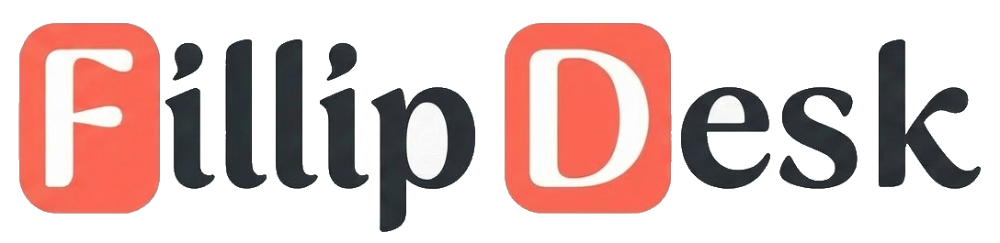

  

  <b>The All-in-One, Cross-Platform AI Office Suite</b>
   
  <i>Empowering productivity with intelligence on every desktop environment.</i>

  
  

## 📖 Introduction

**Fillip Desk** is a strategic subproject of **Intelli OS (Intelligent World OS)**. It is envisioned as a comprehensive, cross-platform AI office suite that redefines modern productivity.

Our mission is to empower users with smart and efficient tools that run seamlessly across **Windows**, **macOS**, and **OpenHarmony** desktop environments. By unifying intelligent document management, advanced search capabilities, and collaborative workflows—all driven by state-of-the-art AI—Fillip Desk seeks to transform your everyday professional experience.

---

## ✨ Key Features

- 🧠 **AI-Driven Productivity**: Automate complex tasks and generate insights using integrated LLMs.
- 📂 **Intelligent Doc Management**: Smart categorization and structured organization for all your professional files.
- 🔍 **Advanced AI Search**: Context-aware search that goes beyond keywords to find exactly what you need.
- 🤝 **Collaborative Workflows**: Seamlessly bridge the gap between team members with integrated sharing tools.
- 💻 **Cross-Platform Excellence**: Unified experience tailored for Windows, macOS, and especially optimized for OpenHarmony Desktop.

---

## 🛠 Tech Stack

*(Note: These are standard templates, please update based on your actual framework)*

- **Frontend**: [e.g., React / Vue / ArkUI]
- **Runtime**: [e.g., Tauri / Electron / Native]
- **Core Engine**: Rust / C++
- **AI Integration**: OpenAI API / Local LLM (Llama, etc.)
- **Database**: SQLite with Vector Extensions

---

## 🚀 Getting Started

For who are willing to contribute their sparks to this project, please refer to the [development guide](./docs/devguide.md) for more details.