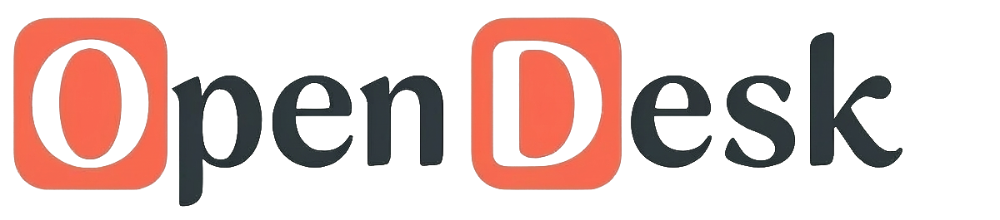

<p align="center">
  
</p>

<p align="center">
  <i>用智能化重新定义生产力：驾驭赛博牛马，驰骋浩瀚深空</i>
</p>

<p align="center">
  
  
</p>

<p align="center">
  <a href="./README.md">中文</a> | <a href="./README_EN.md">English</a>
</p>

Opendesk 是一个面向办公生产力场景的跨平台开源智能体。相比于

## 🚀 为什么选择 Opendesk

- **广泛兼容社区生态**: 支持一键配置主流服务商提供的模型服务和 Coding/Token Plan，也支持用户自定义的任何符合 OpenAI 标准的模型服务。同时桌面版和Cli均内置包括 [ClawHub](https://clawhub.ai/), [OpenHarmony Matrix Skills](https://matrix.openharmony.cn/#/skillSquare), [ModelScope Skills](https://www.modelscope.cn/skills), [Skillhub](https://skillhub.cn/) 等在内的国内外主流技能市场，一键安装各种技能拓展智能体能力;
- **双形态适配不同用户场景**: 入门级用户和更喜欢图形界面的使用者可以选择桌面版, 而更热衷于终端和字符界面的开发者和极客可以使用Cli版本。两种形态共用同样的 Agent 底座和能力;
- **跨平台支持多种系统**：Cli版本和桌面版均支持包括 OpenHarmony(HarmonyOS) PC, MacOS, Linux, Windows (x86, arm64)等环境的运行，
- **对新人友好的易用性**: Cli版本和桌面版本均支持[微信](https://opendesk.bitclub.ai/channels/weixin)，[飞书](https://opendesk.bitclub.ai/channels/feishu)的一键扫码链接; 桌面端面向日历，邮件，笔记，AI浏览器等一系列常用场景专门开发了内嵌的应用来降低用户使用门槛，未来也会持续开发更多 Opendesk 内置应用。除此之外，桌面版还内置了一系列任务模板来帮助新人用户快速上手 Agent 能力;
- **开源开放，适合二次开发**: Opendesk的智能体内核，TUI，Electron GUI以及正在开发中的配套管理服务等全部以 [MulanPSL-2.0](./LICENSE) 许可证开源，欢迎社区开发者共同参与，或者以 Opendesk 为底座构建自己的商业产品;

## 技术架构


请参考[https://opendesk.bitclub.ai/docs/contribute/architecture](这里)获得进一步详细的架构介绍。

## 快速开始

### Opendesk Cli 安装

Opendesk Cli 是 Opendesk 面向开发场景的发行版本，它可以在所有主流平台的终端中流畅运行。我们的终端界面基于 [pi-tui](https://github.com/earendil-works/pi/tree/main/packages/tui) 实现，基于其差分渲染技术，可以实现百万词上下文长任务的流式渲染。

运行下面的命令安装 Opendesk Cli的最新日构建版本，

```
npm i -g "@bitclub.ai/opendesk-cli@nightly"
```

或通过下面的命令

```
npm i -g "@bitclub.ai/opendesk-cli@latest"
```

之后输入 `opendesk` 即可打开 Opendesk Cli，配置基础模型之后即可快速上手。

### Opendesk Cli 常用功能速查

- `/new` 创建新任务;
- `/help` 打开帮助菜单;
- `/switch` 切换任务;
- `/config` 打开配置界面，设置模型，语言等;
- `/skills` 打开技能管理中心，在ClawHub, OpenHarmony Matrix等技能社区下载技能;

📖 [OpenDesk Cli 完整使用文档](https://opendesk.bitclub.ai/docs/manual/cli)

### OpenDesk 桌面客户端

当前我们为 Windows x86 平台 (需要 Windows 10 及以上) 和 Harmony OS 平台 (需要鸿蒙 6.0 及以上) 提供预构建的安装包，你可以在[这里](https://opendesk.bitclub.ai/nightly-release/2026/05/19/nightly-release)下载。

其他平台的用户当前可以通过[这里](https://opendesk.bitclub.ai/docs/contribute/prepare)的教程进行源码构建运行。

📖 [OpenDesk 桌面客户端完整使用文档](https://opendesk.bitclub.ai/docs/manual/desktop)

## 典型场景

你可以在 [➩这里](https://opendesk.bitclub.ai/gallery) 查看我们提供的一系列 OpenDesk 典型实践场景。

## 许可证

本项目采用 [MulanPSL-2.0](./LICENSE) 许可证。

---

## 👥 贡献

欢迎贡献代码、报告问题或提出建议！请参考[开发指南](https://opendesk.bitclub.ai/docs/contribute/prepare)了解如何参与项目开发。

---

## 🔗 相关链接

- [中文版本](./README.md) | [English Version](./README_EN.md)
- [官方主页](https://opendesk.bitclub.ai/docs/quickstart/cli)
- [OpenHarmony具身智能社区](https://gitcode.com/openharmony-robot/)

---

<p align="center">
  <i>让 AI 成为你的得力助手，让工作更智能、更高效</i>
</p>
