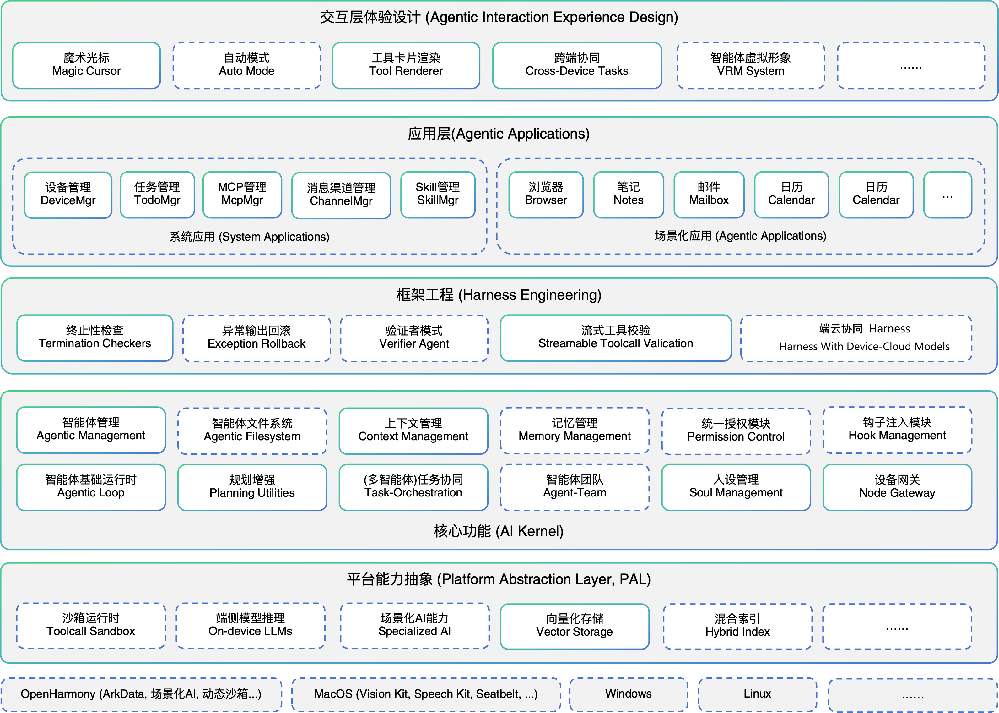

<p align="center">
  <h1 align="center">OpenDesk</h1>
</p>

<p align="center">
  <i>Redefining productivity with intelligence: harness cyber workhorses to traverse the vast digital cosmos</i>
</p>

<p align="center">
  
  
</p>

<p align="center">
  <a href="./README.md">中文</a> | <a href="./README_EN.md">English</a>
</p>

OpenDesk is an open-source cross-platform AI agent designed for productivity scenarios. Compared to alternatives, it offers:

## 🚀 Why OpenDesk

- **Extensive Ecosystem Compatibility**: Supports one-click configuration for major LLM service providers and Coding/Token Plans, with full support for any OpenAI-compatible model service. Both desktop and CLI versions integrate leading skill marketplaces including [ClawHub](https://clawhub.ai/), [OpenHarmony Matrix Skills](https://matrix.openharmony.cn/#/skillSquare), [ModelScope Skills](https://www.modelscope.cn/skills), and [Skillhub](https://skillhub.cn/) — install skills with a single click to extend agent capabilities.
- **Dual-Form Factor for Different Use Cases**: Desktop edition for users who prefer GUI interactions, CLI version for developers and power users who thrive in terminal environments. Both share the same agent foundation and capabilities.
- **Cross-Platform Support**: CLI and desktop versions run on OpenHarmony (HarmonyOS) PC, macOS, Linux, and Windows (x86, arm64).
- **Beginner-Friendly Usability**: Both CLI and desktop versions support one-click QR code pairing with [WeChat](https://opendesk.bitclub.ai/channels/weixin) and [Feishu](https://opendesk.bitclub.ai/channels/feishu). The desktop client features built-in applications for calendars, email, notes, AI browser, and other common scenarios to lower the adoption barrier, with more built-in apps coming in future releases. Additionally, the desktop version includes task templates to help new users quickly get started with agent capabilities.
- **Open Source & Extensible**: OpenDesk's agent core, TUI, Electron GUI, and upcoming management services are all open-sourced under the [MulanPSL-2.0](./LICENSE) license. We welcome community contributions and encourage developers to build commercial products on top of OpenDesk.

## Technical Architecture



For detailed architecture documentation, see [here](https://opendesk.bitclub.ai/docs/contribute/architecture).

## Quick Start

### OpenDesk CLI

OpenDesk CLI is the developer-focused distribution that runs smoothly in terminals across all major platforms. Our TUI is built on [pi-tui](https://github.com/earendil-works/pi/tree/main/packages/tui), leveraging differential rendering technology for streaming output with millions of tokens in context.

Install the latest nightly build:

```
npm i -g "@bitclub.ai/opendesk-cli@nightly"
```

Or install the stable release:

```
npm i -g "@bitclub.ai/opendesk-cli@latest"
```

Launch OpenDesk CLI with `opendesk` command, configure your base model, and you're ready to go.

📖 [OpenDesk CLI Documentation](https://opendesk.bitclub.ai/docs/manual/cli)

### OpenDesk Desktop Client

We provide pre-built installers for Windows x86 (Windows 10+) and Harmony OS (HarmonyOS 6.0+). Download them [here](https://opendesk.bitclub.ai/nightly-release/2026/05/19/nightly-release).

For other platforms, follow the [build guide](https://opendesk.bitclub.ai/docs/contribute/prepare) to run from source.

📖 [OpenDesk Desktop Client Documentation](https://opendesk.bitclub.ai/docs/manual/desktop)

## Use Cases

Explore our curated [OpenDesk showcase scenarios here](https://opendesk.bitclub.ai/gallery).

## License

This project is licensed under [MulanPSL-2.0](./LICENSE).

---

## 👥 Contributing

Contributions welcome! Report issues, submit PRs, or share suggestions. See the [Development Guide](https://opendesk.bitclub.ai/docs/contribute/prepare) to get started.

---

## 🔗 Links

- [中文版本](./README.md) | [English Version](./README_EN.md)
- [Official Website](https://opendesk.bitclub.ai/docs/quickstart/cli)
- [OpenHarmony Embodied Intelligence Community](https://gitcode.com/openharmony-robot/)

---

<p align="center">
  <i>Make AI your capable assistant — smarter work, higher efficiency</i>
</p>
