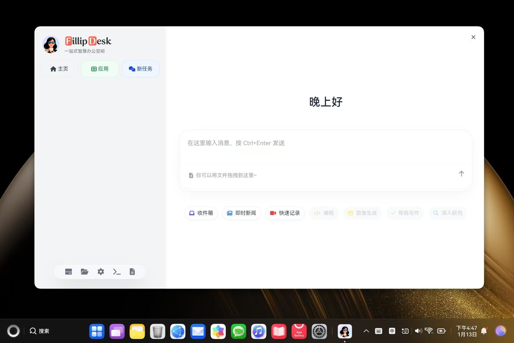

# FillipDesk 鸿蒙化适配说明

### 环境要求

- **DevEco Studio**: 4.0 或更高版本
- **HarmonyOS SDK**: API Level 10 或更高
- **Node.js**: 16.x 或更高版本
- **HDC工具**: 用于设备调试和安装

## 1. 工程包下载

#### 下载FillipDesk鸿蒙化工程包 (*ohos_fillipdesk.tar.gz*)

- Windows环境下载[ohos_fillipdesk.tar.gz](http://113.44.212.85:5005/downloads/ohos_fillipdesk.tar.gz)

## 2. 解压缩、替换FillipDesk代码

ohos_fillipdesk.tar.gz解压后，将FillipDesk最新代码覆盖到`ohos_hap/web_engine/src/main/resources/resfile/resources/app`目录。

## 3. Electron依赖安装

参考[devguide.md](./devguide.md)开发说明，在app/开发目录安装Electron等依赖。也可以直接拷贝FillipDesk应用代码和编译后的产物（node_modules）放入app/目录。

<span style="color: red; font-weight: bold;">当前版本node-screenshots库的鸿蒙兼容性存在问题，需要临时hack recall模块：</span>

### 3.1 注释recall service中的node-screenshots模块功能
`ohos_hap/web_engine/src/main/resources/resfile/resources/app/src/main/applications/recall/service/service.js`
```
注释hack
//import { Window } from 'node-screenshots';
```

### 3.2 移除node-screenshots库依赖安装
`ohos_hap/web_engine/src/main/resources/resfile/resources/app/package.json`
```
删除
"node-screenshots": "^0.2.1",
```

## 4. DevEco Studio工程构建、签名、推包

DevEco Studio打开工程`ohos_hap`目录，适配签名信息等配置后，直接点击右上角的运行按钮启动应用，完成构建编译、签名和推包流程。
hap路径参考`ohos_hap/electron/build/default/outputs/default/electron-default-signed.hap`

## 5. 效果展示

- demo hap包下载[electron-default-signed.hap](http://113.44.212.85:5005/downloads/electron-default-signed.hap)

- 鸿蒙系统FillipDesk应用
  

## 6. 后续规划

node-screenshots依赖库的鸿蒙化适配