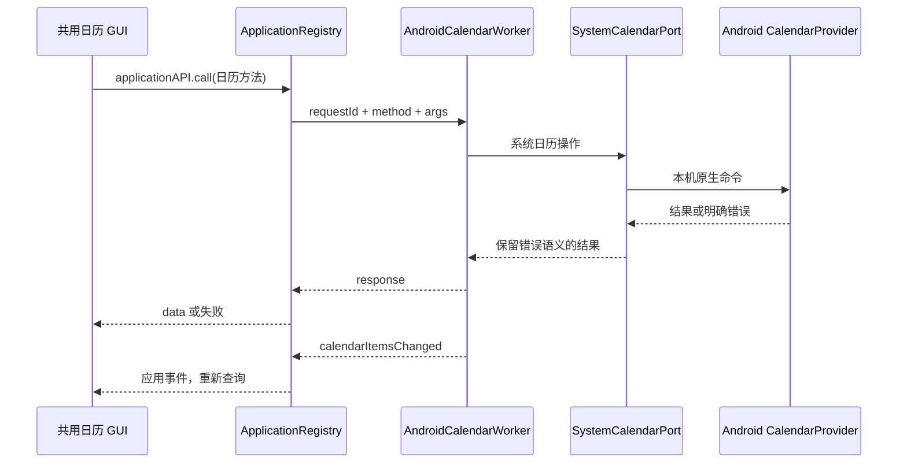

# Android 系统日历接入

本文记录 2026-11-17 本轮代码已经实现的接入方式。Android 原生代码和传输适配保留在独立的 `OpenDesk-Android` 壳仓；Core 保留共用界面、日历应用入口、业务路由与宿主端口合同。APK 构建及真机验收结果由壳仓对应版本的交付报告记录，以下单元测试不代表设备验收。

## 平台与 Worker 选择

`src/main/applications/calendar/app.js` 的 `CalendarApplication.getWorkerClass()` 直接选择 Worker：

| 运行条件                           | Worker                                                 | 本轮行为                                       |
| ---------------------------------- | ------------------------------------------------------ | ---------------------------------------------- |
| `OPENDESK_ANDROID_RUNTIME === '1'` | `service/android-worker.ts` 的 `AndroidCalendarWorker` | 组合本地数据库与 Android 系统日历              |
| 其他运行环境                       | 原 `service/worker.js` 的 `CalendarWorker`             | 保持原本的本地日历、Outlook 配置及本地提醒行为 |

这是本轮批准采用的明确选择点，没有新增 `AndroidCalendarApplication`，也没有修改原 `CalendarWorker` 文件。`AndroidCalendarWorker` 继承原 Worker，复用本地存储和提醒；只扩展日历查询、写入路由及宿主变更通知，并覆盖 Outlook 导入方法为空实现，避免 Android 执行桌面的 PowerShell/Outlook COM 路径。

Core 中的 macOS、Windows、Linux、OpenHarmony GUI 仍使用共用日历界面和原 Worker。本轮没有实现这些系统的原生日历端口。它们的 `getCalendarIntegrationState()` 返回 `supported: false`，界面不显示系统日历控制条，也不向原 Worker 调用 Android 专有方法。Windows 的现有 Outlook 导入不是这里的系统日历端口；其他桌面平台也不会因新增类型定义而自动具备原生日历能力。

## 宿主端口

合同定义在 `src/main/applications/calendar/service/system-calendar.ts`，通过 `src/platforms/runtime.ts` 的可选 `HostRuntimeOptions.systemCalendar` 注入：

```ts
interface SystemCalendarPort {
    getState(): Promise<SystemCalendarState>;
    requestAccess(): Promise<void>;
    listEvents(startTime: number, endTime: number): Promise<CalendarItem[]>;
    addEvent(calendarId: string, item: CalendarItemInput): Promise<CalendarItem>;
    updateEvent(uid: string, updates: CalendarItemUpdates): Promise<CalendarItem>;
    deleteEvent(uid: string): Promise<{ deleted: boolean; uid: string }>;
}
```

`SystemCalendarState` 包含 `supported`、`readGranted`、`writeGranted`、`calendars` 及可选 `revision`。日历描述包含字符串 `id`、`name`、可选 `accountName`、`canWrite`、可选 `visible` 和 `primary`。Core 提供的界面不以操作系统名称判断支持与权限，以返回的状态为准。

`requestAccess()` 表示宿主接受了显示授权界面的请求，不能据此推断用户已经同意。用户完成选择后，通过变更通知或后续状态查询确认权限。只读权限与写权限分别表达；系统日历条目能否编辑还受日历自身的写权限和重复规则限制。

Android 壳的 `bridge/bootstrap.ts` 在业务模块和 Worker 初始化前安装 `createAndroidHostRuntime()`。每个执行该入口的进程/Worker 安装自己的端口函数，端口对象不经 Worker IPC 序列化。`bridge/system-calendar.ts` 将合同映射到 Java 的六个命令：

| 端口方法        | Java 命令               |
| --------------- | ----------------------- |
| `getState`      | `calendarState`         |
| `requestAccess` | `calendarRequestAccess` |
| `listEvents`    | `calendarListEvents`    |
| `addEvent`      | `calendarAddEvent`      |
| `updateEvent`   | `calendarUpdateEvent`   |
| `deleteEvent`   | `calendarDeleteEvent`   |

调用经本机 `4099` 的 `NodeBridgeServer` 到 `SystemCalendarBridge`，实际权限检查与 `CalendarContract` 访问都由 Java 完成。传输错误和结构不合法的返回值会拒绝调用，不会替换成空列表或成功响应，也不会重放写入。

## GUI、Skill 与应用事件

GUI 沿用 `applicationAPI.call()` 的日历读写方法；三个配置/授权入口使用 `applicationAPI.callMainWorld()`，所有平台的 `CalendarApplication` 都提供它们：

- `getCalendarIntegrationState()`：返回宿主状态与当前日历应用配置合并后的平面对象。
- `requestCalendarAccess()`：Android 转交 Worker 请求宿主授权，再返回状态；其他平台返回不支持的状态。
- `configureCalendarIntegration(patch)`：校验并保存日历应用自己的配置，保留其他应用及日历配置字段，再同步 Android Worker。

界面授权按钮直接调用请求入口，没有先执行状态查询再显示系统授权框。`calendarItemsChanged` 回调同时刷新宿主状态和可见范围日程；页面 focus、visibilitychange、pageshow 后也会重新查询。权限拒绝、日历不可写和服务失败会显示本地化提示；查询失败保留上一份日程，不能用“暂无日程”掩盖错误。日程和状态查询各自使用请求序号及组件生命周期检查，忽略过时返回。



Skill 的 `GetCalendarItemsTool`、`AddCalendarItemTool`、`EditCalendarItemTool`、`DeleteCalendarItemTool` 通过同一个 `CalendarApplication.callWorker()` 调用上述 Worker 方法。工具会检查 `{status, data, message, code}` 响应，失败进入工具错误状态，不把错误响应 JSON 当作成功结果。通用 Worker/Registry 响应保留错误的 `code`、`category`、`details`；renderer 在缺失结构化错误码的路径也识别消息并本地化显示。

外部日历应用的修改通过以下路径进入原有应用事件体系：

```text
CalendarProvider ContentObserver / 权限回调 / Activity 恢复
→ SystemCalendarBridge（300ms 合并通知）
→ POST 4095/java-notify，android:calendarChanged
→ bridge/system-calendar.ts 的 relayAndroidCalendarChange
→ ApplicationRegistry.callWorker('calendar', 'systemCalendarChanged', revision)
→ AndroidCalendarWorker（150ms 合并通知）
→ emitEvent('calendarItemsChanged')
→ Registry 校验日历声明的事件
→ GUI 订阅者 + 应用事件监听者 + todomgr.handleApplicationEvent
```

`calendarItemsChanged` 是变更信号，不是日程增量列表，也不代表界面已经完成刷新。GUI 主动写入成功后也会重新查询；重复的查询不意味着重复写入。通知在后端未启动时可能无法送达，之后的实际查询仍直接读取 Provider，不依赖通知重建数据库。该机制不承诺通知持久化或离线补发。

## 配置和数据所有权

配置位于 `applications.calendar.dataSources.systemCalendar`：

```json
{
    "enabled": true,
    "defaultCalendarId": ""
}
```

`enabled` 默认 `true`，控制是否读取/使用系统日历；`defaultCalendarId` 默认空字符串，保留新日程写本地的旧行为。界面显示“显示系统日历”和“新日程保存到”，列表包含本地及系统日历，不能选择只读系统日历；已经配置但当前不可用的系统日历会明确显示不可用，不伪装成本地默认值。

| 数据               | 所有者和写入路径                                                              |
| ------------------ | ----------------------------------------------------------------------------- |
| 本地日程           | 原 NeDB `apps/calendar/calendar.db`，沿用原 Worker 方法                       |
| 系统日程           | Android CalendarProvider，读取时与本地结果合并，不复制到 NeDB                 |
| 系统日历账户及同步 | Android 系统/账户同步组件，本轮不创建账户、不实现远端账户同步协议             |
| 系统日历访问权限   | Android 原生权限系统；Core 配置不能代替授权                                   |
| 本地提醒           | 原本地数据库和提醒器                                                          |
| 系统日程提醒       | 由系统日历管理；本轮不复制给 OpenDesk 本地提醒器，也不新增系统 Reminders 记录 |

新建日程按 `defaultCalendarId` 路由；系统目标写失败时不回退成本地成功。修改、删除按原日程身份路由，不受当前新建默认目标影响。系统项带 `source: 'system'`、`sourceCalendarId`、`canWrite`、`recurring`；本地项保持原结构。

Android UID 使用 `android:<calendarId>:<eventId>:<rawBEGIN>`。最后一段是 Provider 的原始开始值，全天展示转换后也不能拿本地时间替换它。Java 在修改/删除前核对原始身份，并在数据库操作条件中约束日历、事件与原始开始时间；已被其他应用移动或替换的事件返回冲突，不能覆盖新的事件状态。

## 日期与首版限制

- 端口时间值均为 epoch 毫秒。Android 查询使用 Instances，并按与范围重叠筛选，过滤删除和取消项；只读取系统中可见的日历。Provider 返回空 cursor、权限异常及写失败都是失败。
- 全天日程在 Provider 中按 UTC 日期存储，在共用界面中表现为对应的本地午夜，结束时间为排他的次日/后续日期午夜。GUI 新建全天使用 `new Date(y, m, d + 1)`；编辑已有多日全天按日历日期差保留跨度，改标题不缩短事件，改日期也不使用固定 24 小时移动结束时间。
- 系统重复日程能查询，首版不在 OpenDesk 内修改或删除；GUI 禁用编辑、删除、拖动，Java 也独立拒绝相关写入。只读系统日历的普通事件同样不能写。
- 系统日历不存储 OpenDesk 的 `type` 分类。系统新建/编辑表单只提供“未分类”，发送空 `type`；非空分类写入返回 `CALENDAR_TYPE_UNSUPPORTED`。本地日程分类保持原功能。
- 本轮未实现参会者、会议邀请响应、附件、重复规则编辑及系统提醒配置。系统账户同步是否完成由系统组件决定。
- 共用 GUI 仍主要按开始日期组织日程格；本轮保留多日事件的正确时间范围，没有扩展跨日事件在每一个日期格中的可视铺排。
- Android Worker 保留本地查询、原 Outlook 配置结构和本地提醒继承；桌面的旧 Outlook 导入行为及其事件机制未在本轮重写。

## 接入另一个宿主

新的宿主需要实现上述六个端口方法，定义可稳定往返的事件 UID，处理本机权限、日历写权限、日期边界、Provider 错误及身份冲突。端口必须在相应业务进程/Worker 初始化前通过 `configureHostRuntime()` 安装，原生变更也需要转交应用 Worker，再发布现有 `calendarItemsChanged`。

仅注入 `systemCalendar` 还不能改变当前 Worker 选择：本轮选择点明确以 Android runtime 标记选择 `AndroidCalendarWorker`。另一个宿主还需提供适合其身份规则的 Worker/业务适配，并更新应用的选择入口，不能冒用 Android 标记或 Android UID 解析规则。共用 GUI、Skill 方法和应用事件合同可以复用；在该宿主的端口、选择入口和验收完成前，应保持 `supported: false`。

## 本轮验证记录

- GUI 初轮和后续边界修复均先添加失败回归，再实现修复；覆盖权限、配置补丁、只读/重复事件、错误保留、异步交错和恶意系统日程文本。
- 全天回归在 `TZ=America/New_York` 启动的真实 GUI 组件测试中检查实际提交 payload：2026-03-08 单日为 23 小时，跨 2026-11-01 的三日事件为 73 小时；本地及系统目标均覆盖新建、只改标题、改日期保留多日跨度。当前 GUI/既有刷新/locale 共 3 套 47 项通过。
- 本轮 Android 壳全套测试 121 项通过、0 跳过，包含宿主端口、通知路由和 Java fixture 回归。该结果验证代码合同与本机测试，不代替真实 CalendarProvider 的设备验收。
- 本机暂存日志：`/tmp/opendesk-system-calendar-ui-allday-red.log`、`/tmp/opendesk-system-calendar-ui-allday-dst-green.log`、`/tmp/opendesk-system-calendar-shell-full.log`。这些 `/tmp` 文件不是持久 CI 工件。
- Core 相关 8 套 Jest 测试共 92 项通过，另有全天工具 DST 子进程测试 2 项通过；覆盖通用 Worker 的错误和流结束回归。完整日志由本轮壳仓诊断目录归档，构建和设备读写验证范围以该目录的交付报告为准。
