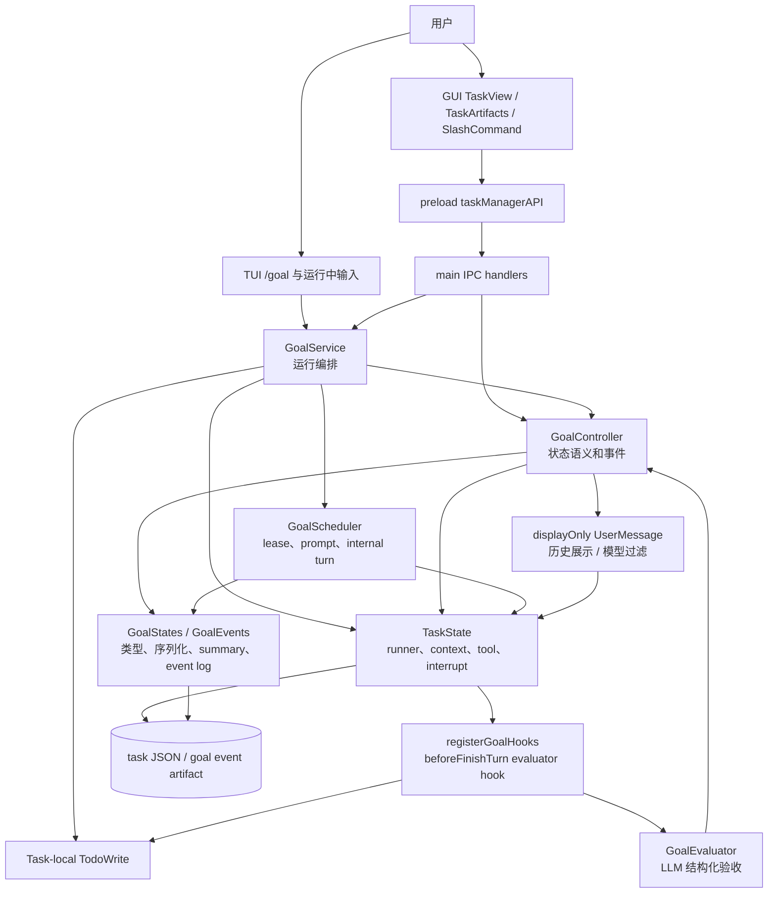
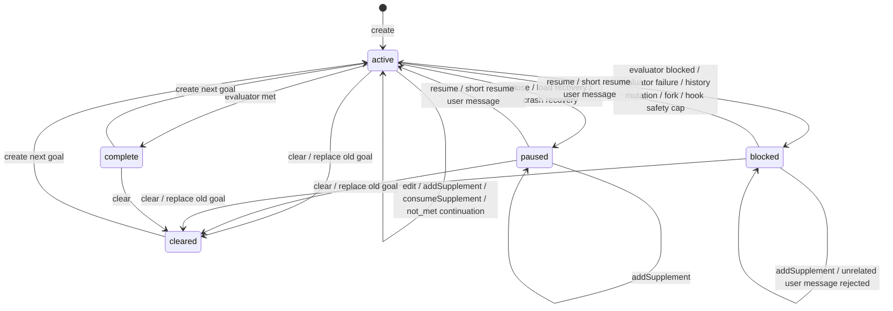

# 最近十个 Goal 相关提交的架构与实现审查

> 审查范围：当前 `HEAD` 的最近 10 个提交：`6f0a4630`、`b6bb52f3`、`bc703678`、`be137ec3`、`456480a0`、`741a85f7`、`752a6e5e`、`82d2aa30`、`c83ec30e`、`f5e78bb0`。本文以当前工作区源码为准，重点审查 Goal 工作流、GUI/TUI 入口、summary/display-only 边界、压缩上下文和测试看护。

## 1. 总体结论

这 10 个提交把 Goal 从规格文档推进为一个挂在 `TaskState` 上的可运行控制面。它不是第二套 task runner，而是复用现有 runner、tool、permission、compaction、subscription 和 finish hook，在其上叠加目标状态、自动续跑、完成评估、暂停/恢复/清除、GUI/TUI 控制面、display-only 历史展示和审计事件。

当前整体架构方向合理：

- Goal 生命周期与 `task_status` 正交，避免把 task 状态机扩展成大量组合状态。
- 状态语义集中在 `GoalController` / `GoalStates`，运行编排集中在 `GoalService` / `GoalScheduler`。
- TUI、GUI、IPC 和 renderer 不直接改 `task.goal_state`，而是通过 service/controller 或安全 summary 读写。
- Goal turn 复用 `TaskState.processTaskTurn()`，并通过 runtime metadata、scheduler lease、stale revision guard 和 runtime interrupt 与原 runner 协作。
- `beforeFinishTurn` hook 中的 evaluator 形成 “执行 -> 评估 -> 续跑或终结” 闭环。
- 最近修复后，运行中的 active goal 收到普通用户文本会进入 `pendingSupplements`，在工具调用边界后作为内部补充上下文注入，而不是触发新的普通用户 turn。
- GUI `/goal` 入口、历史渲染和 timeline anchor 已经对齐：GUI 创建/编辑 goal 会产生可见但不进模型上下文的 display-only `/goal ...` 用户消息，timeline 可以跳回对应历史消息。
- 最近一次重构删除了旧的 goal projection metadata / summarySegments / `buildGoalContextProjection()`，改为统一用 `isDisplayOnlyMessage()` 过滤 UI-only 历史消息，降低了 compaction 和 runtime metadata 的重复语义。

主要架构风险不是当前构建不可用，而是几个边界仍然偏保守：

- `GoalController` 不是纯 reducer，仍直接持久化并发布 task list update。
- evaluator 只读取最近 transcript 摘要，没有独立的 goal-only 上下文隔离层。
- evaluator 的 `met` 判定依赖 LLM 结构化输出，代码没有最低 evidence 阈值。
- event log artifact 只完成写入和 tail 展示，完整回读、修复和导出还没有闭环。
- `GoalService.replace()` 不是事务；旧 goal 会先 clear，再创建新 goal。
- `GoalMaybeResumeResult` 里保留了 `resume_with_user_message` 这个当前未返回、未消费的类型分支，建议后续清理或补实现。
- Renderer `slash-command.ts` 现在有一套 GUI `/goal` 命令解析，与 TUI `/goal` 命令存在语义重复；目前行为已用测试覆盖，但后续容易出现子命令漂移。
- `displayOnly` 作为通用消息字段生效范围很大，已接入 adapters、compaction、memory、context analyze、tools 和 renderer；这是合理简化，但需要后续维持“所有模型/记忆入口都必须过滤”的不变量。

## 2. 十个 commit 的演进脉络

| Commit     | 主题                                               | 主要修改                                                                                                                                                                            | 架构意义                                                                                                   |
| ---------- | -------------------------------------------------- | ----------------------------------------------------------------------------------------------------------------------------------------------------------------------------------- | ---------------------------------------------------------------------------------------------------------- |
| `6f0a4630` | `wip`                                              | 加入 goal 规格、GUI 设计、实现说明、`src/main/aikernel/goal/` 初版、TaskState goal 字段、runtime metadata、TUI `/goal`、GUI/IPC/preload 初始入口和基础测试。                        | 建立 Goal 作为 task 控制面状态的初始骨架。                                                                 |
| `b6bb52f3` | `feat: add goal execution workflow`                | 迁移规格到 `docs/specifications/goal/README.md`，补齐 controller/service/scheduler/state，新增 TUI GoalPanel、renderer task artifacts goal section、pi-tui mock 和更多 UT。         | 形成 state -> scheduler -> internal turn -> evaluator 的第一版闭环。                                       |
| `bc703678` | `fix: preserve goal usage and recall last message` | 引入 `tokenUsageBaseline`，完成态保留本 goal token 用量；TUI recall last user message 跳过 scheduler 内部消息；补 message-utils。                                                   | 解决同一 task 多 goal 串行执行时 token 展示串账，以及内部消息影响人工输入体验的问题。                      |
| `be137ec3` | `fix: improve goal gui state handling`             | 强化 GUI timeline/status 刷新、objective events、inline edit、task name 派生、Todo 清理、goal summary 导出；新增 task-todos 和 controller 测试。                                    | 让 GUI 从临时展示变成可信控制面，并防止旧 goal event/Todo 泄漏到新 goal。                                  |
| `456480a0` | `fix: isolate goal tui input queue`                | TUI active goal running 时普通输入不进普通队列；GoalPanel 状态/本地化收敛；evaluator 输出语言本地化；新增 GoalPanel/input statusbar 测试。                                          | 收紧运行中 goal 的 TUI 输入边界，避免用户补充信息排到普通 task queue。                                     |
| `741a85f7` | `fix: replace active goals across interfaces`      | TUI 新建 goal 时若已有未终结 goal，确认后走 `GoalService.replace()`；replace 编排 clear、runtime interrupt settle、create、scheduler；GUI create 要求 clear-first；新增 race 测试。 | 统一危险的 replace 语义，避免旧 runner 尚未停稳时新 goal 已启动。                                          |
| `752a6e5e` | `refactor: streamline goal follow-up workflow`     | 移除用户可见 budget 配置和部分过早 UI；精简 controller/state/taskartifacts；更新文档；保留 token 展示而不作为资源限制。                                                             | 把 Goal 聚焦到“目标推进/评估/续跑”，降低控制面复杂度。                                                     |
| `82d2aa30` | `refactor: refine goal workflow surfaces`          | 新增架构接口文档、GoalPanel redesign spec、AppSDK subscriber 引用计数、goal supplement 能力、GUI running input 转 supplement、运行中 create attach、更多 renderer/TUI 测试。        | 把 follow-up 输入从普通消息队列改成 goal supplemental context，并修正运行中创建/编辑的控制面体验。         |
| `c83ec30e` | `fix: align gui goal timeline interactions`        | GUI slash command 新增 `/goal` 创建/编辑/pause/resume/clear；TaskView 渲染 display-only/internal goal command；支持 goal timeline anchor 滚动回历史消息；补 message queue 测试。    | 让 GUI `/goal` 与任务进展 timeline 建立可追踪闭环，避免 goal 事件只出现在侧栏而历史区无对应操作。          |
| `f5e78bb0` | `refactor: simplify goal summary flow`             | 删除 compaction projection metadata 和 goal projection 文件；新增 `UserMessage.displayOnly` / `isDisplayOnlyMessage()`；Goal summary 暴露 `displayMessageId`；timeline 支持定位。   | 用统一 display-only 过滤替代 scoped projection，减少上下文压缩、model adapter 和 renderer 之间的重复协议。 |

## 3. 总体架构



### 3.1 分层职责

| 层              | 模块                                                                   | 职责                                                                                                                                         |
| --------------- | ---------------------------------------------------------------------- | -------------------------------------------------------------------------------------------------------------------------------------------- |
| 状态模型        | `src/main/aikernel/goal/state.ts`                                      | 定义 `GoalState`、`GoalEvent`、`GoalRenderSummary`、`GoalCommandResult`、supplement/continuation/lease，负责序列化、反序列化和安全 summary。 |
| 状态控制        | `src/main/aikernel/goal/controller.ts`                                 | create/edit/addSupplement/consumeSupplement/pause/resume/clear/evaluation/load/fork/history mutation 等状态语义，附带 event 记录和持久化。   |
| 服务编排        | `src/main/aikernel/goal/service.ts`                                    | UI/IPC 共享入口，串联 controller、scheduler、Todo 清理和 runner interrupt。                                                                  |
| 调度执行        | `src/main/aikernel/goal/scheduler.ts`                                  | 防重入 lease、消费 continuation、构造 internal prompt、调用 `TaskState.startInternalTurn()`。                                                |
| 完成评估        | `src/main/aikernel/goal/evaluator.ts`、`hooks.ts`                      | 在 turn 收尾前读取 Todo、文件变化、最近 transcript，由 LLM 判断 met/not_met/blocked。                                                        |
| runner 集成     | `src/main/aikernel/states/tasks.ts`                                    | goal metadata、内部 turn、running create/edit reminder、supplement materialize、runtime interrupt、stale revision guard。                    |
| UI/入口         | `main.ts`、`preload.js`、TUI commands、renderer taskview/taskartifacts | 创建、编辑、补充、暂停、恢复、清除、状态刷新、stop 拦截、timeline 展示。                                                                     |
| 历史/上下文边界 | `messages.ts`、adapters、compaction、memory、context analyze、tools    | `displayOnly` 消息保留在历史和导出中，但通过 `isDisplayOnlyMessage()` 从模型请求、压缩、记忆和上下文分析中剔除。                             |

## 4. 状态机

### 4.1 主状态



状态集合只有：

```ts
type GoalStatus = 'active' | 'paused' | 'blocked' | 'complete' | 'cleared';
```

终态是 `complete` 和 `cleared`；未终结状态是 `active`、`paused`、`blocked`。`pendingContinuation`、`pendingSupplements`、`schedulerLease` 和 `runtimeInterrupt` 是状态机上的附属队列/租约/中断，不是独立 `GoalStatus`。

### 4.2 关键不变量

- 未终结旧 goal 存在时，`GoalController.create()` 拒绝重复创建。
- TUI 替换旧 goal 必须经过确认并走 `GoalService.replace()`；GUI create 默认要求先 clear。
- scheduler 只启动 `active` goal，且 task 正在 running、runtime interrupt 未处理或 lease 有效时拒绝。
- evaluator 返回的 goal id/revision 必须匹配当前 active goal；否则结果被视为 stale 并忽略。
- goal revision 变化后，旧 revision tool call 会在权限检查和执行前被标记为 `stale_goal_revision`。
- goal pause/clear 产生的 runtime interrupt 会跳过 finish hooks，避免刚暂停/清除又被 evaluator 续跑。
- active goal running 时，普通文本输入进入 `pendingSupplements`；附件/图片补充被拒绝。
- GUI goal create/edit 生成的 display-only `/goal ...` 消息只能作为历史展示和 timeline anchor，不能进入模型请求、压缩摘要、记忆提取或 evaluator transcript。

## 5. 核心数据接口

| 接口                      | 说明                                    | 当前实现要点                                                                                                                                                                                                                         |
| ------------------------- | --------------------------------------- | ------------------------------------------------------------------------------------------------------------------------------------------------------------------------------------------------------------------------------------ |
| `GoalState`               | 当前 task 的 authoritative goal 状态。  | 挂在 `TaskState.goal_state`。关键字段：`id`、`taskId`、`objective`、`status`、`revision`、`attempts`、`tokenUsageBaseline`、`lastEvaluation`、`pendingContinuation`、`pendingSupplements`、`editHistory`、`schedulerLease`、时间戳。 |
| `GoalSupplement`          | 运行中 goal 的用户补充上下文。          | 单条 content 最多 4000 字，pending 队列最多 20 条；消费后记录 `consumedAt` 和 `consumedByTurnGeneration`。                                                                                                                           |
| `GoalContinuation`        | evaluator `not_met` 后的下一轮 prompt。 | scheduler 优先消费 pending continuation，消费时记录 `continuation_consumed` 事件。                                                                                                                                                   |
| `GoalEvaluation`          | evaluator 结构化输出。                  | `status` 为 `met`、`not_met` 或 `blocked`；非 `not_met` 会删除 `nextPrompt`。                                                                                                                                                        |
| `GoalEvent`               | 审计事件。                              | 包含 created/edited/paused/resumed/evaluated/continuation/supplement/blocked/completed/forked/cleared。                                                                                                                              |
| `GoalEventLogStorage`     | 事件日志存储。                          | 200 条内 inline；超过后追加写 `artifacts/<taskId>/goal/events.jsonl`，task JSON 只保留 tail 和 artifact path。                                                                                                                       |
| `GoalRenderSummary`       | renderer/export 安全摘要。              | 只暴露当前 goal 的状态、objective、pending 数量、evaluation 摘要和安全 event summary，不暴露 raw payload、artifact path 或完整 evidence。                                                                                            |
| `GoalCommandResult`       | 所有命令的统一返回。                    | 用 `ok`、`status`、`messageKey`、`messageArgs`、`startedScheduler`、`interruptedRunner`、`clearedTaskTodos`、`summary`、`errorCode` 表达 UI 可渲染结果。                                                                             |
| `RuntimeMetadata`         | 消息和工具调用的运行时归属。            | `scope` 标识 task/goal/global，`execution.controllerId/controllerRevision` 用于 stale tool guard。                                                                                                                                   |
| `TaskRuntimeInterrupt`    | runner 中断请求。                       | pause/clear 会写 `goal_pause` / `goal_clear`，可停止 running tool、取消权限弹窗，并由 turn 收尾消费。                                                                                                                                |
| `UserMessage.displayOnly` | UI-only 历史消息标记。                  | GUI goal create/edit 写入可见 `/goal ...` 历史消息；消息持久化和导出保留，但 adapters、compaction、memory、context analyze、tools、evaluator 通过 `isDisplayOnlyMessage()` 过滤。                                                    |
| `displayMessageId`        | timeline 到历史消息的锚点。             | `GoalRenderSummary.recentEvents/objectiveEvents` 只对白名单字段暴露该 id；`taskartifacts.ts` 发 `goal-message-anchor`，`taskview.js` 滚动并高亮对应 display-only 消息。                                                              |

## 6. 核心接口

### 6.1 `GoalStates` / `GoalEvents`

| 接口                                            | 功能                                   | 当前实现要点                                                                                                    |
| ----------------------------------------------- | -------------------------------------- | --------------------------------------------------------------------------------------------------------------- |
| `GoalStates.create(taskId, input)`              | 创建 `GoalState` 初始对象。            | 初始化 active/revision 1/attempts 0/pendingSupplements/editHistory/timestamps，不负责持久化。                   |
| `GoalStates.deserialize(raw, taskId?)`          | 从 task JSON 恢复 goal 状态。          | 容错补齐 id、taskId、revision、timestamps，过滤非法 status/source/supplement/continuation/lease。               |
| `GoalStates.serialize/clone(state)`             | 深拷贝持久化对象。                     | 通过 JSON clone 保持 task JSON 结构纯净。                                                                       |
| `GoalStates.isTerminal/isUnfinished()`          | 统一状态分类。                         | terminal 为 complete/cleared；unfinished 为 active/paused/blocked。                                             |
| `GoalStates.renderSummary(state, events)`       | 生成 renderer/export 安全摘要。        | 支持 cleared/terminal retention 过滤；只暴露 evaluation 摘要、pending 数量、recent/objective event 白名单字段。 |
| `GoalStates.statusView(state, events)`          | GUI 轮询用状态视图。                   | 在 summary 外附带 lastEvaluationStatus/lastEvaluationAt/attempts。                                              |
| `GoalStates.createContinuation()`               | 创建 evaluator not_met 的后续 prompt。 | 绑定 goal id/revision，供 scheduler 消费并记录 consumed turn generation。                                       |
| `GoalStates.createSupplement()`                 | 创建用户补充上下文项。                 | 内容截断到 4000 字，绑定 goal id/revision/source。                                                              |
| `GoalStates.limitPendingSupplements()`          | 限制补充队列长度。                     | 只保留最后 20 条 pending supplement。                                                                           |
| `GoalStates.isLeaseValid()`                     | 判断 scheduler lease 是否仍有效。      | 默认按当前时间比较 `expiresAt`，避免并发 scheduler 重入。                                                       |
| `GoalEvents.deserialize/serialize()`            | 恢复和持久化 event log storage。       | 支持 inline 与 artifact 两种 storage。                                                                          |
| `GoalEvents.getTail(storage)`                   | 获取可直接展示的 event tail。          | artifact 模式只读 task JSON 中的 tail，不主动回读完整 JSONL。                                                   |
| `GoalEvents.appendToTask(task, event)`          | 追加审计事件。                         | 200 条内 inline；超过后写 `artifacts/<taskId>/goal/events.jsonl`，失败时退回 inline tail。                      |
| `createGoalEvent(goal, type, source, payload?)` | 构造标准 event。                       | 统一 id、goalId、taskId、revision、timestamp 和 payload。                                                       |

### 6.2 `GoalController`

| 接口                                              | 功能                                                                                        | 调用方                                                                                                            |
| ------------------------------------------------- | ------------------------------------------------------------------------------------------- | ----------------------------------------------------------------------------------------------------------------- |
| `getStatus(task)`                                 | 生成 `GoalStatusView`，供 GUI 运行期刷新。                                                  | IPC `taskManager:getGoalStatus`                                                                                   |
| `create(task, input)`                             | 创建 active goal，设置 token baseline，派生 unnamed task name，记录 created event。         | `GoalService.create/replace`；GUI source 会附加 display-only `/goal ...` 消息并把 `displayMessageId` 写入 event。 |
| `editObjective(task, objective, source)`          | revision +1，清空 stale evaluation/continuation/lease，记录 editHistory。                   | `GoalService.edit`；GUI source 会附加 display-only `/goal ...` 消息并把 `displayMessageId` 写入 edited event。    |
| `addSupplement(task, input)`                      | 把补充文本加入 `pendingSupplements` 并记录 `supplement_added`。                             | `GoalService.addSupplement`、TaskState/TUI/GUI 输入路径                                                           |
| `consumePendingSupplements(task, generation)`     | 消费 pending supplements，记录 `supplement_consumed`，返回带 consumed metadata 的补充列表。 | `TaskState.materializePendingGoalSupplements()`                                                                   |
| `pause(task, source, reason?)`                    | 状态置 paused，清 lease，记录 paused event。                                                | `GoalService.pause`                                                                                               |
| `resumeStateOnly(task, options)`                  | paused/blocked -> active，不启动 scheduler。                                                | `GoalService.resume`                                                                                              |
| `clear(task, source)`                             | 状态置 cleared，清 continuation/supplement/lease。                                          | `GoalService.clear/replace`                                                                                       |
| `recordEvaluation(task, evaluation)`              | met -> complete；blocked -> blocked；not_met -> pendingContinuation + hook reject。         | goal finish hook                                                                                                  |
| `recordEvaluatorFailure(task, goal, error)`       | evaluator 异常时阻塞 goal。                                                                 | goal finish hook catch 分支                                                                                       |
| `maybeResumeGoalFromUserMessage(task, message)`   | paused/blocked goal 的普通消息恢复分类。                                                    | `TaskState.submitUserMessage()`                                                                                   |
| `blockForHistoryMutation(task, source)`           | undo/redo/rewind 后阻塞未终结 goal。                                                        | TaskState 历史变更路径                                                                                            |
| `blockActiveGoal(task, reason, source)`           | hook safety cap 等系统路径阻塞 active goal。                                                | `TaskState.processTaskTurn()`                                                                                     |
| `normalizeLoadedTask(task, wasRunningAtShutdown)` | 加载 task 时修复 active goal 和 runner 不一致。                                             | task 反序列化/加载路径                                                                                            |
| `prepareForkedGoal(sourceTask, forkedTask)`       | fork 后换 goal id、清 lease、重设 baseline，未终结 goal 置 blocked。                        | `TaskState.fork()`                                                                                                |

### 6.3 `GoalService`

| 接口                            | 功能                          | 运行编排                                                                                                                                                                          |
| ------------------------------- | ----------------------------- | --------------------------------------------------------------------------------------------------------------------------------------------------------------------------------- |
| `create(task, input)`           | UI/IPC 创建 goal 的共享入口。 | 等 pending interrupt；controller create；若 task 已 running，则 attach 到当前 turn 并注入 `goal_create` reminder；否则 scheduler start。scheduler 成功后清 task-local TodoWrite。 |
| `replace(task, input)`          | TUI 确认后替换旧 goal。       | 先校验 objective；clear 旧 goal；reset in-progress todos；running 时发 `goal_clear` interrupt 并等待 settle；再 create 新 goal、清 Todo、start scheduler。                        |
| `edit(task, objective, source)` | GUI/API 编辑 objective。      | controller edit；active running 时注入 `goal_edit` reminder；active stopped 时 scheduler resume。                                                                                 |
| `addSupplement(task, input)`    | 添加补充上下文。              | 直接委托 controller。                                                                                                                                                             |
| `pause(task, source, reason?)`  | 暂停 goal 并中断 runner。     | controller pause；running 时发 `goal_pause` interrupt、停止工具、取消权限 prompt。                                                                                                |
| `resume(task, options)`         | 恢复 paused/blocked goal。    | 等 pending interrupt；task running 则拒绝；controller 恢复状态；scheduler resume，可附加 note。                                                                                   |
| `clear(task, source)`           | 清除 goal 并中断 runner。     | controller clear；reset in-progress todos；running 时发 `goal_clear` interrupt。                                                                                                  |

### 6.4 `GoalScheduler`

| 接口                                                      | 功能                                 | 当前实现                                                                                                                                                                                                                      |
| --------------------------------------------------------- | ------------------------------------ | ----------------------------------------------------------------------------------------------------------------------------------------------------------------------------------------------------------------------------- |
| `startExecution(task, reason, promptOverride?, options?)` | 启动 goal 控制的一轮 internal turn。 | 只允许 active goal；拒绝 running task、pending interrupt 和有效 lease；获取 30 秒 lease；优先消费 pending continuation，否则按 create/resume 构造 prompt；调用 `TaskState.startInternalTurn()` 并写入 goal runtime metadata。 |

### 6.5 `GoalEvaluator` 和 hook

| 接口                                 | 功能                    | 当前实现                                                                                                                                   |
| ------------------------------------ | ----------------------- | ------------------------------------------------------------------------------------------------------------------------------------------ |
| `GoalEvaluator.evaluate(task, goal)` | 判断 goal 是否完成。    | 收集 TodoWrite、文件变化、最近 20 条 transcript 摘要，调用 `LLM.askForObjectWithSchema()` 输出 `GoalEvaluation`。                          |
| `registerGoalHooks()`                | 注册 goal finish hook。 | priority 300，phase `goal_evaluation`。跳过 subtask/internal task、goal runtime interrupt、终态或非 active goal、仍有未完成 Todo 的 task。 |

### 6.6 `TaskState` / messages / renderer 集成接口

| 接口 / 方法                                          | 功能                              | 当前实现要点                                                                                                      |
| ---------------------------------------------------- | --------------------------------- | ----------------------------------------------------------------------------------------------------------------- |
| `TaskState.appendInternalUserMessage()`              | 追加内部用户消息。                | 支持 runtime metadata 和 rawText；用于 goal reminder、supplement、hook reject 等内部上下文。                      |
| `TaskState.startInternalTurn()`                      | 启动 goal 控制的 internal turn。  | 写 internal user message 与 assistant placeholder，设置 `_activeTurnMetadata`，然后复用普通 runner。              |
| `TaskState.injectGoalEditReminder()`                 | 运行中创建/编辑 goal 的提醒队列。 | 支持 `goal_create` 和 `goal_edit` 两种 reason，在模型下一次安全边界 materialize。                                 |
| `TaskState.materializePendingGoalSupplements()`      | 消费运行中补充上下文。            | 从 `GoalController.consumePendingSupplements()` 取补充信息，写入 `<system-reminder>` 内部消息，并继续下一轮模型。 |
| `TaskState.submitUserMessage()`                      | 普通用户消息入口。                | paused/blocked 短消息可 resume；active goal running 文本转 supplement；图片补充拒绝；否则进入普通 task turn。     |
| `TaskState.interruptRunningTurn()`                   | 请求中断当前 runner。             | pause/clear/stop/shutdown/failure recovery 共享；可停止工具、取消权限弹窗并记录 runtime interrupt。               |
| `TaskState.waitForRuntimeInterruptSettled()`         | 等待中断被当前 turn 消费。        | `GoalService.replace/resume/create` 用它避免新 goal 与旧 runner 并发。                                            |
| `TaskState.markStaleGoalToolCallSkipped()`           | 跳过旧 revision tool call。       | tool call 的 goal revision 与当前 goal 不一致时，在权限和执行前标记 skipped。                                     |
| `TaskUpdateUserChunk` / `TaskUpdateUserReplaceChunk` | 推送用户消息渲染进度。            | 携带 `rawText`、`metadata`、`displayOnly`、`internal`、timestamp，保证 GUI 能渲染 display-only `/goal ...`。      |
| `UserMessage.displayOnly`                            | 标记仅 UI 可见消息。              | 持久化和导出保留；不等同 `internal`，renderer 可以显示，模型/记忆/压缩入口必须过滤。                              |
| `isDisplayOnlyMessage()`                             | 模型上下文过滤判断。              | OpenAI/Anthropic adapters、compaction、token estimation、memory、context analyze、tools、evaluator 统一调用。     |
| `getVisibleInternalGoalCommandText()`                | renderer 历史消息可见性判断。     | display-only `/goal ...` 直接可见；兼容旧 internal goal create command。                                          |
| `shouldRenderUserHistoryMessage()`                   | renderer 是否渲染用户消息。       | 普通用户消息渲染；internal 仅 goal command 例外渲染。                                                             |
| `goal-message-anchor` event                          | timeline 到历史消息定位事件。     | `taskartifacts.ts` 由 click/Enter/Space 触发；`taskview.js` 监听后滚动和高亮目标消息。                            |

## 7. UI、IPC 与外部接口

### 7.1 IPC / preload

| IPC channel / preload API                               | 功能                    | 说明                                                                                                                                    |
| ------------------------------------------------------- | ----------------------- | --------------------------------------------------------------------------------------------------------------------------------------- |
| `taskManager:getGoalStatus` / `getGoalStatus()`         | 获取 `GoalStatusView`。 | 用于 GUI 运行期刷新。                                                                                                                   |
| `taskManager:createGoal` / `createGoal()`               | GUI 创建 goal。         | 已有未终结 goal 时返回 `goal.create.requires_clear`。若 scheduler race 返回 task_running 且 goal active，main 会转成 attached success。 |
| `taskManager:editGoal` / `editGoal()`                   | 编辑 objective。        | 走 `GoalService.edit(task, objective, 'gui')`。                                                                                         |
| `taskManager:addGoalSupplement` / `addGoalSupplement()` | 添加 goal 补充上下文。  | GUI active goal running 输入使用。                                                                                                      |
| `taskManager:pauseGoal` / `pauseGoal()`                 | 暂停 goal。             | 走 `GoalService.pause(task, 'gui')`。                                                                                                   |
| `taskManager:resumeGoal` / `resumeGoal()`               | 恢复 goal。             | 支持 `note`，source 固定 gui。                                                                                                          |
| `taskManager:clearGoal` / `clearGoal()`                 | 清除 goal。             | 走 `GoalService.clear()` 并广播 Todo 展示更新。                                                                                         |
| `taskManager:stopTask`                                  | 普通 stop。             | active goal 下拒绝，提示用户使用 pause/clear。                                                                                          |

### 7.2 TUI

| 入口                   | 行为                                                                                                            |
| ---------------------- | --------------------------------------------------------------------------------------------------------------- |
| `/goal` / `/goal help` | 显示帮助，不创建 goal。                                                                                         |
| `/goal <objective>`    | 无未终结 goal 时 create；已有未终结 goal 时确认 replace。                                                       |
| `/goal pause`          | 暂停 goal，running 时中断 runner 和工具。                                                                       |
| `/goal resume`         | 恢复 paused/blocked goal 并启动 scheduler。                                                                     |
| `/goal clear`          | 清除 goal，running 时中断 runner，并清空当前 task 输入队列。                                                    |
| 普通输入               | active goal running 时进入 supplement；goal clear stopping 时拒绝；否则走普通 task turn。                       |
| `/stop`                | active goal 下拒绝普通 stop，要求 pause/clear。                                                                 |
| GoalPanel              | 显示 objective、状态、evaluation trail、token、elapsed；cleared 隐藏，complete 保留。状态文本不再带状态 emoji。 |

### 7.3 GUI

| 组件                                                     | 行为                                                                                                                                                                                                                    |
| -------------------------------------------------------- | ----------------------------------------------------------------------------------------------------------------------------------------------------------------------------------------------------------------------- |
| `slash-command.ts`                                       | GUI 支持 `/goal <objective>`、`/goal pause/resume/clear/help/status`。已有未终结 goal 时 `/goal <objective>` 转 edit；无当前 task 时可先 create task。                                                                  |
| `taskview.js`                                            | active goal running 时，submit/queue 事件优先调用 `addGoalSupplement`；附件/图片作为 supplement 被拒绝。stop button 在 active goal 下转 pause；display-only/internal goal command 会作为可见 `/goal ...` 历史消息渲染。 |
| `taskartifacts.ts`                                       | 任务进展 tab 中 TodoWrite 在上、Goal section 在下；支持 create/edit/pause/resume/clear；timeline 优先用 `objectiveEvents`，含 `displayMessageId` 时可点击/键盘定位到历史消息。                                          |
| `agentinput.js`                                          | running input mode 支持 `goal_supplement`，用于 GUI 输入框显示和队列语义。                                                                                                                                              |
| `taskartifacts-goal-state.ts` / `taskview-goal-input.js` | renderer 侧抽取 goal summary、判断输入是否 text-only supplement、识别 attached running create success。                                                                                                                 |

## 8. 关键调用关系

### 8.1 空闲 task 创建 goal

```text
TUI/GUI -> GoalService.create
    -> waitForGoalCreateReadiness
    -> GoalController.create
        -> GoalStates.create
        -> if source == gui:
            append displayOnly UserMessage("/goal ...")
            event payload.displayMessageId = message_id
        -> GoalEvents.appendToTask(created)
        -> persist/publish
    -> GoalScheduler.startExecution(create)
        -> acquire lease
        -> TaskState.startInternalTurn(goal_create metadata)
            -> append internal UserMessage + AssistantMessage
            -> processTaskTurn
```

### 8.2 运行中 task 创建 goal

```text
UI -> GoalService.create
    -> GoalController.create
    -> attachCreatedGoalToRunningTurn
        -> TaskState.injectGoalEditReminder(reason = goal_create)
    -> 当前 turn 在 processCompletion 后 materialize reminder
```

这个分支保留当前 task 的 TodoWrite，不启动第二个 scheduler turn，避免并发 runner。

### 8.3 替换未终结 goal

```text
TUI /goal <new objective>
    -> ConfirmOverlay
    -> GoalService.replace
        -> GoalController.clear(old)
        -> resetInProgressTaskTodos
        -> interruptRunningTurn(goal_clear) + waitForRuntimeInterruptSettled
        -> GoalController.create(new)
        -> deleteTaskTodos
        -> GoalScheduler.startExecution(create)
```

### 8.4 编辑 objective

```text
GUI/API -> GoalService.edit
    -> GoalController.editObjective
        -> revision + 1
        -> clear lastEvaluation / pendingContinuation / lease
        -> if source == gui:
            append displayOnly UserMessage("/goal ...")
            event payload.displayMessageId = message_id
    -> if task running:
        TaskState.injectGoalEditReminder(reason = goal_edit)
    -> if task stopped:
        GoalScheduler.startExecution(resume)

Tool execution:
    -> TaskState.markStaleGoalToolCallSkipped
    -> skip old revision tool calls before permission/tool execution
```

### 8.5 用户补充信息

```text
GUI/TUI active goal running input
    -> GoalService.addSupplement
        -> GoalController.addSupplement
            -> pendingSupplements += supplement
            -> event supplement_added

TaskState.processTaskTurn
    -> processCompletion
    -> materializePendingGoalEditReminders
    -> processToolCalls
    -> if hasToolCalls:
        materializePendingGoalSupplements
            -> GoalController.consumePendingSupplements
            -> append internal UserMessage(goal_supplement)
            -> append AssistantMessage placeholder
        continue next model iteration
```

### 8.6 pause / clear

```text
UI -> GoalService.pause/clear
    -> GoalController.pause/clear
    -> interruptRunningTurn(goal_pause/goal_clear)
        -> cancel permission prompts
        -> stop running tools
        -> mark tool calls interrupted

TaskState.processTaskTurn finally
    -> finishRuntimeInterruptIfCurrentTurn
    -> goal pause/clear => skip afterFinish hooks/evaluator
```

### 8.7 resume

```text
UI or short user message -> GoalService.resume
    -> wait pending runtime interrupt up to 2s
    -> reject if task still running
    -> GoalController.resumeStateOnly
    -> GoalScheduler.startExecution(resume)
        -> consume pendingContinuation if present
        -> append optional note
        -> startInternalTurn
```

### 8.8 evaluation loop

```text
TaskState.processTaskTurn
    -> no more tool calls
    -> TaskHooks.checkBeforeFinishTurn
        -> goal_evaluation hook
            -> skip if todo not all completed
            -> GoalEvaluator.evaluate
            -> GoalController.recordEvaluation
                -> met: complete
                -> blocked: blocked
                -> not_met: continuation_created
            -> not_met returns reject
    -> hook reject:
        -> append internal continuation prompt
        -> continue processCompletion
```

### 8.9 GUI timeline 到历史消息定位

```text
GoalController.create/edit(source = gui)
    -> append displayOnly UserMessage("/goal ...")
    -> created/edited event payload.displayMessageId

GoalStates.renderSummary
    -> recentEvents/objectiveEvents 暴露 displayMessageId

TaskArtifacts
    -> timeline item 写 data-goal-message-id
    -> click/Enter/Space dispatch goal-message-anchor

TaskView
    -> 监听 goal-message-anchor
    -> 查找 user-msg/message container
    -> scrollIntoView + 临时高亮
```

### 8.10 display-only 模型上下文边界

```text
GUI goal create/edit
    -> UserMessage.displayOnly = true
    -> 保留在 chat_context、task JSON、历史渲染、导出中

模型/记忆/压缩入口
    -> isDisplayOnlyMessage(message)
    -> OpenAI/Anthropic adapters 跳过
    -> full/session compaction 和 token estimation 跳过
    -> memory review/user portrait/factorial memory 跳过
    -> context analyze/tools/evaluator transcript 跳过
```

## 9. 合理性分析

### 9.1 合理之处

1. **状态正交性好。** Goal 不扩展 `task_status`，而是通过 `goal_state` 表达用户级目标，通过 `task_status` 表达 runner 是否运行。这样能自然表达 “goal paused 但 task 可对话”、“goal active 但 runner 暂停” 等组合。

2. **共享 service 入口降低 UI 分叉风险。** TUI、GUI 和 IPC 的危险操作基本都走 `GoalService`，pause/clear/replace 不需要 UI 自己处理 runner interrupt、Todo 清理或 scheduler lease。

3. **复用现有 runner 是务实选择。** Goal turn 只是带 metadata 的 internal user turn，避免重复实现 tool、permission、streaming、compaction、subscription 和 persistence。

4. **revision guard 解决了编辑后的副作用风险。** 旧 revision 的 tool call 在权限检查和执行前被拦截，避免 objective 已变更但旧工具继续执行。

5. **runtime interrupt settle 解决了 replace race。** `GoalService.replace()` 等待旧 turn 消费 goal_clear interrupt，比固定 sleep 更可靠。

6. **supplement 设计比普通队列更符合 goal 语义。** 运行中 active goal 收到用户文本时不启动新普通 turn，而是作为补充上下文进入当前 goal 控制链路，避免破坏 runner 归属。

7. **summary/export 安全边界清晰。** Renderer 拿到的是 `GoalRenderSummary`，不是 raw event payload 或 artifact path；timeline 也按当前 goal id 过滤。

8. **display-only 替代 projection 是正确收敛。** 旧方案在 runtime metadata、compact boundary 和 goal projection 中维护并行语义；当前实现把“仅 UI 可见、不进模型”的规则收敛成 `UserMessage.displayOnly` + `isDisplayOnlyMessage()`，更容易审计。

9. **测试覆盖围绕高风险边界。** 当前测试覆盖 running create attach、replace running race、supplement capture/materialize、stale revision tool guard、blocked/paused message、fork、event artifact、GUI/TUI 输入、display-only 过滤和 timeline anchor 等关键路径。

### 9.2 冗余实现审查

| 项目                                             | 判断                 | 证据                                                                                                                                                             | 建议                                                                                                 |
| ------------------------------------------------ | -------------------- | ---------------------------------------------------------------------------------------------------------------------------------------------------------------- | ---------------------------------------------------------------------------------------------------- |
| 旧 goal projection / compact projection metadata | 已清理               | `f5e78bb0` 删除 `src/main/aikernel/goal/projection.ts`、`src/main/aikernel/compaction/projection-metadata.ts`，并移除 `CompactProjection*` / `summarySegments`。 | 不建议恢复 scoped projection，除非先定义严格的 goal-only 上下文隔离需求。                            |
| GUI `/goal` 解析与 TUI `/goal` 解析              | 有重复               | `slash-command.ts` 单独解析 help/pause/resume/clear/create/edit；TUI command 也维护同类子命令。                                                                  | 抽出共享 command intent parser，只让 TUI/GUI 负责确认弹窗、alert、queue 清理等端侧差异。             |
| running active goal 输入分类                     | 必要重复但可收敛     | TUI entry、GUI taskview、`TaskState.submitUserMessage()` 都会把 running active goal 文本转 supplement。TaskState 是最终兜底，端侧是体验优化。                    | 保留 TaskState 兜底；把“是否允许 supplement / 是否拒绝附件图片”的判定抽成共享 helper，减少端侧漂移。 |
| display-only 过滤调用点                          | 横切重复，当前可接受 | adapters、compaction、memory、context analyze、tools、evaluator 都显式调用 `isDisplayOnlyMessage()`。                                                            | 这是安全边界，不建议隐藏在单个隐式过滤器里；但新增模型/记忆入口必须有测试证明过滤 display-only。     |
| `GoalMaybeResumeResult.resume_with_user_message` | 冗余未用             | 当前 `maybeResumeGoalFromUserMessage()` 只返回 none/resume_via_scheduler_only/ignore_and_reject。                                                                | 删除该 union 分支，或实现“用户消息作为 resume note”的完整语义。                                      |
| GoalPanel / TaskArtifacts 状态展示               | 部分重复             | TUI GoalPanel 和 GUI TaskArtifacts 都格式化状态、evaluation、token、elapsed，但组件环境完全不同。                                                                | 暂不抽 UI 组件；只共享状态 summary 和 locale key，避免跨渲染栈抽象过度。                             |

### 9.3 设计风险与后续建议

| 风险                                    | 等级 | 说明                                                                                                                  | 建议                                                                                         |
| --------------------------------------- | ---- | --------------------------------------------------------------------------------------------------------------------- | -------------------------------------------------------------------------------------------- |
| Controller 含副作用                     | 中   | `GoalController` 直接修改 `TaskState`、append event、persist/publish，不是纯 reducer。                                | 如果 Goal 继续复杂化，拆成 reducer + adapter，adapter 负责 persist/publish/Todo/scheduler。  |
| evaluator evidence 阈值不制度化         | 中   | schema 保证形状，但不能保证 `met` 的证据质量。                                                                        | 增加 evidence policy、低置信度策略或用户确认模式。                                           |
| display-only 过滤是横切不变量           | 中   | 新增任意模型、记忆、压缩或上下文入口时，如果忘记过滤 display-only，GUI `/goal ...` 历史命令可能重新进入模型上下文。   | 为 `isDisplayOnlyMessage()` 增加入口级测试清单，新增 adapter/compact/memory 工具时必须覆盖。 |
| GUI/TUI `/goal` 命令语义可能漂移        | 中   | GUI slash command 与 TUI command 各自解析子命令和错误展示。                                                           | 抽共享 parser 或至少建立 table-driven 测试，覆盖两端子命令矩阵。                             |
| event artifact 回读未闭环               | 中   | 超过 200 条后完整 JSONL 会写入 artifact，但 UI/export/status 只消费 tail。                                            | 后续补完整回读、修复和导出水合。                                                             |
| replace 非事务                          | 中   | 旧 goal 先 clear；如果新 goal create/scheduler 失败，旧 goal 已终结。                                                 | 记录 replace_failed 事件，或把 replace 改成 staged/transaction-like。                        |
| paused/blocked supplement 消费语义偏弱  | 低   | `addSupplement` 允许所有 unfinished 状态，但 `materializePendingGoalSupplements()` 只在 active 且工具调用边界后消费。 | 若要支持 blocked 信息补充，应定义 “补充并 resume” 或 “补充后保持 blocked” 的明确产品语义。   |
| supplement 只在工具调用边界 materialize | 低   | 如果用户在模型流式阶段补充，而该轮没有工具调用，补充可能留到后续轮次才进入 transcript。                               | 如果产品要求立即生效，可在安全的 completion boundary 或 resume 时也消费 pending supplement。 |
| `resume_with_user_message` 类型未使用   | 低   | `GoalMaybeResumeResult` 保留了未返回/未消费分支。                                                                     | 清理类型，或实现“用户消息作为 resume note”的语义。                                           |
| AppSDK subscriber 引用计数是旁路改动    | 低   | 该改动解决组件订阅取消互相影响，和 Goal live refresh 有关，但属于通用 app SDK 行为变化。                              | 保留已有 `base-application.test.ts`，后续订阅 API 改动要避免破坏引用计数。                   |

## 10. 测试与验证覆盖

当前主要看护：

| 文件                                                     | 覆盖重点                                                                                                                                                                                                            |
| -------------------------------------------------------- | ------------------------------------------------------------------------------------------------------------------------------------------------------------------------------------------------------------------- |
| `src/tests/ut/aikernel/goal.test.ts`                     | create/service/scheduler、supplement capture/materialize、running create attach、runtime interrupt settle、stale revision guard、hook priority、token baseline、event artifact、fork、blocked/paused user message。 |
| `src/tests/ut/tui/commands/goal.test.ts`                 | `/goal` help/create/running create/replace/running replace/pause/resume/clear、补全、无 active task 创建、`/stop` 拒绝。                                                                                            |
| `src/tests/ut/tui/entry.test.ts`                         | running active goal 输入作为 supplement，不启动普通 user turn。                                                                                                                                                     |
| `src/tests/ut/tui/components/input-statusbar.test.ts`    | active goal running 输入提示、supplement consumed 后清 hint、goal clear stopping 时拒绝普通 queued message。                                                                                                        |
| `src/tests/ut/tui/components/goalpanel.test.ts`          | GoalPanel cleared 隐藏、complete 保留、状态文本和 evaluation trail。                                                                                                                                                |
| `src/tests/ut/renderer/taskview-goal-input.test.ts`      | GUI running active goal text-only 输入作为 supplement，附件/图片拒绝，status result 解析。                                                                                                                          |
| `src/tests/ut/renderer/taskartifacts-goal-state.test.ts` | renderer 终态判断、TodoWrite suggestion、cleared 后创建、attached running create result。                                                                                                                           |
| `src/tests/ut/renderer/slash-command.test.ts`            | GUI `/goal` slash command 的 create/edit/pause/resume/clear/help/status、无 task 创建、错误展示。                                                                                                                   |
| `src/tests/ut/renderer/taskview-message-queue.test.ts`   | display-only/internal goal command 的历史渲染、去重、timeline anchor reload 后定位。                                                                                                                                |
| `src/tests/ut/compact/llm-build-messages.smoke.test.ts`  | display-only 用户消息不会进入 LLM request messages。                                                                                                                                                                |
| `src/tests/ut/node/goal-summary.test.ts`                 | `GoalRenderSummary` 只暴露安全 event metadata，并对白名单事件暴露 objective/displayMessageId。                                                                                                                      |
| `src/tests/ut/applications/base-application.test.ts`     | AppSDK event subscriber 引用计数，保护 GUI live refresh 订阅。                                                                                                                                                      |

最近一次提交前验证结果：

```text
npm run build-cli
npm run build
npm test
```

其中 `npm test` 结果为 108 个 suite 通过、2 个跳过、938 个测试通过。另补充验证：`src/tests/ut/node/goal-summary.test.ts` 可用 `tsx --test` 单独通过；当前 `npm run test:node` 脚本会先因 `.js` glob 无匹配报错，手动展开完整 node runner 时还有既有 `base-index-db.test.ts` 的 `open_failed` 失败，和本轮 Goal summary 变更无直接关系。

## 11. 文档一致性审查

需要保持一致的事实：

- 当前状态机没有 budget-limited；token 只做展示增量，不做自动停止条件。
- `GoalController` 是状态语义集中层，不是纯状态 reducer。
- GUI 支持 `/goal` slash command；显式按钮和任务进展 tab 仍是主要可视控制面。
- TUI 支持确认 replace；GUI create 默认要求 clear-first。
- active goal running 输入是 supplement，不是普通 message queue。
- event artifact 当前主要写入，UI/status/export 消费的是 tail summary。
- 旧 goal projection / compact projection metadata 已删除；当前 summary flow 依赖 display-only 过滤和 event summary 白名单。
- display-only `/goal ...` 消息是历史展示和 timeline anchor，不是模型上下文、记忆或 evaluator evidence。

## 12. 审查结论

这 10 个 commit 的架构演进整体健康。早期提交建立状态、服务、调度、评估和 UI 入口；中段提交围绕真实使用场景修复了 token 展示、GUI 状态刷新、TUI 输入隔离、replace 竞态、follow-up workflow 和 supplement 语义；最新两个提交把 GUI `/goal` 历史交互和 summary/display-only 边界补齐，并删除了过早的 projection 元数据方案。当前实现已经形成可维护的核心分层，并且关键高风险路径都有测试看护。

下一阶段不建议继续扩 UI 功能之前盲目增加状态，而应优先收敛四件事：

1. 为 evaluator 的 evidence 和 `met` 判定增加产品级或代码级策略。
2. 抽出 GUI/TUI `/goal` 共享 intent parser，减少子命令语义漂移。
3. 让 replace/event artifact 这类跨状态与持久化路径具备更强的失败恢复语义。
4. 明确 paused/blocked supplement 的消费语义。

在这些后续项完成前，当前 Goal 机制适合作为自动推进和用户可控暂停/恢复的工作流控制面，但不应被描述为已经具备严格 goal-only 上下文隔离、事务式状态切换或强证据验收能力。
