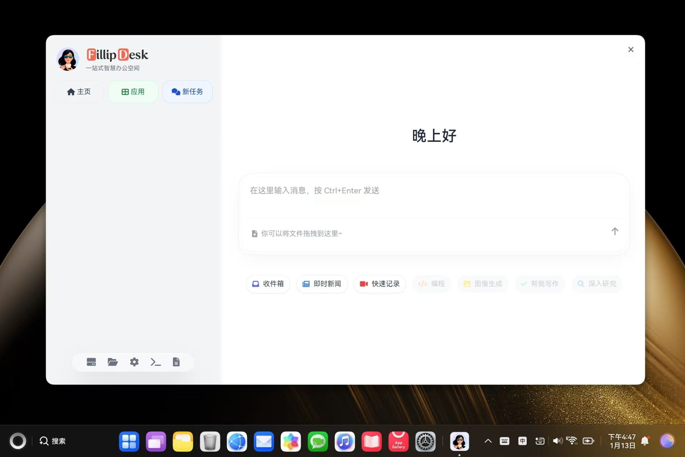

# OpenDesk 鸿蒙化适配说明

### 环境要求

- **DevEco Studio**: 4.0 或更高版本
- **HarmonyOS SDK**: API Level 10 或更高
- **Node.js**: 16.x 或更高版本
- **HDC工具**: 用于设备调试和安装

## 1. 工程包下载

#### 下载OpenDesk鸿蒙化工程包 (_ohos_opendesk.tar.gz_)

- Windows环境下载[ohos_opendesk.tar.gz](http://113.44.212.85:5005/downloads/ohos_opendesk.tar.gz)

## 2. 解压缩、替换OpenDesk代码

ohos_opendesk.tar.gz解压后，将OpenDesk最新代码覆盖到`ohos_hap/web_engine/src/main/resources/resfile/resources/app`目录。

## 3. Electron依赖安装

参考[devguide.md](../devguide.md)开发说明，在app/开发目录安装Electron等依赖。也可以直接拷贝OpenDesk应用代码和编译后的产物（node_modules）放入app/目录。

<span style="color: red; font-weight: bold;">当前版本node-screenshots库的鸿蒙兼容性存在问题，需要临时hack recall模块：</span>

### 3.1 注释recall service中的node-screenshots模块功能

`ohos_hap/web_engine/src/main/resources/resfile/resources/app/src/main/applications/recall/service/service.js`

```
注释hack
//import { Window } from 'node-screenshots';
```

### 3.2 移除node-screenshots库依赖安装

`ohos_hap/web_engine/src/main/resources/resfile/resources/app/package.json`

```
删除
"node-screenshots": "^0.2.1",
```

## 4. DevEco Studio工程构建、签名、推包

DevEco Studio打开工程`ohos_hap`目录，适配签名信息等配置后，直接点击右上角的运行按钮启动应用，完成构建编译、签名和推包流程。
hap路径参考`ohos_hap/electron/build/default/outputs/default/electron-default-signed.hap`

## 5. 效果展示

- demo hap包下载[electron-default-signed.hap](http://113.44.212.85:5005/downloads/electron-default-signed.hap)

- 鸿蒙系统OpenDesk应用
  

## 6. 后续规划

node-screenshots依赖库的鸿蒙化适配

## 7. HM PC 开机自启动

业务侧统一使用 NativeBridge 的两个自启动能力，边界见 [自启动 bridge 说明](../specifications/startup_bridge.md)。

普通应用通过公开的 `autoStartupManager.getAutoStartupStatusForSelf()` 查询自身状态（API 21+）。
修改自启动名单的接口属于系统接口，OpenDesk 不申请 `MANAGE_APP_BOOT` 或企业设备管理权限。
因此 HM PC 的「通用设置 → 启动」显示系统状态和「前往系统设置」按钮，由用户在
「系统设置 → 应用和元服务 → 应用启动管理」添加或移除 OpenDesk；返回应用后自动刷新状态。
查询失败时显示状态未知，不将失败视为关闭或保存成功。

该能力需要同时更新 OpenDesk 业务代码及 **OpenDesk-ohos 鸿蒙壳工程**。只替换 `dist`
不会注册新的 ArkTS 绑定，旧壳不能提供状态查询和系统设置入口。

配套壳改动由 [OpenDesk-ohos PR #48](https://gitcode.com/openharmony-robot/OpenDesk-ohos/merge_requests/48)
维护，功能提交为 `8a598b20204cc1ea201278c1f27e2adc3bfa0d96`。构建时需使用包含该提交的壳版本，
其中包含原生适配器、三个 AKI 绑定及逻辑测试；业务仓不再保存壳源码补丁副本。

精准跳转「应用启动管理」的壳改动见 [OpenDesk-ohos PR #51](https://gitcode.com/openharmony-robot/OpenDesk-ohos/merge_requests/51)，
通过设置 Ability 的 `uri: 'pc_app_setup_settings'` 实现，业务侧不保存该系统路由。

同步当前 OpenDesk 构建产物后，使用壳工程既有构建和签名流程生成新的 HAP。

桥接协议：

| 绑定                                     | 参数/返回类型                  | 说明                                                   |
| ---------------------------------------- | ------------------------------ | ------------------------------------------------------ |
| `EtsBridge.OpenDeskStartupStatusStart`   | `[] → number`                  | 发起本应用系统状态查询，返回请求 ID                    |
| `EtsBridge.OpenDeskStartupSettingsStart` | `[] → number`                  | 通过当前 UIAbilityContext 打开系统设置，返回请求 ID    |
| `EtsBridge.OpenDeskStartupResultPeek`    | `[requestId: number] → string` | 返回 pending/ok/unsupported/error JSON，完成后消费结果 |

各请求使用独立 ID，Node 侧最多轮询 5 秒，ArkTS 侧 30 秒清理未消费结果。
状态只来自系统查询，不写入 OpenDesk 配置。所有协议错误在界面显示为本地化提示。

验收：在新 HAP 中打开系统设置并添加 OpenDesk，返回后显示已开启；移除后返回显示未开启；
最后由测试者重启/重新登录验证真实启动行为。系统设置入口打开不代表已经开启自启动。

参考：[公开状态查询 API](https://github.com/openharmony/docs/blob/master/zh-cn/application-dev/reference/apis-ability-kit/js-apis-app-ability-autoStartupManager.md)、
[华为 HM PC 自启动管理说明](https://consumer.huawei.com/cn/support/content/zh-cn16048401/)。
