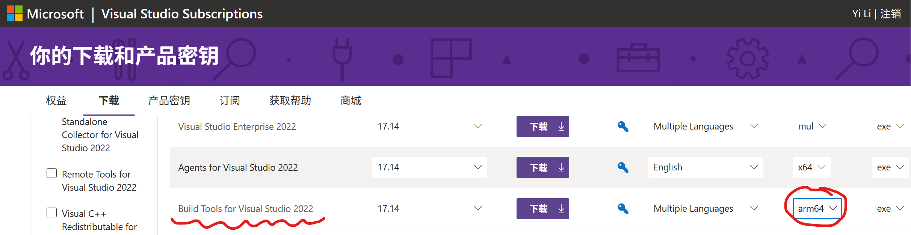
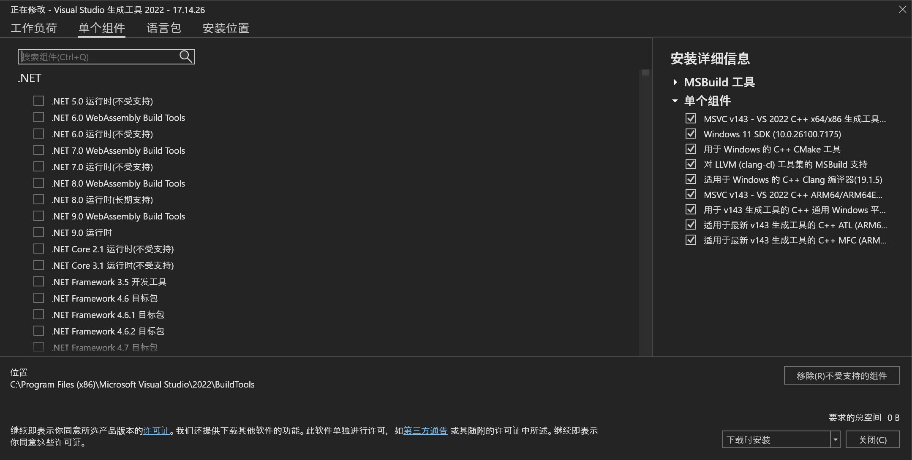

# 在Windows Arm上开发OpenDesk

OpenDesk的CLI版和桌面GUI版都会提供可供在Windows Arm上安装的发行版安装包文件。但与此同时，我们强烈不建议大家在Windows Arm上进行OpenDesk的开发。由于生态十分不完善，在Arm64版本的Windows上开发需要多踩很多坑。

但是如果你一定要尝试一把的话，可以参考下面的文档。这是笔者在鸿蒙PC的Windows虚拟机中进行OpenDesk开发时进行环境配置的经验总结。如果在其他设备上，按照下面的步骤无法安装的话，也欢迎在本仓库的Issues中讨论。

## 1. NodeJS安装

在安装nodejs之前，一定要注意看nvm的配置。
[nvm-windows](https://github.com/coreybutler/nvm-windows/releases)所提供的安装包是x86架构的，Windows Arm上也可以安装并以转译的形式运行，但这会导致默认安装的node版本是也是x86的，后续会有很多坑；

总是建议你通过下面的完整命令来安装node, e.g.::
```shell
nvm install v25.2.1 arm64
nvm use v25.2.1 arm64
# 安装完后执行 nvm list
nvm list
# 应当看到如下内容
# * 25.2.1 (Currently using arm64-bit executable)
#                          ~~~~~~~~~~~
```

## 2. 本地构建npm包所依赖的环境

NodeJS生态中的大部分包都是跨平台的。但其中少数使用到了Native的组件(e.g. leveldb, better-sqlite3, ...)。大多数时候，这些包在Windows下都有对应的预构建版本可以直接安装，但是在Arm64下，你需要手动安装构建所需要的工具链。

这里介绍了如何在Windows Arm上安装这些工具。在下面的工具都安装完成之后，在OpenDesk的根目录中运行`npm install`应当可以正常构建所有依赖的库。

在NodeJS生态中，通常通过`node-gyp`工具来对这些Native包进行构建。通常构建它们有两个依赖项: **Python** 以及 **VS Buildtools**。

### 2.1 安装 Python

你可以选择在Microsoft Store中安装Python，或者自己在官网上下载。这里以后者为例。

在[Python官方网站](https://www.python.org/downloads/)选择你想要的Python版本，当前我选用的是[Python 3.13.12](https://www.python.org/downloads/release/python-31312/)，下载并安装。注意在安装的时候选择Arm64版本的Installer。

在安装的时候，注意勾选一下将Python添加到环境变量。如果安装的时候没有选择，需要手动进入环境变量修改页面添加Python安装目录。例如我这里添加的是:

```
C:\Users\OseasyVM\AppData\Local\Programs\Python\Python313-arm64\
C:\Users\OseasyVM\AppData\Local\Programs\Python\Python313-arm64\Scripts\
```

### 2.2 安装 VS Buildtools

1. 在[Visual Studio下载界面](https://my.visualstudio.com/Downloads?q=visual%20studio%202022&wt.mc_id=o~msft~vscom~older-downloads)查找Visual Studio 2022 (因为目前node-gyp主流版本还不支持更新版本的VS);
2. 找到Build Tools for Visual Studio 2022, 并选择arm版本下载;
   
3. 打开安装工具，选择**单个组件**（重要！在工作负荷里可能看不到arm64相关的内容），并勾选以下几个选项:
    - Windows 11 SDK
    - MSVC v143 - VS 2022 C++ ARM64/ARM64EC 生成工具(最新)
    - 适用于最新v143生成工具的C++ ATL(ARM64/ARM64EC)
    - 适用于最新v143生成工具的C++ MFC(ARM64/ARM64EC)
    - 用于v143生成工具的C++通用平台支持(ARM64/ARM64EC)
    - 用于Windows的C++ CMake工具
    - 适用于Windows的C++ Clang编译器

   
   然后安装即可。

安装后重启你的IDE，之后由于安装包构建报错的软件包(如better-sqlite3等)应当都可以通过node-gyp正常安装。

### 2.3 安装VSSetup模块

在构建过程中，`node-gyp`会使用Powershell中的`Get-VSSetupInstance`指令来获取当前安装的VS构建工具的信息。如果你的Powershell中没有这个工具模块就会导致失败，且报错信息中会包含如下字样:

```
Get-VSSetupInstance : 无法将“Get-VSSetupInstance”项识别为 cmdlet、函数、脚本文件或可运行程序的名称。请检查名称的拼写
，如果包括路径，请确保路径正确，然后再试一次。
```

这时候你需要进入Powershell并运行下面的指令来安装VSSetup，并且手动放宽脚本执行权限以允许系统执行：

```
Install-Module -Name VSSetup -Force -AllowClobber -Scope CurrentUser
Set-ExecutionPolicy RemoteSigned -Scope CurrentUser -Force
```
接下来再运行`Get-VSSetupInstance`，你应当看到下面的输出，表示该模块已经成功安装。

```
InstanceId          : faaf9b48
DisplayName         : Visual Studio 生成工具 2022
InstallationVersion : 17.14.36930.0
InstallationPath    : C:\Program Files (x86)\Microsoft Visual Studio\2022\BuildTools
InstallDate         : 2026/2/17 20:52:09
```

### (可选)设置默认编码为UTF8

如果还存在有安装包无法构建，且大量报C/C++编译错误的情况可以考虑将全局的编码设置为UTF8。但是需要注意，一旦修改默认编码后，有一些其他的包如`better-sqlite3`的编译会出问题。所以尽量不要修改这个默认编码。

参考[这篇帖子](https://zhuanlan.zhihu.com/p/153219931)的教程，在控制面板中将Windows的全局编码设定为UTF-8（否则默认情况下，中文的编码为GBK）.

如果不这么设置的话，部分需要node-gyp来本地构建的包会由于编码问题而无法编译(e.g. nodejieba)。在x86架构的Windows下，由于有预编译包的存在才不容易出现这个问题。