# OpenDesk 源码架构分析报告

生成日期：2026-07-01  
依据要求：`/home/intellios/.codex/attachments/c4f3bf4b-69fb-4fbd-8f29-74f6cc084f78/pasted-text-1.txt`  
分析范围：仓库源码、配置、文档、测试与打包脚本。只读盘点显示仓库共有 839 个 Git 跟踪文件，其中 `src/` 与 `packages/` 下 TypeScript/JavaScript 文件 675 个；`src/main` 中主要分布为 `applications` 182 个、`aikernel` 83 个、`tui` 82 个、`services` 45 个、`server` 25 个。

## 0. 模块识别与范围说明

附件要求正式分析前确认核心模块清单。本文将源码中的核心模块先归纳为以下 15 组，并以该清单展开分析；如后续需要重新划分，可以按这一节作为确认基线。

| 编号 | 核心模块                | 主要源码位置                                                                                 | 说明                                            |
| ---- | ----------------------- | -------------------------------------------------------------------------------------------- | ----------------------------------------------- |
| M01  | 启动入口与平台适配      | `src/main/main.ts`, `src/main/cli.ts`, `src/main/worker.ts`, `src/platforms/*`               | Electron、CLI、worker、平台能力抽象             |
| M02  | 应用框架与注册中心      | `src/main/applications/base.ts`, `registry.ts`, `worker.ts`, `packages/appsdk/src/*`         | 内置/外部应用、worker RPC、AppSDK               |
| M03  | AI Kernel 核心运行时    | `src/main/aikernel/states/*`, `agents/*`, `llm.ts`, `tool.ts`                                | Task、Agent、LLM、Tool 调度                     |
| M04  | 权限、安全与交互        | `src/main/aikernel/security/*`, `interaction/*`                                              | 权限规则、prompt provider、askUser/exitPlanMode |
| M05  | Goal、Todo 与自动化控制 | `src/main/aikernel/goal/*`, `todos/*`, `applications/todomgr/*`                              | 长任务目标、任务待办、全局自动化触发            |
| M06  | 记忆、上下文与压缩      | `src/main/aikernel/memory/*`, `compaction/*`, `context/*`                                    | 长上下文压缩、session memory、长期记忆          |
| M07  | GUI Renderer Shell      | `src/renderer/*`, `src/main/windows/*`                                                       | Electron preload、Web Components、应用宿主      |
| M08  | CLI/TUI/Headless        | `src/main/tui/*`                                                                             | pi-tui 交互界面、斜杠命令、headless runner      |
| M09  | Serve/兼容协议          | `src/main/server/acp/*`, `src/main/server/opencode/*`, `src/main/tui/subcommands/serve.ts`   | ACP/OpenCode HTTP 兼容层                        |
| M10  | 浏览器自动化            | `src/common/embedBrowserUse/*`, `src/main/applications/browser/*`, `src/renderer/browser.ts` | 通用 CDP 库与 OpenDesk 浏览器应用               |
| M11  | 文件、搜索与存储索引    | `applications/filemgr/*`, `applications/search/*`, `services/storage/*`                      | 文件工具、文件索引、Web/学术搜索、通用存储      |
| M12  | Skill、MCP 与应用工坊   | `applications/skillmgr/*`, `mcpmgr/*`, `appmgr/*`, `aikernel/skill.ts`                       | Agent Skills、MCP server、用户应用              |
| M13  | Device、Channel 与插件  | `applications/devicemgr/*`, `channelmgr/*`, `plugins/*`                                      | OpenClaw 节点、消息渠道、插件加载               |
| M14  | 生产力应用与业务能力    | `mailbox`, `calendar`, `notes`, `knowledgebase`, `recall`, `a2a`, `agentgate`, `builtin`     | 邮件、日历、笔记、知识库、安全网关等            |
| M15  | 基础设施与工程支撑      | `utils/*`, `locale/*`, `updater/*`, `scripts/*`, `docs/*`, `src/tests/*`                     | 设置、日志、本地化、更新、构建脚本、测试        |

## 1. 项目定位与背景

### 1.1 项目使命

OpenDesk 是一个基于 Electron 与 TypeScript 的全能型 AI 工作站，同时提供桌面 GUI、CLI/TUI、headless 命令、ACP/OpenCode 兼容服务等多种入口。源码显示其目标不是单一聊天客户端，而是一个可运行任务、调用工具、管理应用、连接设备和消息渠道、扩展技能/MCP/插件的本地 Agent 操作系统。

核心能力可以概括为：

- 用统一 `TaskState` 管理多轮 Agent 对话、工具调用、权限确认、文件变更、目标状态、记忆和压缩。
- 用 `BaseApplication`/`ApplicationRegistry` 把邮件、日历、文件、浏览器、搜索、技能、MCP、设备、渠道等能力以应用形式注册进 Agent。
- 用 GUI/TUI/server 多入口共享同一个 AI kernel，避免不同入口各自实现业务逻辑。
- 用权限与执行宿主抽象控制本地文件、网络、shell、远端设备节点等高风险能力。

### 1.2 背景约束

| 约束              | 源码体现                                            | 架构影响                                        |
| ----------------- | --------------------------------------------------- | ----------------------------------------------- |
| 双模式/多模式入口 | `main.ts`, `cli.ts`, `headless.ts`, `serve.ts`      | 核心状态与应用必须与具体 UI 解耦                |
| Electron 多进程   | main/preload/renderer/webview/worker                | 需要 IPC、contextBridge、worker RPC 和协议常量  |
| 跨平台            | `src/platforms/*`, OpenHarmony 文档、WASM storage   | 平台能力统一通过 `AbstractPlatform`/工厂分发    |
| 本地高权限工具    | filemgr、terminal、browser、devicemgr               | 必须有权限模型、prompt provider、执行宿主上下文 |
| 长任务与长上下文  | goal、compaction、session memory                    | 需要可恢复目标、压缩流水线、任务持久化          |
| 扩展生态          | skillmgr、mcpmgr、appmgr、plugins                   | 应用、技能、插件、MCP 都需要热加载和可配置      |
| 用户数据长期保存  | `Setting`, task artifacts, app data dir, storage DB | 数据目录和状态格式成为稳定契约                  |
| 本地化            | `src/locale/*`, `t()`                               | 运行时用户可见文案应尽量接入 locale             |

### 1.3 技术选择评估

| 技术/库                        | 使用位置                                             | 选择原因与影响                                    |
| ------------------------------ | ---------------------------------------------------- | ------------------------------------------------- |
| Electron 39 + electron-vite    | `electron.vite.config.ts`, `main.ts`                 | 支持桌面窗口、webview、preload 隔离、native shell |
| TypeScript ESM                 | `package.json`, `tsconfig*`                          | 主体类型安全，模块边界清晰；部分历史 JS 仍存在    |
| Node worker_threads            | `applications/registry.ts`, `applications/worker.ts` | 把应用 worker 与主进程隔离，复用一个全局 worker   |
| zod                            | App 配置、工具参数、LLM object 输出                  | schema 同时用于配置、校验、工具描述               |
| OpenAI/Anthropic SDK           | `aikernel/llm.ts`                                    | 多 provider LLM 适配与流式输出                    |
| MCP SDK                        | `applications/mcpmgr/*`                              | 标准化接入第三方工具服务器                        |
| Hono                           | `server/opencode/server.ts`                          | 轻量 HTTP API/SSE 兼容层                          |
| pi-tui                         | `src/main/tui/*`                                     | CLI 交互、组件、快捷键、斜杠命令                  |
| better-sqlite3/sqlite-vec/WASM | `services/storage/*`                                 | 本地元数据、全文、向量、chunk 索引                |
| ws/OpenClaw                    | `devicemgr`, `plugins`, `channelmgr`                 | 设备节点和消息渠道插件生态                        |

## 2. 整体架构

### 2.1 分层图

```text
┌─────────────────────────────────────────────────────────────────────┐
│ 用户入口                                                             │
│ Electron GUI / CLI TUI / Headless -c / ACP stdio / OpenCode HTTP     │
└──────────────┬──────────────────────┬──────────────────────┬────────┘
               │                      │                      │
┌──────────────▼────────────┐ ┌───────▼────────┐ ┌──────────▼─────────┐
│ Renderer + Preload        │ │ TUI/Headless    │ │ Server Adapters     │
│ Web Components/App Host   │ │ Slash Commands  │ │ ACP/OpenCode/Hono   │
└──────────────┬────────────┘ └───────┬────────┘ └──────────┬─────────┘
               │ IPC                  │ direct calls          │ route calls
┌──────────────▼──────────────────────▼──────────────────────▼────────┐
│ Main/CLI Runtime                                                      │
│ Platform Adapter + Setting + GlobalState + ApplicationRegistry        │
└──────────────┬──────────────────────┬──────────────────────┬────────┘
               │                      │                      │
┌──────────────▼────────────┐ ┌───────▼────────┐ ┌──────────▼─────────┐
│ AI Kernel                 │ │ Applications    │ │ Security/Harness     │
│ Task/Agent/LLM/Tool       │ │ app + worker    │ │ permission/execution │
└──────────────┬────────────┘ └───────┬────────┘ └──────────┬─────────┘
               │                      │                      │
┌──────────────▼──────────────────────▼──────────────────────▼────────┐
│ 外部与持久化资源                                                     │
│ LLM/Embedding APIs, MCP servers, Browser CDP, local FS, SQLite,       │
│ OpenClaw devices, channel plugins, OS native shell/notifications      │
└─────────────────────────────────────────────────────────────────────┘
```

### 2.2 Mermaid 结构图

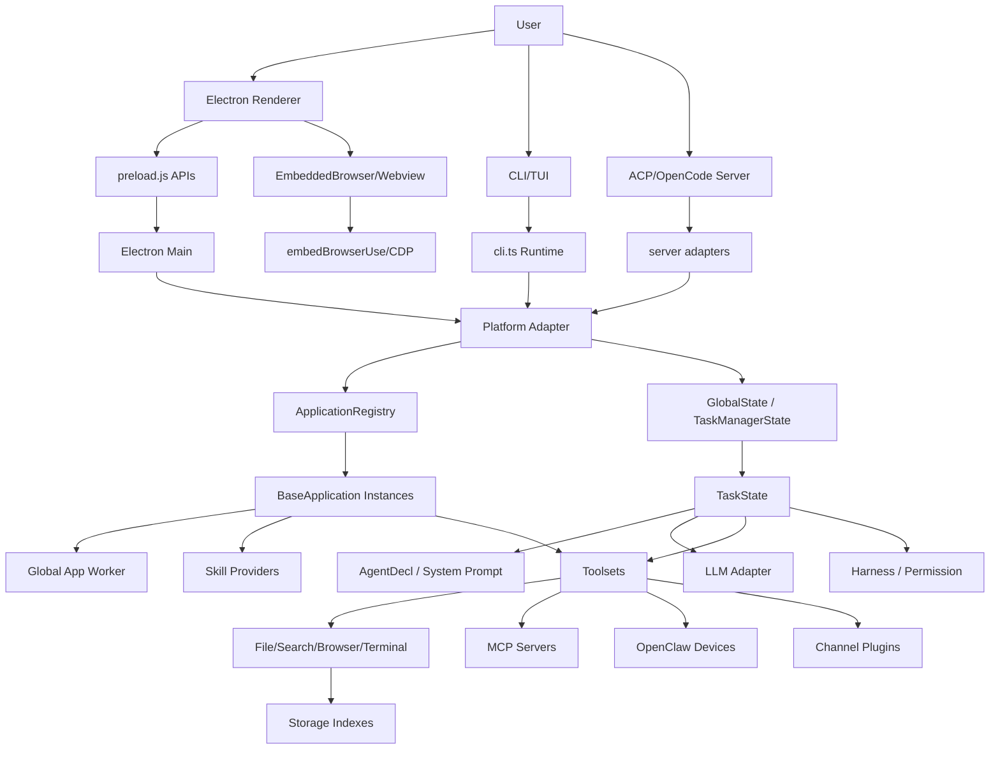

### 2.3 进程与服务模型

| 进程/服务           | 入口                                           | 职责                                                         | 主要通信                                          |
| ------------------- | ---------------------------------------------- | ------------------------------------------------------------ | ------------------------------------------------- |
| Electron main       | `src/main/main.ts`                             | 窗口、IPC、平台、任务状态、应用注册、worker、browser manager | `ipcMain`, worker `postMessage`, Electron session |
| Renderer main frame | `src/renderer/scripts/index.js`                | Web Components、任务视图、侧栏、工具栏、设置等 GUI           | `window.*API` via preload                         |
| Renderer app frame  | `application*.html`, `application-host.ts`     | 加载内置/外部应用 renderer entry，挂载应用组件               | `opendeskAppAPI`, `applicationAPI`                |
| Webview guest       | `renderer/browser.ts`                          | 嵌入式浏览器页面                                             | preload browser bridge、CDP                       |
| Global app worker   | `src/main/worker.ts`, `applications/worker.ts` | 初始化所有带 worker 的应用，执行应用 worker RPC              | parentPort message                                |
| CLI/TUI             | `src/main/cli.ts`, `tui/entry.ts`              | 终端 UI、斜杠命令、权限/askUser 弹窗                         | 直接调用 Task/Application                         |
| Headless            | `tui/headless.ts`                              | 无交互执行 `-c` 命令，块级输出                               | 直接调用 Task                                     |
| ACP server          | `server/acp/*`                                 | ACP stdio session/protocol                                   | ndjson/stdin/stdout                               |
| OpenCode server     | `server/opencode/*`                            | Hono HTTP/SSE 兼容 API                                       | HTTP routes/EventBus                              |
| Device gateway      | `applications/devicemgr/gateway.ts`            | OpenClaw Node Protocol WebSocket 网关                        | WebSocket RPC/events                              |

### 2.4 核心模块总表

| 模块                   | 输入                                 | 输出                                       | 关键状态                                 | 依赖方向                           |
| ---------------------- | ------------------------------------ | ------------------------------------------ | ---------------------------------------- | ---------------------------------- |
| 平台适配               | app/CLI args, OS APIs                | fetch/shell/native/window/workspace        | Platform singleton                       | 上层依赖平台，平台不依赖 UI 细节   |
| 应用注册中心           | application class, external manifest | app list/toolsets/skills/events/worker RPC | application maps, worker request maps    | kernel 通过 provider 获取工具/技能 |
| AI Kernel              | user message, system prompt, tools   | assistant stream, tool result, task status | TaskState/TaskManagerState               | 调用应用工具，不直接绑定 renderer  |
| 权限/交互              | tool permission requests             | allow/deny/askUser/exitPlanMode result     | HarnessContext/rules                     | provider 注入 GUI/TUI/ACP/OpenCode |
| Goal/Todo              | objective, task status, events       | continuation prompt, todo trigger          | GoalState/todo state                     | hooks 注入 Task 生命周期           |
| Memory/Compaction      | chat context/token usage             | compacted context/session memory           | memory files/artifacts                   | kernel 内部流水线                  |
| Renderer               | IPC state/task chunks                | DOM/UI/app frame/browser webview           | component state                          | 只经 preload API 访问 main         |
| TUI                    | keyboard/input/slash command         | task submission/overlays/render            | active task, command registry            | 直接操作 kernel                    |
| Serve                  | HTTP/ACP prompt                      | task session response/events               | server session maps                      | 兼容层薄封装                       |
| Browser                | browser tool call                    | CDP action/snapshot/download               | BrowserController/session/downloads      | 通用库 + OpenDesk 注入 hook        |
| File/Search/Storage    | file ops/search query                | file result/search result/index            | FSStorage/BaseStorage                    | filemgr 组合 storage/search        |
| Skill/MCP/AppMgr       | registry/config/user packages        | skills/tools/apps                          | skill cache/MCP connections/app versions | 通过 ApplicationRegistry 暴露      |
| Device/Channel/Plugins | WebSocket/plugin inbound             | node tools/channel replies                 | node registry/channel task map           | 插件与任务系统桥接                 |
| 生产力应用             | domain config                        | domain tools/events/renderers              | app worker stores                        | 使用统一 app contract              |
| 基础设施               | settings/logs/locale/update/test     | config/log/i18n/build artifacts            | setting data/log files                   | 横切依赖                           |

## 3. 各核心模块深度分析

本章不再只按目录罗列源码，而是把每个 `Mxx` 视为一个功能模块来说明。每个模块都从四个维度展开：

- **功能边界**：该模块负责什么，不负责什么。
- **架构设计**：模块内部如何分层，和其他模块如何连接。
- **接口设计**：对外暴露的类、函数、IPC、协议或工具契约。
- **使用场景**：用户、Agent、插件或外部客户端会在什么情况下走到该模块。

从功能域看，15 个模块可再分成 6 层：

| 功能层       | 对应模块           | 设计关注点                                        |
| ------------ | ------------------ | ------------------------------------------------- |
| 运行入口层   | M01, M08, M09      | 多入口启动、平台能力注入、协议兼容                |
| Agent 执行层 | M03, M04, M05, M06 | 任务状态、模型调用、工具权限、长任务与记忆        |
| 应用扩展层   | M02, M12, M13, M14 | 应用生命周期、worker RPC、Skill/MCP/插件/业务应用 |
| UI 表现层    | M07, M10           | Electron renderer、preload API、嵌入式浏览器      |
| 数据与检索层 | M11, M15           | 本地文件、搜索、索引、配置、日志、本地化          |
| 工程治理层   | M15                | 构建、测试、更新、架构约束                        |

### M01 启动入口与平台适配

#### 功能模块视角

**功能边界**

启动入口模块负责把不同运行形态统一拉起，包括 Electron GUI、CLI/TUI、headless、serve 和 worker。它不承载具体业务逻辑，而是决定当前进程可用的平台能力、应用集合、工作区、权限交互 provider 和系统 bridge。

**架构设计**

核心抽象是 `AbstractPlatform`。Electron、CLI、worker 各自实现平台能力，主入口只做编排：设置 platform 单例、加载设置与本地化、初始化 `GlobalState`、初始化 `ApplicationRegistry`、创建或连接全局 app worker，并为 task 注入 harness。`WorkerPlatform` 不能直接使用 Electron 或 undici，因此把 fetch/shell 请求通过 parentPort 转发到主进程；`ElectronPlatform` 使用 `net.fetch`、Electron shell 和 native bridge；`CliPlatform` 使用 undici 并继承系统代理。

**架构图**

```mermaid
flowchart TB
    GUI[Electron GUI main.ts] --> Bootstrap[启动编排]
    CLI[CLI/TUI cli.ts] --> Bootstrap
    Headless[Headless -c] --> Bootstrap
    Serve[serve subcommand] --> Bootstrap
    Worker[worker.ts] --> WorkerPlatform[WorkerPlatform]

    Bootstrap --> Platform[setPlatform(AbstractPlatform)]
    Platform --> ElectronPlatform[ElectronPlatform]
    Platform --> CliPlatform[CliPlatform]
    Platform --> AppClasses[getApplicationClasses]
    Platform --> Harness[initPlatformHarness]
    Platform --> OS[fetch / shell / native bridge]

    AppClasses --> Registry[ApplicationRegistry]
    Bootstrap --> GlobalState[GlobalState / TaskManagerState]
    Registry --> AppWorker[Global app worker]
    Harness --> Task[TaskState HarnessContext]
```

**接口设计**

| 接口                                                                        | 契约                                                       |
| --------------------------------------------------------------------------- | ---------------------------------------------------------- |
| `setPlatform(platform)` / `getPlatform()`                                   | 进程级平台单例，供全局模块读取平台能力                     |
| `AbstractPlatform.getEffectiveWorkspace()`                                  | 当前任务和应用默认工作区来源                               |
| `AbstractPlatform.initPlatformHarness(task)`                                | 注入权限 prompt、askUser、exitPlanMode 等入口相关 provider |
| `AbstractPlatform.fetch/openPath/openExternal/trashItem/showItemInFolder()` | 网络和 OS shell 能力的跨平台门面                           |
| `AbstractPlatform.getApplicationClasses()`                                  | 决定当前入口注册哪些应用                                   |
| `getWorkerPath()`                                                           | Electron/worker 场景下定位编译后的 worker 入口             |

**接口调用关系**

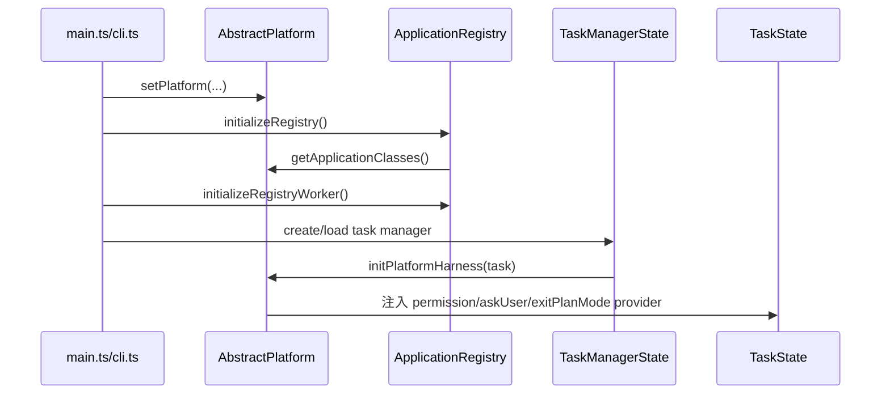

**使用场景**

- 用户启动 GUI 时，`main.ts` 创建 Electron 窗口、注册 IPC、初始化浏览器 session 和应用注册中心。
- 用户运行 `opendesk` 进入 TUI 时，`cli.ts` 设置 `CliPlatform`，注册应用 CLI option 和 slash command。
- 用户执行 headless 命令时，平台注入无交互 permission provider，高风险 ask 默认拒绝。
- 应用 worker 内调用网络或打开文件时，通过 `WorkerPlatform` 把请求转回主进程，避免 worker 自己绑定平台实现。

**具体使用场景**

| 场景                | 触发动作                                  | 关键调用链                                                                                                               | 结果                                                      |
| ------------------- | ----------------------------------------- | ------------------------------------------------------------------------------------------------------------------------ | --------------------------------------------------------- |
| 桌面 GUI 启动       | 用户双击应用或运行 `npm start`            | `main.ts` → `setPlatform(ElectronPlatform)` → `initializeRegistry()` → `initializeRegistryWorker()` → 创建 BrowserWindow | GUI 可打开任务、应用和嵌入式浏览器                        |
| TUI 启动            | 用户运行 `opendesk --workspace /repo`     | `cli.ts` → `CliPlatform.setWorkspace()` → 注册应用 CLI options → `OpenDeskTUI`                                           | 终端里可提交任务、执行 slash command、处理权限 overlay    |
| worker 发起网络请求 | app worker 中 MCP/Search/Skill 需要 fetch | `WorkerPlatform.fetch()` → parentPort `__fetch_request` → main `getPlatform().fetch()` → `__fetch_response`              | worker 不直接绑定 Electron/undici，也能继承主进程网络能力 |
| headless 批处理     | 脚本执行 `opendesk -c "总结文件"`         | `HeadlessRunner.execute()` → `TaskState.submitUserMessage()` → 无交互 permission provider                                | 输出一次性结果，高风险 ask 直接失败或提示不可交互         |

**定位与边界**

- `src/main/main.ts` 是 Electron 主入口，负责平台初始化、窗口、IPC、ApplicationRegistry、worker、BrowserManager、权限/interaction provider、任务 IPC。
- `src/main/cli.ts` 是 CLI/TUI/headless/serve 的入口，解析 Commander 参数并注册应用 CLI option/subcommand。
- `src/main/worker.ts` 是全局应用 worker 入口。
- `src/platforms/base.ts`, `cli.ts`, `worker.ts`, `electron.ts` 定义平台能力边界：workspace、fetch、native bridge、shell、worker path、application class list、harness provider。

**内部结构**

```text
main.ts / cli.ts / worker.ts
        │
        ▼
setPlatform(AbstractPlatform)
        │
        ├─ ElectronPlatform extends WorkerPlatform
        ├─ CliPlatform
        └─ WorkerPlatform
        │
        ▼
GlobalState + ApplicationRegistry + TaskManagerState
```

**外部接口**

| 接口                      | 提供者                        | 消费者                                     | 说明                                                         |
| ------------------------- | ----------------------------- | ------------------------------------------ | ------------------------------------------------------------ |
| `setPlatform/getPlatform` | `platforms/base.ts`           | 全局源码                                   | 单例平台适配                                                 |
| `getApplicationClasses()` | 各 platform                   | `ApplicationRegistry.initializeRegistry()` | 决定当前运行形态启用哪些应用                                 |
| `initPlatformHarness()`   | platform                      | `TaskManagerState.initHarness`             | 注入权限、askUser、exitPlanMode                              |
| Electron IPC              | `main.ts`                     | preload/renderer                           | taskManager、settings、fs、workspace、permission、browser 等 |
| CLI options/subcommands   | `cli.ts` + app static methods | 用户 CLI                                   | 应用可注册参数与子命令                                       |

**核心业务流**

1. Electron 启动：`main.ts` 设置 `ElectronPlatform`，创建 BrowserWindow，绑定 preload IPC，初始化 registry/worker，注册 BrowserManager session，最后加载 renderer。
2. CLI TUI 启动：`cli.ts` 设置 `CliPlatform`，加载 setting/locale/logging，初始化 GlobalState/AgentRegistry/ApplicationRegistry/worker，创建 `OpenDeskTUI`。
3. Headless 启动：`cli.ts` 在 `--headless -c` 下创建 `HeadlessRunner`，创建 task、设置 harness、提交命令并等待完成。

**数据模型**

- `CommandLineArgs`：CLI/TUI 参数，包括 workspace/model/headless/profile/mode/appCliOptions。
- `AbstractPlatform`：平台服务抽象，包含 fetch、shell、native bridge、worker path、application classes。
- `GlobalState`：持有 `TaskManagerState` 和 serve mode 标志。

**设计决策**

- 用 platform 注册应用列表，使 CLI 与 Electron 可启用不同应用集合。
- ElectronPlatform 继承 WorkerPlatform，复用 worker 应用集，同时覆写 fetch/native/shell 能力。
- serve 模式通过 `GlobalState.isServeMode()` 抑制设备网关等 GUI/本地服务自动启动。

### M02 应用框架与注册中心

#### 功能模块视角

**功能边界**

应用框架把 OpenDesk 内置能力和用户扩展能力统一成 application。它负责应用发现、配置 schema 注册、技能和工具暴露、应用事件、GUI 入口、TUI 入口、worker RPC 和外部应用资源协议，不直接理解邮件、浏览器、MCP 等业务细节。

**架构设计**

应用主类继承 `BaseApplication`，运行在 main/CLI 进程，适合做轻量编排、配置读写、事件订阅、renderer 协议和工具/技能声明。耗时任务、连接型服务和索引扫描放到 `BaseWorker` 子类，所有应用 worker 运行在一个全局 worker 线程中，由 `ApplicationRegistry` 用 `bundleName + methodName + requestId` 分发。外部应用通过 appmgr 生成 `ExternalManifestApplication`，注册进同一个 registry，并通过 `opendesk-app://` 受限协议暴露静态资源。

**架构图**

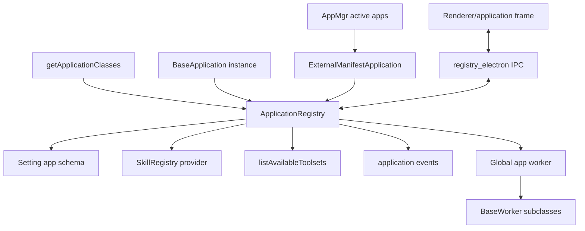

**接口设计**

| 接口                                                            | 契约                                                      |
| --------------------------------------------------------------- | --------------------------------------------------------- |
| `BaseApplication.getConfigSchema()`                             | 应用配置 schema，注册到全局 `Setting`                     |
| `BaseApplication.getToolsets()` / `getSkills()`                 | 向 Agent 暴露工具集和 skill                               |
| `BaseApplication.getSupportedEvents()` / `emitEvent()`          | 声明和发布应用事件，供 renderer、todomgr 或其他订阅者消费 |
| `BaseApplication.getCliSlashCommands()` / `getTUIStatusBlock()` | 向 TUI 注入命令和状态栏片段                               |
| `BaseApplication.getProtocolHandlers()`                         | 注册应用专属协议 handler                                  |
| `BaseApplication.callWorker()`                                  | main 侧调用本应用 worker 方法                             |
| `BaseWorker.handleMessage()` / `handleStreamMessage()`          | worker 侧普通/流式 RPC 分发                               |
| `BaseWorker.emitEvent()` / `callAppWithResponse()`              | worker 反向通知或调用 main 侧 app 方法                    |
| `ApplicationRegistry.listAvailableToolsets()`                   | AI kernel 构造工具集的统一入口                            |

**接口调用关系**

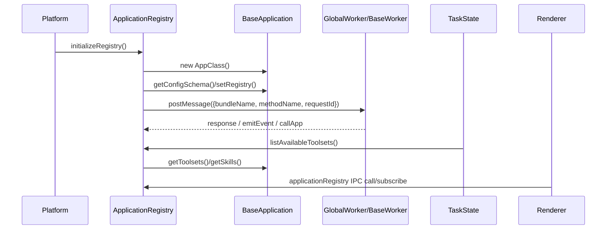

**使用场景**

- 新增一个业务应用时，实现 `BaseApplication`，声明配置、技能、工具和 renderer entry，就能被 GUI/TUI/Agent 统一发现。
- 文件索引、邮箱同步、MCP 连接等长耗时逻辑放在 `BaseWorker`，避免阻塞主进程。
- 应用 worker 发出事件后，registry 同时通知 renderer 订阅者和 todomgr 触发器。
- appmgr 安装或激活外部应用后，registry reload external applications，应用立即进入应用列表和技能注册表。

**具体使用场景**

| 场景               | 触发动作                                            | 关键调用链                                                                                                                               | 结果                                        |
| ------------------ | --------------------------------------------------- | ---------------------------------------------------------------------------------------------------------------------------------------- | ------------------------------------------- |
| 新业务应用接入     | 开发者新增 `BaseApplication` 子类                   | platform `getApplicationClasses()` → registry 实例化 → `Setting.registerApplicationSettings()` → `SkillRegistry.registerSkillProvider()` | 应用出现在 GUI/TUI/Agent 可用能力中         |
| worker 方法调用    | Browser/Mail/MCP renderer 或 tool 调 `callWorker()` | app `callWorker(method)` → registry `postMessage` → worker `handleMessage()` → response                                                  | 耗时逻辑在 worker 完成，main 只等结果       |
| 应用事件触发自动化 | worker `emitEvent('mailReceived')`                  | `BaseWorker.emitEvent()` → registry `handleWorkerEmitEvent()` → renderer subscribers + todomgr                                           | GUI 更新，同时全局 todo 可被事件唤起        |
| 外部应用加载       | 用户安装并启用 app 包                               | `AppManagerStore.listActiveApps()` → `ExternalManifestApplication` → registry reload                                                     | 外部 app 静态资源和 skill/tool 能力进入系统 |

**定位与边界**

应用框架把 OpenDesk 功能拆成可注册的应用。应用主类运行在 main/CLI 进程中，应用 worker 运行在全局 worker 中；外部应用可由 appmgr 加载。

**内部结构**

```text
packages/appsdk
  ├─ BaseApplication
  ├─ BaseWorker
  └─ renderer APIs
        │
src/main/applications/base.ts
        │ setOpenDeskAppHost
        ▼
ApplicationRegistry
  ├─ app instances
  ├─ event subscribers
  ├─ skill providers
  ├─ global worker
  └─ pending RPC/stream maps
```

**外部接口**

| 接口                                  | 文件                           | 说明                                                                  |
| ------------------------------------- | ------------------------------ | --------------------------------------------------------------------- |
| `BaseApplication`                     | `packages/appsdk/src/index.ts` | 应用生命周期、config、toolsets、skills、events、CLI slash、TUI status |
| `BaseWorker`                          | `packages/appsdk/src/index.ts` | worker 初始化、配置变更、普通/流式消息处理、emitEvent/callApp         |
| `ApplicationRegistry.callWorker()`    | `applications/registry.ts`     | main 向全局 worker 派发应用 worker 方法                               |
| `ApplicationRegistry.dispatchEvent()` | `registry.ts`                  | 应用事件分发，并转发 todomgr 做触发匹配                               |
| `applicationRegistry:*` IPC           | `registry_electron.ts`         | GUI 获取应用列表、调用应用 main/worker、订阅事件                      |
| `opendesk-app://`                     | `registry_electron.ts`         | 外部应用资源协议，含路径安全检查                                      |

**核心业务流**

1. 注册应用：`initializeRegistry()` 从 platform 取 application classes，实例化后 `registerApplication()` 保存 app、注册配置 schema、注册 skill provider。
2. worker RPC：main `callWorker(bundle, method, args)` 记录 requestId，发送到全局 worker；worker 初始化所有 `getWorkerClass()`，执行方法后回传 response。
3. 事件广播：worker `emitEvent` 到 registry，registry 校验应用声明事件，通知订阅者，并把事件给 todomgr 做自动化触发。

**数据模型**

- `OpenDeskAppManifest`：bundleName/name/version/icon/gui/experiment 等应用描述。
- `ProtocolHandlerConfig`：外部应用资源协议配置。
- Registry maps：`applications`, `externalApplicationBundles`, `pendingWorkerRequests`, `pendingStreamRequests`。

**设计决策**

- 只使用一个全局 worker，而不是每个应用一个 worker，降低进程数量和打包复杂度。
- 应用主类保留轻量 orchestration，耗时同步/连接逻辑放 worker。
- `BaseApplication` 同时服务 GUI/TUI/Agent，应用能力以 toolsets/skills/events/renderer entry 暴露。

### M03 AI Kernel 核心运行时

#### 功能模块视角

**功能边界**

AI Kernel 是 Agent 执行层，负责将用户输入、系统 prompt、工具定义、长期状态和模型响应组织成一个可恢复的任务执行过程。它不直接负责 GUI 绘制、具体业务应用实现或平台启动，但会通过 registry、platform 和 harness 调用这些能力。

**架构设计**

`TaskManagerState` 管理任务列表、持久化和默认 harness 初始化；`TaskState` 是任务聚合根，持有 chat context、状态机、消息队列、toolsets、model/profile、goal、memory、compaction、文件变更和订阅者。每一轮执行由 `submitUserMessage()` 或 `startInternalTurn()` 进入，`processTaskTurn()` 构造模型上下文，`processCompletion()` 消费 LLM 流式输出，`processToolCalls()` 找到待执行 tool call，再经权限检查和 `BaseTool.execute()` 写回结果。

**架构图**

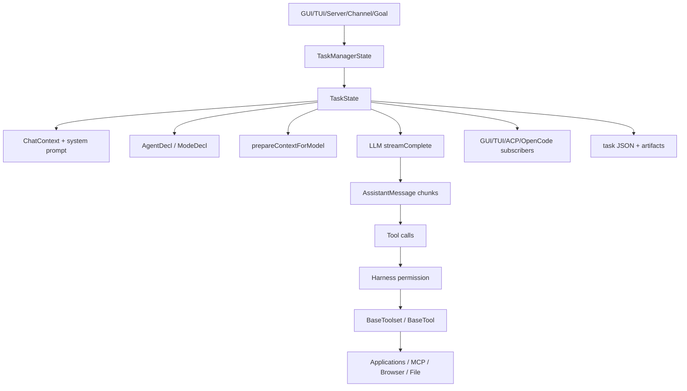

**接口设计**

| 接口                                                        | 契约                                                      |
| ----------------------------------------------------------- | --------------------------------------------------------- |
| `TaskManagerState.createTask()` / `dispatchPromptToAgent()` | 创建普通任务或直接向指定 agent/mode 派发 prompt           |
| `TaskManagerState.initHarness(task, workspace, mode)`       | 为任务创建 `HarnessContext` 并注入 platform provider      |
| `TaskState.submitUserMessage()`                             | 外部用户消息入口，追加 user message 并启动 turn           |
| `TaskState.startInternalTurn()`                             | Goal、memory review、channel 等内部续跑入口               |
| `TaskState.processCompletion()`                             | 处理 LLM 流式 assistant 输出和重试                        |
| `TaskState.processToolCall()`                               | 单个 tool call 的参数校验、权限检查、执行和反馈           |
| `TaskState.waitUntilFinished(callback)`                     | GUI/TUI/server 订阅任务完成和增量更新                     |
| `BaseTool` / `BaseToolset`                                  | 工具 schema、权限声明、执行器、增量结果、GUI/TUI 渲染契约 |
| `LLM.streamComplete()`                                      | 模型流式调用统一接口                                      |

**接口调用关系**

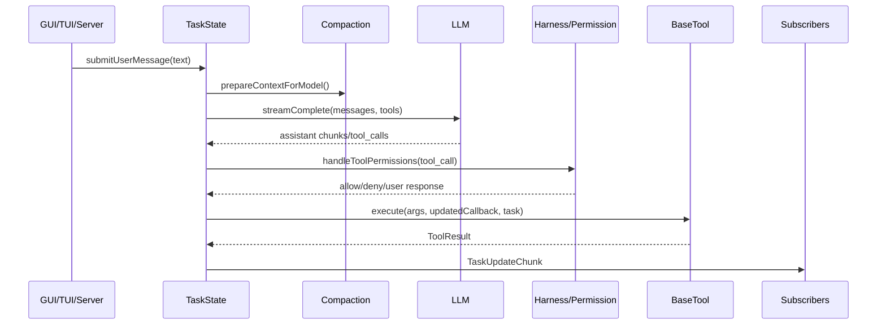

**使用场景**

- GUI/TUI 用户发送一句自然语言请求，最终进入 `TaskState.submitUserMessage()`。
- Agent 调用 file/search/browser/MCP 等工具时，Kernel 统一解析工具参数、执行权限检查和结果写回。
- OpenCode/ACP 外部客户端创建 session 后，本质上也是创建或复用 `TaskState`。
- Goal 续跑、记忆回顾、todomgr 自动触发等无人值守流程使用 internal turn，不需要 UI 发送普通用户消息。

**具体使用场景**

| 场景         | 触发动作                         | 关键调用链                                                                                  | 结果                                 |
| ------------ | -------------------------------- | ------------------------------------------------------------------------------------------- | ------------------------------------ |
| 普通问答     | GUI task view 输入“解释这个文件” | renderer → `submitUserMessage()` → `prepareContextForModel()` → LLM → subscriber 回推       | 任务视图流式显示回答                 |
| 工具调用     | 模型返回 `readFile` tool call    | `processToolCalls()` → 权限检查 → `BaseTool.execute()` → tool result 写回 assistant message | 下一轮模型能看到文件内容或错误       |
| 模型失败重试 | provider 请求超时或 5xx          | `processCompletion()` 捕获错误 → retry delay feedback → 再次 `streamComplete()`             | UI/TUI 看到重试状态，成功后继续 turn |
| 内部续跑     | Goal 判断目标未完成              | `GoalScheduler` → `startInternalTurn()` → `processTaskTurn()`                               | 不需要用户新消息，任务自动继续执行   |

**定位与边界**

AI kernel 是 OpenDesk 的执行核心，负责把用户输入变成 LLM 请求、流式响应、工具调用和任务状态更新。

**内部结构**

```text
TaskManagerState
  └─ TaskState
       ├─ chat_context/messages
       ├─ harnessContext
       ├─ model/reasoning/profile
       ├─ toolsets + renderer toolsets
       ├─ goal/memory/compaction/todos
       └─ subscribers

AgentDecl → system prompt → LLM.streamComplete → tool calls → Toolset.callTool
```

**外部接口**

| 接口                                       | 文件                        | 说明                                      |
| ------------------------------------------ | --------------------------- | ----------------------------------------- |
| `TaskManagerState.createTask()`            | `aikernel/states/tasks.ts`  | 创建任务并持久化                          |
| `TaskState.submitUserMessage()`            | `tasks.ts`                  | 用户消息入口                              |
| `TaskState.processTaskTurn()`              | `tasks.ts`                  | 单轮 LLM+工具执行主循环                   |
| `BaseTool/BaseToolset`                     | `aikernel/tool.ts`          | 工具参数 schema、执行器、渲染器、权限声明 |
| `LLM.streamComplete/complete/askForObject` | `aikernel/llm.ts`           | 模型调用与对象输出                        |
| `AgentDecl/ModeDecl`                       | `aikernel/agents/common.ts` | Agent 模式、权限工厂、prompt 段           |

**核心业务流**

1. 用户输入：GUI/TUI/server 调用 `submitUserMessage`，追加 `UserMessage`，创建 `AssistantMessage`，进入 `processTaskTurn`。
2. 构建上下文：TaskState 合并 system prompt、messages、toolsets，调用 compaction pipeline 准备模型输入。
3. 工具调用：LLM 返回 tool_calls，TaskState 解析并按工具权限声明执行 prompt，调用 tool executor，写入 `ToolResult`，继续下一步。

**数据模型**

- `TaskState`：任务 id/name/status/parent、chat context、message queue、harness、mode、tool result replacement、goal、memory、file read state、profiling、subscribers。
- `ChatMessage` 及 message parts：user/assistant/reasoning/text/tool_call/error 等。
- `ToolCall`：tool name、args、status、result、permission/render 状态。

**设计决策**

- TaskState 是强聚合根，能统一 GUI/TUI/server 的执行语义，但文件较大，演进成本高。
- Agent 模式用 `ModeDecl` 管理权限、子 prompt、允许/禁用工具，避免在工具层硬编码模式。
- Tool 渲染在 tool 类中支持 GUI/TUI 双输出，便于一致展示，但也让工具类同时承担 UI 片段。

### M04 权限、安全与交互

#### 功能模块视角

**功能边界**

权限、安全与交互模块负责高风险动作的授权、任务运行时的执行宿主约束，以及 Agent 主动询问用户或退出计划模式的交互入口。它不决定具体 UI 长什么样，GUI/TUI/server 只通过 provider 实现交互。

**架构设计**

权限声明由工具实现 `getDeclaredPermissions()` 产生，资源类型统一为 `file/network/skill/*`，动作统一为 `read/write/execute/access/*`。`HarnessContext` 为每个任务持有 `PermissionEnforcer`、`PermissionPromptProvider`、workspace、environment 和 `ExecutionHost`。`GlobPermissionEnforcer` 读取默认规则和动态规则，按 deny、ask、allow 语义判定。遇到 ask 时，TaskState 会按同类请求合并，调用 provider 展示前缀授权选项，用户选择后可写入本次或持久规则。

**架构图**

```mermaid
flowchart TB
    Tool[BaseTool.getDeclaredPermissions] --> Requests[PermissionRequest[]]
    Requests --> Enforcer[GlobPermissionEnforcer]
    Rules[Default rules + dynamic rules] --> Enforcer
    Readable[ReadableDirectoryRegistry] --> Rules
    Enforcer -->|allow| Execute[Execute tool]
    Enforcer -->|deny| Fail[Tool failure]
    Enforcer -->|ask| Provider[PermissionPromptProvider]
    Provider --> GUI[Electron overlay]
    Provider --> TUI[TUI overlay]
    Provider --> ACP[ACP/OpenCode broker]
    Provider --> Remember[PermissionRule add/remove]
    Remember --> Enforcer
    Harness[HarnessContext] --> Enforcer
    Harness --> ExecutionHost[local / node execution host]
```

**接口设计**

| 接口                                    | 契约                                              |
| --------------------------------------- | ------------------------------------------------- |
| `PermissionRequest`                     | 工具声明的资源类型、动作和资源路径                |
| `ResourcePath.getPrefixes()`            | 为文件、网络、skill 生成可授权前缀                |
| `PermissionEnforcer.checkAllDetailed()` | 批量检查权限，返回所有非 allow 结果               |
| `PermissionPromptProvider.prompt()`     | UI/协议层展示权限确认并返回 allow/deny/remember   |
| `notifyPermissionRulesChanged()`        | 持久规则变更后，让 provider 队列重查待处理请求    |
| `HarnessContext.createForMode()`        | 根据 mode 的 permissionFactory 创建任务权限上下文 |
| `registerExecutionNodeListProvider()`   | devicemgr 向 kernel 注册远端执行节点列表          |
| `createInteractionToolset()`            | 把 askUser、exitPlanMode 注入为 Agent 可调用工具  |

**接口调用关系**

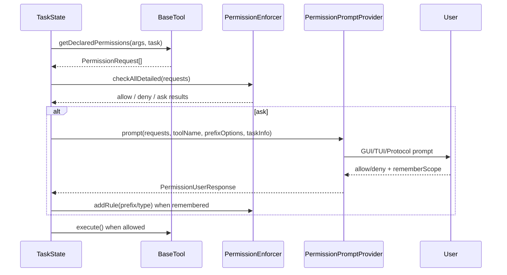

**使用场景**

- Agent 准备写 workspace 外的文件时，file tool 声明 write 权限，enforcer 返回 ask，GUI/TUI 弹出合并后的权限确认。
- 用户选择“始终允许当前目录”后，provider 写入 prefix 规则，后续同目录请求自动通过。
- 计划模式下 Agent 需要切回执行模式时，调用 exitPlanMode provider，由 GUI/TUI/ACP 决定如何展示和切换。
- 用户选择远端设备作为 execution host 后，terminal/file 类能力会转向 node execution 工具。

**具体使用场景**

| 场景                  | 触发动作                                  | 关键调用链                                                                       | 结果                               |
| --------------------- | ----------------------------------------- | -------------------------------------------------------------------------------- | ---------------------------------- |
| 写入 workspace 外文件 | Agent 调 `writeFile('/tmp/a.txt')`        | tool 声明 file/write → enforcer 返回 ask → GUI/TUI prompt → 用户选 prefix allow  | 本次或后续同路径写入通过           |
| 拒绝敏感路径          | Agent 读取系统密钥目录                    | file/read request → 默认/用户规则命中 deny                                       | tool result 失败，模型收到拒绝原因 |
| skill 读取资源        | Agent `loadSkill` 需要读 skill references | SkillResourcePath → ReadableDirectoryRegistry 已注册目录 → enforcer allow        | skill 渐进加载不反复弹窗           |
| OpenCode 权限回复     | 外部客户端收到 permission event           | ServerPermissionBroker.prompt → `/permission/:id/reply` → PermissionUserResponse | OpenCode 客户端驱动同一套权限流程  |

**定位与边界**

该模块为高风险工具提供统一权限判断，并把需要用户参与的 prompt 委托给 GUI/TUI/ACP/OpenCode 等 provider。

**内部结构**

```text
HarnessContext
  ├─ workspace
  ├─ PermissionEnforcer
  ├─ PermissionPromptProvider
  ├─ AskUserProvider
  ├─ ExitPlanModeProvider
  └─ executionHost(local/node)
```

**外部接口**

| 接口                               | 文件                           | 说明                            |
| ---------------------------------- | ------------------------------ | ------------------------------- |
| `PermissionRequest/Rule/Enforcer`  | `security/permission.ts`       | 权限抽象                        |
| `GlobPermissionEnforcer`           | `security/enforcer.ts`         | deny > ask > allow 的 glob 规则 |
| `HarnessContext.createForMode()`   | `security/harness.ts`          | 根据 mode 生成执行上下文        |
| `ElectronPermissionPromptProvider` | `security/electronPrompt.ts`   | GUI 权限队列与 IPC              |
| `TUIPermissionPromptProvider`      | `tui/components/permission.ts` | TUI 权限 overlay                |
| `AskUserTool/exitPlanMode`         | `interaction/tools.ts`         | Agent 与用户交互工具            |

**核心业务流**

1. 工具执行前，TaskState 收集 tool 的 `getDeclaredPermissions()`，交给 harness 的 enforcer 判断。
2. 命中 ask 时，通过当前 platform 注入的 prompt provider 弹 GUI/TUI/协议层确认。
3. 用户选择 allow/deny/remember 后，权限结果回写规则或本次执行，工具继续或失败。

**数据模型**

- `ResourcePath`：文件/网络/技能等资源路径，支持 prefix option。
- `PermissionRule`：action/resourceType/path/effect。
- `ExecutionHost`：本地或远端 node，影响 terminal/file 工具执行位置。

**设计决策**

- 默认规则允许 workspace、temp、skill 读，敏感路径和未知路径 ask，安全边界明确。
- `ReadableDirectoryRegistry` 给 skill/app 等模块登记可读目录，避免 aikernel 直接依赖应用目录。
- Prompt provider 注入避免 GUI/TUI/server 逻辑污染工具层。

### M05 Goal、Todo 与自动化控制

#### 功能模块视角

**功能边界**

Goal 负责“一个任务要持续达成什么目标”，Todo 负责“目标执行过程中有哪些必须完成的事项”和“应用事件是否触发自动化任务”。二者让 OpenDesk 从单轮问答扩展为可续跑、可被事件唤起、可在完成前自检的长任务系统。

**架构设计**

Goal 的核心由 `GoalService`、`GoalController`、`GoalScheduler`、`GoalEvaluator` 和 hook 组成。Service 是 GUI/TUI/API 的命令门面；Controller 管状态变更和事件记录；Scheduler 持有 lease，避免并发续跑；Evaluator 用结构化 LLM 输出判断目标 complete/blocked/continue。TodoMgr 作为应用进入 registry，任务 todo 和全局 todo 都由 todomgr 工具/worker 管理；registry 将应用事件额外转发给 todomgr worker 做触发匹配。

**架构图**

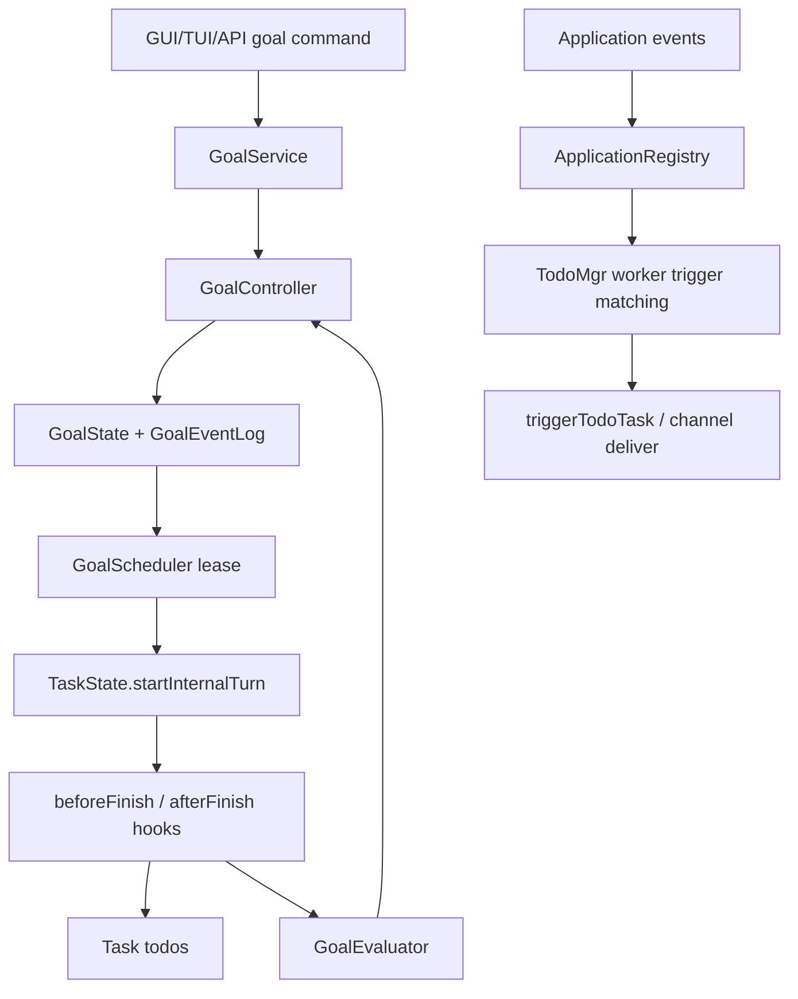

**接口设计**

| 接口                                           | 契约                                               |
| ---------------------------------------------- | -------------------------------------------------- |
| `GoalService.create/edit/pause/resume/clear()` | 用户或协议层操作 goal 的统一入口                   |
| `GoalController.applyEvaluation()`             | 将 evaluator 判断应用到 `GoalState`                |
| `GoalScheduler.startInternalTurn()`            | 获取续跑 lease，并向 task 注入 continuation prompt |
| `GoalEvaluator.evaluate()`                     | 用当前任务状态和目标状态生成结构化判断             |
| `registerGoalHooks()`                          | 在 Task 完成前后挂入目标自检和续跑逻辑             |
| `GoalState` / `GoalEvent`                      | 目标状态、补充信息、事件日志和 token baseline      |
| `TodoWriteTool` / todomgr worker               | Agent 更新任务 todo、处理全局 todo 触发            |
| `ApplicationRegistry.dispatchEvent()`          | 应用事件进入自动化系统的入口                       |

**接口调用关系**

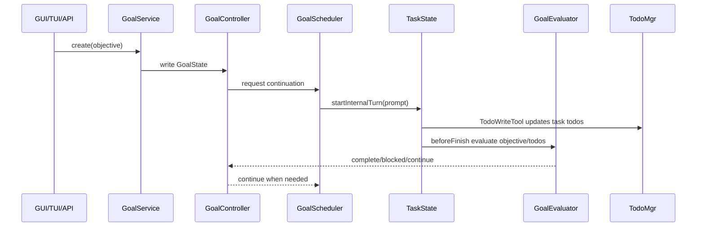

**使用场景**

- 用户创建“持续完成某个开发任务”的 goal，Agent 每轮结束前会检查 todo 和 objective 是否真正完成。
- 用户在目标执行中补充要求，`GoalService` 将 supplement 挂到 goal state，下一轮 materialize 到上下文。
- 邮件、渠道消息或浏览器等应用发出事件时，todomgr 匹配全局 todo 并创建自动化任务。
- 任务 token 使用超过基线很多时，goal evaluation 仍以原始 objective 和事件日志为依据，而不是只看最后一条消息。

**具体使用场景**

| 场景                   | 触发动作                     | 关键调用链                                                                 | 结果                                          |
| ---------------------- | ---------------------------- | -------------------------------------------------------------------------- | --------------------------------------------- |
| 创建长期开发目标       | 用户 `/goal fix flaky tests` | TUI command → `GoalService.create()` → `GoalScheduler.startInternalTurn()` | 任务开始自动规划和执行，目标状态写入 artifact |
| 完成前发现 todo 未做完 | Agent 准备结束               | `beforeFinish` hook → task todos 非空 → 注入 continuation prompt           | 任务继续处理未完成事项                        |
| 用户补充目标要求       | 用户输入“还要覆盖移动端”     | `GoalService.addSupplement()` → TaskState materialize supplement           | 下一轮执行看到补充约束                        |
| 应用事件触发任务       | mailbox worker 发 `newMail`  | registry → todomgr `handleApplicationEvent` → `triggerTodoTask`            | 自动创建 task 处理新邮件并可通过 channel 回复 |

**定位与边界**

Goal 模块让任务具备长期目标和自动续跑能力；Todo 模块提供任务/全局待办与应用事件触发自动化。

**内部结构**

```text
GoalService
  ├─ GoalController
  ├─ GoalScheduler
  ├─ GoalEvaluator
  └─ beforeFinish hook

TodoMgrApplication/Worker
  ├─ task todos
  ├─ global todos
  └─ triggerTodoTask
```

**外部接口**

| 接口                                         | 文件                          | 说明                            |
| -------------------------------------------- | ----------------------------- | ------------------------------- |
| `GoalService.create/edit/pause/resume/clear` | `goal/service.ts`             | GUI/TUI/API 统一命令入口        |
| `GoalController`                             | `goal/controller.ts`          | Goal 状态变更和事件记录         |
| `GoalScheduler`                              | `goal/scheduler.ts`           | 获取 lease 并启动/恢复内部 turn |
| `GoalEvaluator`                              | `goal/evaluator.ts`           | LLM 判断目标是否完成/阻塞       |
| `TodoWriteTool`                              | `applications/todomgr/app.ts` | Agent 更新任务 todo             |
| `ApplicationRegistry.dispatchEvent()`        | `registry.ts`                 | 应用事件转发给 todomgr 触发匹配 |

**核心业务流**

1. 创建目标：用户通过 GUI/TUI/IPC 调用 GoalService，TaskState 写入 `goal_state`，scheduler 注入起始 prompt。
2. 完成前检查：beforeFinish hook 检查未完成 todos；若无，则 LLM evaluator 判断目标状态，不满足时注入 continuation。
3. 自动化触发：应用发事件，registry 转发给 todomgr worker，匹配全局 todo 后创建/派发 task，必要时通过 channel 回复。

**数据模型**

- `GoalState`：objective/status/pending supplements/event log/token baseline。
- `GoalEventLog`：inline 或 artifact 事件。
- Todo：任务 todo 和全局 todo 两层，前者用于目标完成约束，后者用于事件自动化。

**设计决策**

- Goal 不直接依赖 UI，所有 UI 操作走 GoalService。
- Evaluator 使用 read-only 上下文和结构化输出，降低误判后直接终止的风险。
- todomgr 作为应用存在，事件触发与业务系统隔离，但 registry 对 todomgr 有显式转发耦合。

### M06 记忆、上下文与压缩

#### 功能模块视角

**功能边界**

记忆与压缩模块负责模型上下文窗口管理、任务内 session memory、全局/工作区长期记忆和用户画像。它不改变业务工具语义，而是在模型请求前后维护“哪些上下文还可见、哪些上下文被摘要或落盘”。

**架构设计**

上下文准备由 `prepareContextForModel()` 串起 active context view、tool result budget、microcompact、session memory compact、auto compact 和 full compact。大工具结果可落盘到 task artifact，只在上下文保留 preview。Session memory 使用 `session-memory.md` 作为任务级摘要文件，完整压缩保留最近 tail 和关键 assistant/tool/error/plan 边界。长期记忆由 `FactorialMemoryStore` 和 memory tools 管理，任务 idle 后的 review hook 可创建内部任务提取全局/工作区记忆和用户画像。

**架构图**

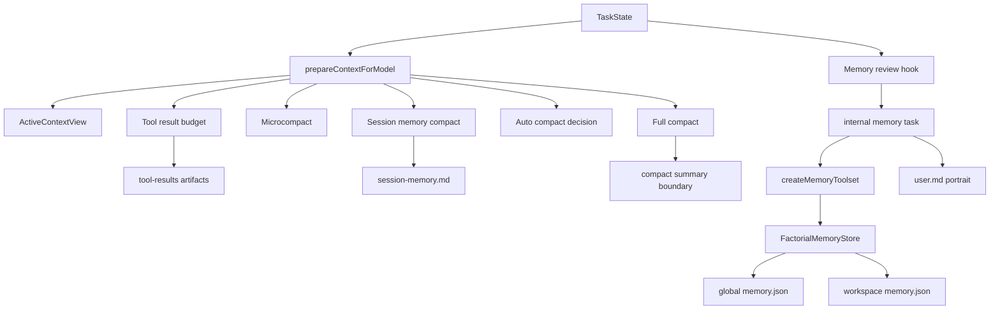

**接口设计**

| 接口                                                                    | 契约                                    |
| ----------------------------------------------------------------------- | --------------------------------------- |
| `prepareContextForModel(task, options)`                                 | 模型请求前的统一上下文准备入口          |
| `buildActiveContextView()` / `buildProjectedActiveContextView()`        | 把 chat context 转成可压缩视图          |
| `buildToolResultBudgetProjectionForChatContext()`                       | 计算大工具结果是否需要 preview/落盘替换 |
| `analyzeMicrocompactCandidates()`                                       | 挑选可轻量压缩的工具结果                |
| `buildSessionMemoryCompactPlan()` / `applySessionMemoryCompactResult()` | session memory 摘要边界规划和应用       |
| `buildFullCompactPlan()` / `applyFullCompactResult()`                   | 全量压缩规划和应用                      |
| `createMemoryToolset()`                                                 | add/remove/search/get memory 工具       |
| `registerMemoryReviewHook()`                                            | 任务空闲后自动更新长期记忆              |

**接口调用关系**

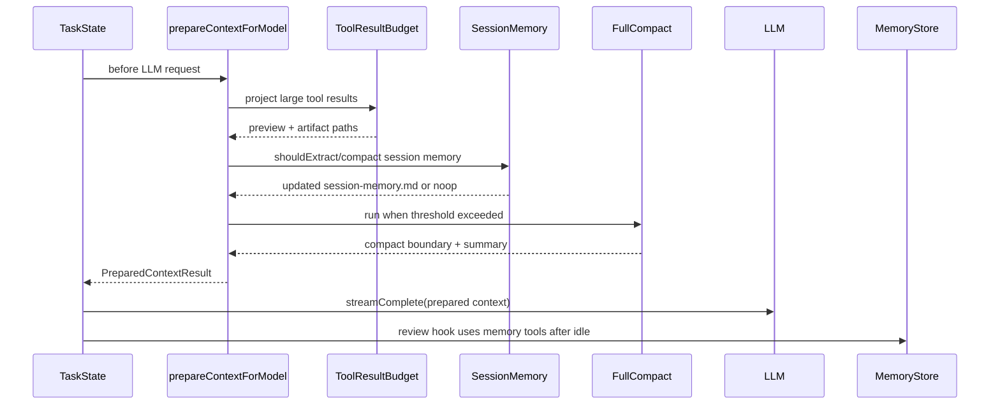

**使用场景**

- 长任务执行到上下文接近模型限制时，pipeline 先压缩大工具结果，再按阈值选择 session memory 或 full compact。
- Agent 读取大量文件后，原始 tool result 落到 artifact，后续上下文只保留路径和摘要，避免挤占窗口。
- 用户多次表达偏好或项目约定后，memory review 将其写入全局或工作区记忆，后续系统 prompt 可引用。
- 手动 compact 命令调用同一套压缩能力，只是触发时机由用户控制。

**具体使用场景**

| 场景                 | 触发动作                        | 关键调用链                                                                    | 结果                                           |
| -------------------- | ------------------------------- | ----------------------------------------------------------------------------- | ---------------------------------------------- |
| 大文件读取后继续对话 | Agent 读取长日志或源码文件      | `persistToolResultForToolCall()` → preview 替换 → artifact 路径进入上下文     | 模型保留可追溯路径，不携带完整大文本           |
| 长任务接近上下文限制 | 多轮工具调用后 token 估算超阈值 | `prepareContextForModel()` → session memory compact 或 full compact           | 旧消息被摘要，最近执行状态被保留               |
| 手动压缩             | 用户执行 `/compact`             | TUI command → `TaskState.manualCompact()` → full/session compact pipeline     | 当前任务上下文立即瘦身                         |
| 长期记忆更新         | 任务空闲且有新信息              | `registerMemoryReviewHook()` → internal task → `addMemory/updateUserPortrait` | 后续任务系统 prompt 可引用偏好、约定或用户画像 |

**定位与边界**

该模块处理长上下文窗口、任务内 session memory、全局长期记忆和用户画像。

**内部结构**

```text
prepareContextForModel
  ├─ active context
  ├─ tool result budget
  ├─ microcompact
  ├─ auto compact decision
  ├─ session memory compact
  └─ full compact

Memory
  ├─ FactorialMemoryStore
  ├─ memory tools
  ├─ user portrait
  └─ review hook
```

**外部接口**

| 接口                              | 文件                        | 说明                                          |
| --------------------------------- | --------------------------- | --------------------------------------------- |
| `prepareContextForModel`          | `compaction/pipeline.ts`    | 模型请求前统一上下文准备                      |
| `auto-compact.ts/full-compact.ts` | compaction                  | token 阈值、tail 保护、summary                |
| `SessionMemoryCompact`            | `session-memory-compact.ts` | 写 task artifact `session-memory.md`          |
| `FactorialMemoryStore`            | `memory/store.ts`           | JSON 长期记忆存储与搜索                       |
| `createMemoryToolset()`           | `memory/tools.ts`           | add/remove/search/get memory, update portrait |
| `memory/review.ts`                | memory                      | task idle 后内部记忆更新任务                  |

**核心业务流**

1. 模型请求前，TaskState 调用 compaction pipeline，先估 token，再决定微压缩、session memory、完整压缩。
2. 任务完成/空闲时，memory review hook 创建内部任务，让模型从会话提取长期记忆和用户画像更新。
3. Agent 系统提示中注入长期记忆、用户画像、AGENTS.md、skills 等动态段。

**数据模型**

- `session-memory/session-memory.md`：任务 artifact。
- memory JSON：全局/workspace 记忆，带 heat 搜索权重。
- compact state：失败阈值、cooldown、summary、保护尾部消息。

**设计决策**

- 压缩流水线分层，先用轻量策略，必要时才 full compact。
- full compact 保护最近 tail、assistant tool/error/plan 消息，减少执行状态丢失。
- 记忆更新通过内部任务和工具完成，复用 Agent 能力，但要避免内部任务递归触发 review。

### M07 GUI Renderer Shell

#### 功能模块视角

**功能边界**

GUI Renderer Shell 负责 Electron 桌面界面的展示、用户输入、任务流渲染、应用宿主和浏览器/设置/权限等组件。它不直接访问 Node 权限能力，所有主进程能力都必须经 preload 暴露的受控 API。

**架构设计**

主窗口 renderer 由 `index.html`、`scripts/index.js` 和 Web Components 组成。`preload.js` 根据 main frame、application frame、webview 等上下文暴露不同 API 集：主框架拿到 task、setting、permission、browser 等能力；应用 frame 拿到应用 bundle、main/worker call 和事件订阅；webview 走浏览器桥。应用宿主 `application-host.ts` 动态加载内置 renderer entry，外部应用资源走 protocol handler。任务更新从 main 的 subscriber 推送回来，renderer 只维护 UI 状态，权威状态仍在 `TaskState`。

**架构图**

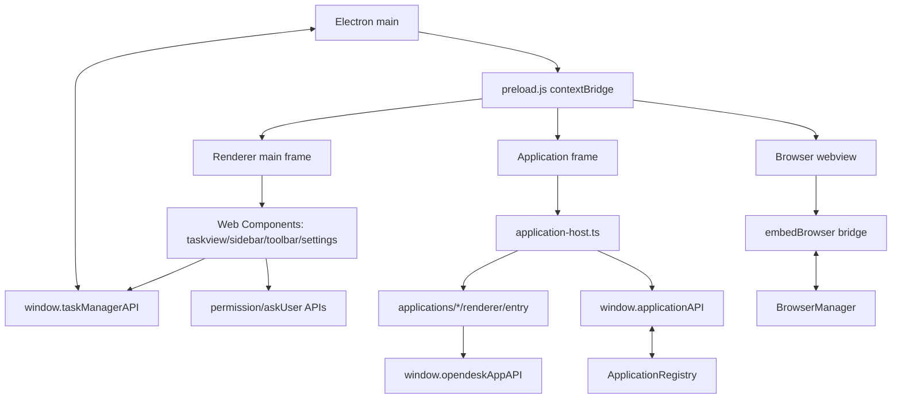

**接口设计**

| 接口                                        | 契约                                                                     |
| ------------------------------------------- | ------------------------------------------------------------------------ |
| `window.taskManagerAPI`                     | create/submit/stop/fork/compact/goal/todos/session memory/task artifacts |
| `window.applicationAPI`                     | 应用宿主设置 bundle、调用 app main/worker、订阅 app event                |
| `window.opendeskAppAPI`                     | 应用 iframe 内访问自身 bundle/config/call 能力                           |
| permission/askUser/exitPlanMode preload API | GUI overlay 与 main provider 的交互通道                                  |
| browser preload API                         | 嵌入式浏览器实例、tab、截图、snapshot 和 devtools                        |
| `safeSendToWebFrame()`                      | main 向 renderer frame 推送 task/application 更新的安全封装              |

**接口调用关系**

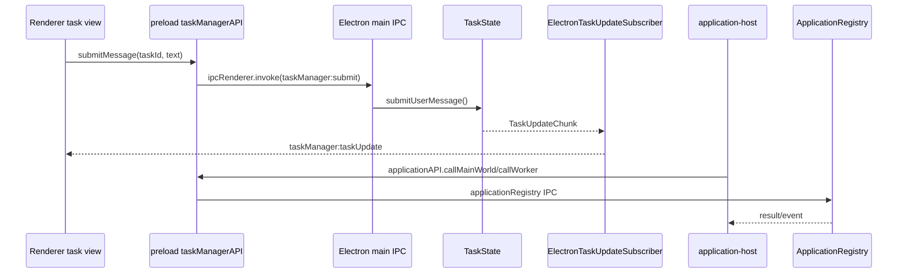

**使用场景**

- 用户在 task view 输入消息，renderer 调 `taskManagerAPI.submitMessage`，主进程执行后以 chunk 形式回推。
- 用户打开 Mailbox、SkillMgr、Browser 等应用时，application host 加载对应 renderer entry，并把应用调用转给 registry。
- 工具请求权限时，GUI permission overlay 显示同类请求和前缀授权选项，再把选择返回 provider。
- task artifact 面板展示 goal、todo、session memory、file changes、browser 等任务附属状态。

**具体使用场景**

| 场景         | 触发动作               | 关键调用链                                                                           | 结果                                                   |
| ------------ | ---------------------- | ------------------------------------------------------------------------------------ | ------------------------------------------------------ |
| 用户发送消息 | task view 输入并提交   | renderer → `taskManagerAPI.submitMessage` → main IPC → `TaskState` → subscriber 回推 | 页面流式显示 assistant、reasoning 和 tool card         |
| 打开内置应用 | 用户点击 SkillMgr 图标 | sidebar → application frame → `application-host.ts` → dynamic import renderer entry  | 应用 UI 挂载，可调用 main/worker 方法                  |
| 权限确认     | file tool 需要 ask     | main provider → renderer permission overlay → 用户选择 → IPC 返回 provider           | task 按用户决策继续或失败                              |
| 查看任务产物 | 用户打开 artifact 面板 | renderer 调 task artifact API → main 读取 task artifact/state                        | 展示 goal、todo、文件变更、session memory 或浏览器状态 |

**定位与边界**

Renderer 负责桌面 UI 表现，不直接访问 Node/Electron 权限能力；所有主进程能力经 preload 暴露。

**内部结构**

```text
preload.js
  ├─ taskManagerAPI
  ├─ applicationAPI / opendeskAppAPI
  ├─ setting/fs/native/window APIs
  ├─ permission/askUser/exitPlanMode
  └─ browserAPI

renderer/scripts
  ├─ index.js
  ├─ application-host.ts
  └─ components/*
```

**外部接口**

| API                     | 文件                                   | 说明                                                               |
| ----------------------- | -------------------------------------- | ------------------------------------------------------------------ |
| `window.taskManagerAPI` | `renderer/preload.js`                  | create/submit/stop/fork/compact/goal/todos/session memory 等       |
| `window.applicationAPI` | preload                                | main/worker/stream call 与应用事件订阅                             |
| `window.opendeskAppAPI` | preload/app host                       | 应用 iframe 获取 bundle/config/call                                |
| `task-artifacts`        | `renderer/components/taskartifacts.ts` | todos、goal、session memory、file changes、browser 等任务 artifact |
| `application-host.ts`   | renderer                               | 动态加载 `applications/**/renderer/entry` 并挂载                   |

**核心业务流**

1. 任务消息：renderer 调用 `taskManagerAPI.submitMessage`，main 侧 TaskState 执行，增量更新经订阅回到 task view。
2. 应用宿主：用户打开应用，application host 动态 import 对应 renderer entry，必要时创建 AI bar task。
3. 权限与交互：main 发送 permission/askUser 事件，renderer overlay 收集用户选择后回 IPC。

**数据模型**

- Renderer 主要持有 UI state；权威任务状态仍在 main 的 TaskState。
- Application frame 通过 bundleName 和 renderer entry 建立应用组件边界。

**设计决策**

- Preload 根据 main frame/sub app frame 区分暴露 API，减少子应用越权。
- 应用 renderer 通过 `import.meta.glob` 加载，适合内置应用；外部应用走 `opendesk-app://` 协议。
- Browser UI 与任务 artifact 结合，便于按 task 绑定浏览器实例。

### M08 CLI/TUI/Headless

#### 功能模块视角

**功能边界**

CLI/TUI/Headless 是桌面 GUI 之外的完整入口。TUI 提供交互式任务视图、输入框、快捷键、overlay 和 slash command；headless 提供无交互批处理执行。它们共享 AI kernel 和应用注册中心，不复制业务逻辑。

**架构设计**

`cli.ts` 解析 commander 参数后初始化 `CliPlatform`、registry、worker、locale、setting 和 agent registry。TUI 聚合根是 `OpenDeskTUI`，内部维护 active task、task view、input queue、prompt queue、shortcut registry、slash command registry 和 before-exit hooks。应用可通过 `getCliSlashCommands()` 注入命令。Headless 使用 `HeadlessRunner` 创建 task、设置 mode/harness、提交命令并按 80 列输出 chunk；因为没有交互 UI，权限 ask provider 返回拒绝或明确错误。

**架构图**

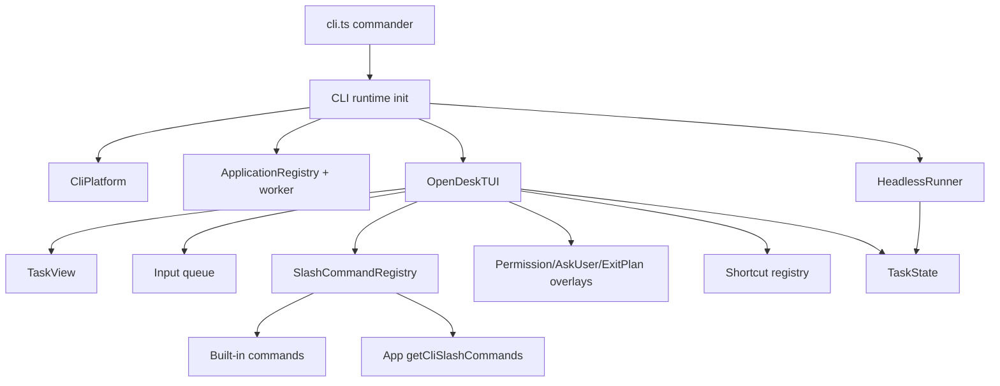

**接口设计**

| 接口                                      | 契约                                                       |
| ----------------------------------------- | ---------------------------------------------------------- |
| `CommandLineArgs`                         | workspace、model、profile、mode、headless、app CLI options |
| `OpenDeskTUI.onRequestSubmit()`           | 普通输入或 goal supplement 的入口                          |
| `OpenDeskTUI.setMode()` / `cycleMode()`   | TUI 内切换 agent mode 并重建 harness                       |
| `SlashCommandRegistry.register/execute()` | 命令注册、补全和执行协议                                   |
| app `getCliSlashCommands(tui)`            | 应用向 TUI 注入 `/mail`、`/calendar`、`/devices` 等命令    |
| `HeadlessRunner.execute(command)`         | 无交互执行入口                                             |
| TUI prompt providers                      | 权限、askUser、exitPlanMode 的终端 overlay 实现            |

**接口调用关系**

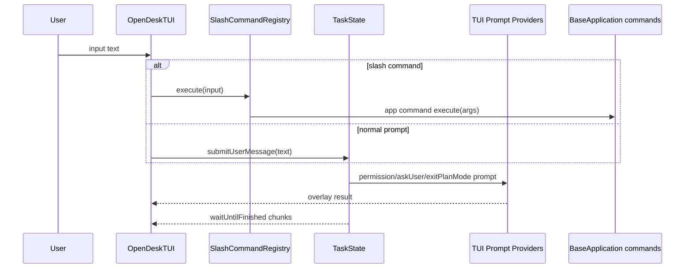

**使用场景**

- 用户在终端里持续和 Agent 对话，TUI 将非 slash 输入提交给 active task。
- 用户输入 `/goal`、`/model`、`/compact`、`/mail` 等命令时，slash registry 分发到内置或应用命令。
- CI 或脚本用 headless 模式执行一次性请求，只接收文本输出，不打开 UI。
- TUI 中出现权限、确认或配置弹窗时，prompt queue 保证焦点恢复和 overlay 顺序符合规范。

**具体使用场景**

| 场景         | 触发动作                          | 关键调用链                                                                                  | 结果                                  |
| ------------ | --------------------------------- | ------------------------------------------------------------------------------------------- | ------------------------------------- |
| 终端连续对话 | 用户输入普通文本                  | `OpenDeskTUI.onRequestSubmit()` → active task `submitUserMessage()` → `waitUntilFinished()` | TUI task view 增量渲染回答和工具      |
| 切换模型     | 用户输入 `/model`                 | `SlashCommandRegistry.execute()` → `registerModelCommand` handler → 更新 task/model setting | 后续 turn 使用新模型                  |
| 应用命令     | 用户输入 `/mail`                  | registry ready 后应用 command 注册 → mailbox TUI overlay                                    | 用户在终端查看邮件状态或执行邮箱操作  |
| 无交互脚本   | 用户执行 `opendesk -c "生成摘要"` | `HeadlessRunner.execute()` → headless permission provider → block 输出                      | 脚本拿到稳定文本输出，不依赖 TUI 组件 |

**定位与边界**

TUI 是 GUI 之外的交互完整入口；headless 是无交互批处理入口。二者共享 TaskManagerState、MainAgentDecl、ApplicationRegistry。

**内部结构**

```text
cli.ts
  ├─ OpenDeskTUI
  │    ├─ TaskView/Input/GoalPanel/TodoList/Dashboard
  │    ├─ SlashCommandRegistry
  │    └─ Permission/AskUser providers
  └─ HeadlessRunner
```

**外部接口**

| 接口                        | 文件                    | 说明                       |
| --------------------------- | ----------------------- | -------------------------- |
| `OpenDeskTUI`               | `tui/entry.ts`          | TUI 聚合根                 |
| `SlashCommandRegistry`      | `tui/commands/base.ts`  | 注册/执行 slash 命令和补全 |
| `registerAllCommands()`     | `tui/commands/index.ts` | 内置命令注册               |
| app `getCliSlashCommands()` | 各应用                  | 应用向 TUI 注入命令        |
| `HeadlessRunner.execute()`  | `tui/headless.ts`       | 无交互执行一条命令并输出   |

**核心业务流**

1. TUI 输入：input area 判断 slash command，否则提交 active task；goal active 时可能转为 supplement。
2. Slash command：内置命令和应用命令共用 registry，如 `/goal`, `/mail`, `/calendar`, `/devices`。
3. Headless：创建 task、设置 mode/harness、提交命令；权限 ask 在无交互模式直接拒绝并输出日志。

**数据模型**

- TUI active task、undo stack、shortcut registry、pending prompt actions。
- Headless flushedParts 用来避免重复输出流式 part。

**设计决策**

- TUI prompt provider 内置队列，配合 overlay 状态避免多个弹窗抢焦点。
- 应用命令延迟到 ApplicationRegistry ready 后注册，确保内置/外部应用都可参与。
- Headless 固定 80 列块级输出，减少流式 UI 依赖。

### M09 Serve/兼容协议

#### 功能模块视角

**功能边界**

Serve 模块把 OpenDesk 的 Task Runtime 适配给外部 Agent 客户端。它只做协议转换、session 映射、事件推送、权限/问答桥接和配置兼容，不重新实现模型、工具或权限系统。

**架构设计**

`opendesk serve` 基于 CLI runtime 初始化 registry、worker 和 `TaskManagerState`。ACP 走 stdio，`OpenDeskAcpAgent` 实现 session、mode、model、prompt、cancel 等方法，并用 `AcpUpdateTranslator` 把 OpenDesk task chunk 翻译成 ACP update。OpenCode 走 Hono HTTP/SSE，routes 按 session、event、config、provider、MCP、permission、question 分组；`EventBus` 负责进程内 SSE 广播；permission/question broker 实现 OpenDesk provider 接口。

**架构图**

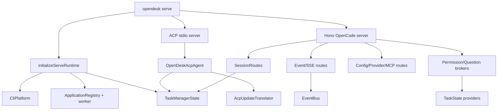

**接口设计**

| 接口                                                         | 契约                                                  |
| ------------------------------------------------------------ | ----------------------------------------------------- |
| `startAcpServer()`                                           | 安装 stdout guard，启动 ACP stdio AgentSideConnection |
| `OpenDeskAcpAgent.newSession/prompt/cancel/setSessionMode()` | ACP session 到 TaskState 的映射                       |
| `AcpPermissionPromptProvider` / `AcpAskUserProvider`         | ACP elicitation 或 permission tool call 桥接          |
| `listen(ServerOptions)`                                      | 启动 OpenCode Hono server                             |
| `SessionRoutes()`                                            | `/session` 创建、消息提交、异步 prompt、状态查询      |
| `PermissionRoutes()` / `QuestionRoutes()`                    | 外部客户端回复权限和 askUser 请求                     |
| `EventBus.subscribe()`                                       | session/global event SSE 推送                         |
| config/provider/MCP routes                                   | OpenCode 配置模型、provider 和 MCP 状态兼容层         |

**接口调用关系**

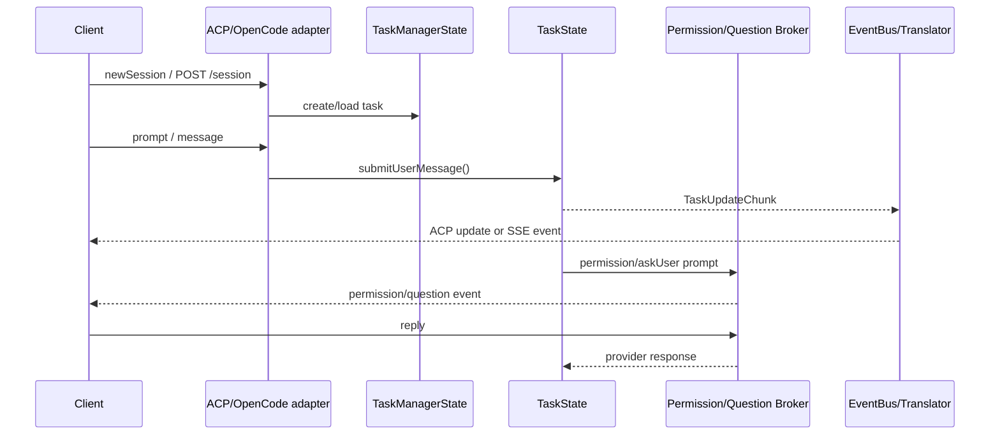

**使用场景**

- 支持 ACP 的编辑器或 Agent 客户端通过 stdio 创建 session 并发送 prompt。
- OpenCode 兼容客户端通过 HTTP 创建 `ses_*`，服务端映射到 OpenDesk `task_*`。
- 外部客户端收到 permission/question event 后调用 reply route，broker 将其转换为 OpenDesk provider 响应。
- 客户端更新 provider/model 配置时，config compat 写入 `Setting` 并通知 task context 和 skill 刷新。

**具体使用场景**

| 场景                | 触发动作                                | 关键调用链                                                                                                 | 结果                                       |
| ------------------- | --------------------------------------- | ---------------------------------------------------------------------------------------------------------- | ------------------------------------------ |
| ACP 编辑器发 prompt | 客户端调用 ACP `newSession` 和 `prompt` | `OpenDeskAcpAgent` → `configureTaskForSession()` → `TaskState.submitUserMessage()` → `AcpUpdateTranslator` | 编辑器收到 text/tool/status update         |
| OpenCode HTTP 会话  | 客户端 `POST /session/:id/message`      | `SessionRoutes` → `ensureServerTaskHarness()` → task submit → `EventBus`                                   | 客户端通过 SSE 收到 session/message/part   |
| 外部权限确认        | task 触发 file write ask                | `ServerPermissionBroker.prompt()` → SSE permission event → `/permission/:id/reply`                         | 外部客户端控制 allow once/always/reject    |
| 修改模型配置        | 客户端 `PATCH /config`                  | config compat merge → `Setting.setData()` → notify registry/worker/task contexts                           | OpenCode 客户端配置同步到 OpenDesk runtime |

**定位与边界**

Serve 模块把 OpenDesk task runtime 暴露为第三方 Agent 协议，主要是 ACP stdio 和 OpenCode HTTP/SSE。

**内部结构**

```text
opendesk serve
  ├─ initializeServeRuntime
  ├─ ACP AgentSideConnection
  └─ OpenCode Hono server
        ├─ session routes
        ├─ permission/question routes
        ├─ config/provider/mcp routes
        └─ EventBus
```

**外部接口**

| 接口                   | 文件                                   | 说明                                     |
| ---------------------- | -------------------------------------- | ---------------------------------------- |
| `opendesk serve`       | `tui/subcommands/serve.ts`             | 启动 ACP/OpenCode                        |
| `OpenDeskAcpAgent`     | `server/acp/agent.ts`                  | ACP session/new prompt/cancel/model/mode |
| `createOpenCodeServer` | `server/opencode/server.ts`            | Hono app 路由                            |
| `/session` routes      | `server/opencode/routes/session.ts`    | OpenCode session 与 TaskState 映射       |
| `PermissionBroker`     | `server/opencode/permission-broker.ts` | OpenCode permission asked/replied        |

**核心业务流**

1. ACP prompt：客户端创建 session，ACP agent 创建 TaskState，设置 workspace/harness/provider，提交 prompt，翻译 task updates。
2. OpenCode session：HTTP 请求创建/获取 session，`ses_` 映射到 `task_`，EventBus 发布 session/message/part 事件。
3. 权限兼容：OpenCode permission route 与 OpenDesk PermissionPromptProvider 互转 allow/deny/once/always。

**数据模型**

- ACP persisted model/mode/session。
- OpenCode session id/task id map、EventBus event id、permission question。

**设计决策**

- serve 初始化使用 CliPlatform，不启动 Electron GUI。
- 协议层尽量薄，TaskState 仍是唯一执行实体。
- OpenCode routes 同时映射设置、provider、MCP、permission，方便外部客户端完整接入。

### M10 浏览器自动化

#### 功能模块视角

**功能边界**

浏览器模块同时服务人类用户的嵌入式浏览器和 Agent 的浏览器自动化。通用 CDP 控制库保持和 OpenDesk UI 解耦，OpenDesk browser app 负责 webview、任务侧栏、下载、证书、清理数据、skill 和工具包装。

**架构设计**

`src/common/embedBrowserUse` 定义通用协议、preload bridge、renderer `BrowserInstance`、main 侧 `BrowserManager/BrowserController` 和 CDP session。`BrowserController` 按 task/browser instance id 控制 webview，所有导航、点击、输入、上传、键盘、tab、snapshot、evaluate 等动作都走互斥锁，避免并发操作破坏页面状态。`applications/browser` 注入 `BrowserScriptGenerators`，在工具调用前展开侧栏、激活对应浏览器并处理 OpenDesk 特有 UI 状态。

**架构图**

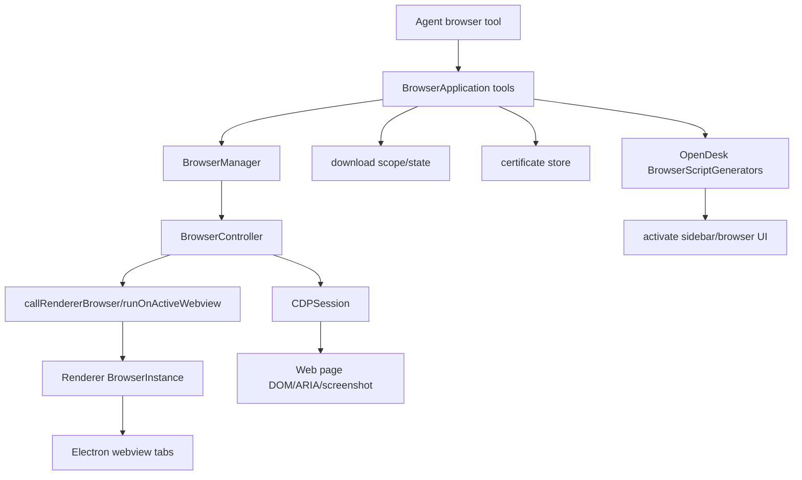

**接口设计**

| 接口                                                            | 契约                                                                             |
| --------------------------------------------------------------- | -------------------------------------------------------------------------------- |
| `defineBrowserBridge()`                                         | preload 暴露 `BrowserBridgeAPI` 给 renderer                                      |
| `BrowserBridgeAPI.navigate/getState/listTabs/...`               | renderer browser instance 到 main controller 的 IPC 契约                         |
| `BrowserManager.bind()`                                         | 注册 Electron IPC handler 和 renderer 调用桥                                     |
| `BrowserManager.getOrCreateController(id)`                      | 按任务/实例获取浏览器控制器                                                      |
| `BrowserController.navigate/snapshot/click/type/uploadFile/...` | Agent 浏览器动作的底层控制接口                                                   |
| `BrowserScriptGenerators`                                       | OpenDesk 注入“准备 UI”的脚本，不污染通用库                                       |
| Browser tools                                                   | `navigate/snapshot/click/type/upload/hover/key/select/scroll/tabs/wait/evaluate` |
| Browser app main methods                                        | 下载打开、缓存/cookie/storage 清理、证书导入/删除、snapshot 导出                 |

**接口调用关系**

```mermaid
sequenceDiagram
    participant Agent
    participant Tool as BrowserTool
    participant App as BrowserApplication
    participant Ctrl as BrowserController
    participant Renderer as BrowserInstance/webview
    participant CDP as CDPSession
    Agent->>Tool: browser.click/type/navigate(args)
    Tool->>App: getController(taskId)
    App->>Ctrl: action(args)
    Ctrl->>Renderer: beforeCallRenderer hooks/focus
    Ctrl->>CDP: DOM/Runtime/Input/Page commands
    CDP-->>Ctrl: page info/snapshot/result
    Ctrl-->>Tool: structured result
    Tool-->>Agent: ToolResult with optional snapshot/downloads
```

**使用场景**

- 用户在 GUI 打开 Browser 应用浏览网页，renderer tab/history/bookmark 维护人类操作体验。
- Agent 需要登录网页、检索信息、填表或下载文件时，通过 browser tool 驱动同一个 webview。
- 自动下载 scope 把工具触发的下载路径写入 tool result，便于 Agent 后续处理文件。
- 企业内网站证书不被系统信任时，Browser app 维护用户证书 store，并在证书校验钩子中匹配 fingerprint。

**具体使用场景**

| 场景               | 触发动作                          | 关键调用链                                                                        | 结果                                         |
| ------------------ | --------------------------------- | --------------------------------------------------------------------------------- | -------------------------------------------- |
| Agent 打开网页检索 | 模型调用 `browser.navigate`       | BrowserNavigateTool → controller `navigate()` → renderer webview → CDP page ready | 返回 URL/title，可继续 snapshot/click        |
| 表单自动填写       | 模型调用 `browser.type` 和 submit | tool → controller `type()` → focus webview → CDP input events → optional snapshot | 页面完成输入或提交，Agent 获得新页面结构     |
| 上传本地文件       | 模型调用 `browser.uploadFile`     | 权限检查 file/read → controller 解析 input → CDP set files 或 synthetic frame     | 网页 file input 收到目标文件                 |
| 下载文件后处理     | 网页触发下载                      | Browser app download scope → 保存到 workspace 下载目录 → tool result 附下载记录   | Agent 可接着 readFile/extractText 处理下载物 |

**定位与边界**

浏览器模块分两层：`src/common/embedBrowserUse` 是通用 Electron/CDP 浏览器控制库；`applications/browser` 是 OpenDesk 应用适配。

**内部结构**

```text
embedBrowserUse
  ├─ protocol.ts
  ├─ preload.ts
  ├─ renderer.ts BrowserInstance
  ├─ main.ts BrowserManager/BrowserController
  └─ cdp/*

OpenDesk browser app
  ├─ app.ts tools/skills/download/cert
  ├─ utils.ts UI hook injection
  └─ renderer/browser.ts webview tabs
```

**外部接口**

| 接口                              | 文件                                 | 说明                                                                           |
| --------------------------------- | ------------------------------------ | ------------------------------------------------------------------------------ |
| `defineBrowserBridge`             | `common/embedBrowserUse/preload.ts`  | preload 暴露 browser IPC                                                       |
| `BrowserInstance`                 | `common/embedBrowserUse/renderer.ts` | renderer 浏览器抽象                                                            |
| `BrowserManager.bind/initSession` | `common/embedBrowserUse/main.ts`     | 主进程控制器与 IPC                                                             |
| `BrowserScriptGenerators`         | `common/embedBrowserUse/main.ts`     | 注入 OpenDesk UI 准备脚本                                                      |
| Browser tools                     | `applications/browser/tools.ts`      | navigate/snapshot/click/type/upload/hover/key/select/scroll/tabs/wait/evaluate |

**核心业务流**

1. 渲染侧 `EmbeddedBrowser` 注册 taskId 实例到 preload bridge，主进程 `BrowserController` 可按 id 驱动该 webview。
2. Agent 调用 browser tool，tool 找 controller，controller 通过 renderer bridge/CDP 执行导航、点击、输入、截图和 ARIA snapshot。
3. 下载/证书/缓存等浏览器管理能力由 browser app 在 Electron main 中处理，并向 renderer 广播状态。

**数据模型**

- `BrowserState`, `TabInfo`, `PageSnapshot`, IPC response envelope。
- Browser app 下载记录、自动下载 scope、证书 store。

**设计决策**

- 通用库不引入 OpenDesk UI 逻辑，通过 `BrowserScriptGenerators` 注入“展开侧栏/激活浏览器”等脚本。
- CDP action 有互斥锁，避免并发点击/输入冲突。
- snapshot 使用 ARIA tree，给 Agent 结构化页面状态，而不是只给截图。

### M11 文件、搜索与存储索引

#### 功能模块视角

**功能边界**

文件、搜索与存储模块提供本地文件操作、文本抽取、glob/grep、语义文件索引、Web/学术搜索和通用结构化存储。它是 Agent 访问本地知识、外部网页和可检索业务数据的基础层。

**架构设计**

filemgr main 应用暴露工具，worker 负责文件系统扫描、索引和 embedding 队列。工具层只做路径规范化、权限声明、diff/render 和 worker 调用，实际索引写入由 `FSStorage` 和 storage 服务完成。`services/storage` 分为 `BaseStorage` 协调层、Base/BM25/Tag/Vector/Chunk indexer、底层 SQLite/WASM/ArkData DB 实现。Search app 再封装 WebSearch、AcademicSearch 和 WebFetch，把 provider 差异隐藏在应用配置中。

**架构图**

```mermaid
flowchart TB
    Agent[Agent file/search tools] --> FileTools[filemgr tools]
    FileTools --> Permission[file read/write permissions]
    FileTools --> FS[local filesystem]
    FileTools --> Worker[FileManagerWorker]
    Worker --> Scanner[FSScanner]
    Scanner --> FSStorage[FSStorage]
    FSStorage --> BaseStorage[BaseStorage]
    BaseStorage --> BaseIndexer[BaseIndexer]
    BaseStorage --> BM25[BM25Indexer]
    BaseStorage --> Vector[VectorIndexer]
    BaseStorage --> Chunk[ChunkIndexer]
    BaseStorage --> Tag[TagIndexer]
    BaseIndexer --> DB[SQLite/WASM/ArkData]
    BM25 --> DB
    Vector --> DB
    Chunk --> DB
    SearchApp[SearchApplication] --> WebSearch[WebSearch/AcademicSearch/WebFetch]
    Agent --> SearchApp
```

**接口设计**

| 接口                                               | 契约                                                                     |
| -------------------------------------------------- | ------------------------------------------------------------------------ |
| `createFileManagerToolset()`                       | read/write/edit/searchReplace/glob/grep/extract/semantic search 工具集合 |
| file tool `getDeclaredPermissions()`               | 对具体路径声明 file read/write 权限                                      |
| `FileManagerWorker.getFileSystemStatus()`          | 返回扫描、索引、embedding 状态                                           |
| `FileManagerWorker.searchIndexedFiles()`           | 语义/关键词文件索引搜索                                                  |
| `BaseStorage.insert/update/upsert/delete/search()` | 业务存储唯一推荐 API                                                     |
| `FilterCondition` / `SearchItem`                   | 跨 Base/BM25/Vector/Tag/Chunk 的查询与结果模型                           |
| `BaseStorage.getSemanticWriteState()`              | 判断当前是否可接受语义写入                                               |
| `WebSearchTool/AcademicSearchTool/WebFetchTool`    | Web 搜索、学术搜索和网页抓取工具                                         |

**接口调用关系**

```mermaid
sequenceDiagram
    participant Agent
    participant Tool as File/Search Tool
    participant Perm as PermissionEnforcer
    participant Worker as FileManagerWorker
    participant Storage as BaseStorage
    participant Provider as WebSearch Provider
    Agent->>Tool: read/write/grep/semanticSearch/webSearch
    Tool->>Perm: declared file/network permission
    alt local file op
        Tool->>Tool: fs read/write/edit + render diff
    else indexed search
        Tool->>Worker: searchIndexedFiles(query)
        Worker->>Storage: search(FilterCondition[])
        Storage-->>Worker: SearchItem[]
    else web search
        Tool->>Provider: search/fetch
        Provider-->>Tool: normalized results
    end
    Tool-->>Agent: markdown/structured ToolResult
```

**使用场景**

- Agent 读取、修改项目文件时，file tool 先声明路径权限，再执行 fs 操作并向 GUI/TUI 渲染 diff。
- 用户配置索引目录后，filemgr worker 后台扫描文件，保存 metadata、全文和向量索引。
- Agent 需要在项目资料中找信息时，semantic search 走 worker 和 storage 多索引检索。
- Agent 需要联网查资料时，Search app 根据默认 channel 选择 Tavily、Brave、Bocha、Exa、Bing 等 provider。

**具体使用场景**

| 场景         | 触发动作                  | 关键调用链                                                                                    | 结果                         |
| ------------ | ------------------------- | --------------------------------------------------------------------------------------------- | ---------------------------- |
| 修改源码文件 | Agent 调 `editFile`       | path normalize → file/write permission → 读取旧内容 → 应用 patch/search replace → diff render | 文件被更新，GUI/TUI 展示变更 |
| 项目语义检索 | Agent 调 `semanticSearch` | file tool → worker `searchIndexedFiles()` → `BaseStorage.search()` → Vector/BM25/Chunk 合并   | 返回相关文件片段和路径       |
| 后台索引目录 | 用户配置 indexed entries  | Setting change → filemgr worker scanner → `saveFiles`/embedding queue → FSStorage             | 工作区文件进入全文和向量索引 |
| 外部网页查询 | Agent 调 `webSearch`      | SearchApplication config → provider facade → HTTP API → 标准化 markdown                       | 模型获得可引用的网页搜索摘要 |

**定位与边界**

该模块提供本地文件读写/搜索、语义索引、Web 搜索和通用 storage。

**内部结构**

```text
filemgr
  ├─ tools.ts read/write/edit/search/glob/grep/extract
  ├─ worker.js FSScanner + FSStorage
  └─ storage/search-indexed/parser

services/storage
  ├─ BaseStorage
  ├─ Base/BM25/Vector/Tag/Chunk Indexer
  └─ node/wasm DB implementations

search app
  ├─ WebSearch facade
  ├─ AcademicSearch facade
  └─ WebFetch
```

**外部接口**

| 接口                                                       | 文件                                   | 说明                                                            |
| ---------------------------------------------------------- | -------------------------------------- | --------------------------------------------------------------- |
| `createFileManagerToolset()`                               | `filemgr/tools.ts`                     | readFile/extractText/writeFile/editFile/searchReplace/glob/grep |
| `SemanticSearchTool`                                       | `filemgr/tools.ts`                     | 调 worker `searchIndexedFiles`                                  |
| `FileManagerWorker.getFileSystemStatus/searchIndexedFiles` | `filemgr/worker.js`                    | 扫描状态与索引搜索                                              |
| `BaseStorage`                                              | `services/storage/abstract-storage.ts` | 业务唯一 storage API                                            |
| `WebSearchTool/AcademicSearchTool/WebFetchTool`            | `search/tools/*`                       | 统一搜索与网页抓取工具                                          |

**核心业务流**

1. 文件读写：工具规范化路径、声明权限、执行 fs 操作、生成 GUI/TUI render 和 diff。
2. 文件索引：worker 启动 scanner，`fast-glob` 扫描 entries，批量 `saveFiles` 到 FSStorage；语义 embedding 队列异步写入。
3. 搜索：`SearchApplication` 根据配置启用统一 `WebSearch`/`AcademicSearch` 工具，具体 provider 由 app config 决定。

**数据模型**

- `FileEntrySchema`/FSStorage scanner state：root、last_full_scan、unavailable_roots、probe_error。
- `BaseStorage.Item`：`item_id`, `item_type`, dynamic columns, `indexer_columns`。
- `FilterCondition`/`SearchItem`：跨索引搜索输入输出。

**设计决策**

- filemgr worker 明确要求 scan、config change、rebuild、reset 全部通过 `runSequentially` 串行，避免 scan/rebuild/embedding 写入并发破坏。
- Storage 三层架构：BaseStorage 协调层、Indexer 语义层、IndexDB 实现层。
- WebSearch/AcademicSearch facade 保持工具名稳定，渠道差异隐藏在应用配置中。

### M12 Skill、MCP 与应用工坊

#### 功能模块视角

**功能边界**

该模块负责 OpenDesk 的能力生态：Agent Skill 的发现与渐进加载、MCP server 的连接与工具包装、用户应用的安装/版本管理/修改工作流。它让能力扩展可以通过文件目录、外部进程、远程 registry 或 OpenDesk app 包进入系统。

**架构设计**

Skill 由 `aikernel/skill.ts` 定义运行时协议，`skillmgr` 负责安装、扫描、启停、依赖分析、测试和 registry 搜索。`SkillRegistry` 聚合各应用的 skill provider，系统 prompt 只注入 frontmatter，完整内容和 references/scripts/assets 通过 `loadSkill` 渐进加载。MCP 由 `mcpmgr` main 应用管理配置，worker 维护 stdio/SSE/streamableHttp 连接和 discovered tools。AppMgr 管理用户应用目录、manifest、版本和修改任务，外部 app 被包装成 `ExternalManifestApplication` 进入 registry。

**架构图**

```mermaid
flowchart TB
    Agent[Agent] --> SkillTools[loadSkill/callSkill]
    SkillTools --> SkillRegistry[SkillRegistry]
    SkillRegistry --> SkillProviders[Application skill providers]
    SkillProviders --> SkillMgr[SkillMgrApplication]
    SkillMgr --> SkillDirs[user/config/mount skill dirs]
    SkillMgr --> Analyzer[SkillAnalyzer/test/dependency]

    Agent --> MCPTools[MCPTool wrappers]
    MCPTools --> McpApp[McpMgrApplication]
    McpApp --> McpWorker[McpMgrWorker]
    McpWorker --> McpServers[MCP stdio/SSE/HTTP servers]
    McpApp --> McpRegistry[MCP registries]

    Agent --> AppMgrTools[AppMgr tools]
    AppMgrTools --> AppMgr[AppMgrApplication]
    AppMgr --> Store[AppManagerStore]
    Store --> ExternalApps[ExternalManifestApplication]
    ExternalApps --> ApplicationRegistry[ApplicationRegistry]
```

**接口设计**

| 接口                                                                           | 契约                                          |
| ------------------------------------------------------------------------------ | --------------------------------------------- |
| `Skill.parseMd()` / `SkillFrontmatter`                                         | 解析和校验 `SKILL.md` 元数据                  |
| `SkillRegistry.getSkillFrontmatterXml()`                                       | 给系统 prompt 注入可用技能摘要                |
| `LoadSkillTool` / `CallSkillTool`                                              | Agent 渐进加载或调用 skill handler 的工具     |
| `SkillMgrApplication.getSkills()`                                              | skill 管理能力自身也以 skill 形式暴露         |
| `McpMgrApplication.add/update/delete/toggleServer()`                           | MCP server 配置管理                           |
| `McpMgrWorker.connectServer/disconnectServer/getDiscoveredTools/callMcpTool()` | MCP 连接和调用执行面                          |
| `MCPTool`                                                                      | 把 MCP JSON schema 包装成 OpenDesk `BaseTool` |
| `AppManagerStore.installFromZip/installFromDirectory/createNewVersion()`       | 用户应用包和版本状态管理                      |
| `AppMgrApplication.requestModifyApp()`                                         | 创建应用修改任务，完成后更新或回滚版本        |

**接口调用关系**

```mermaid
sequenceDiagram
    participant Agent
    participant Skill as SkillRegistry/LoadSkillTool
    participant SkillMgr as SkillMgrApplication
    participant McpApp as McpMgrApplication
    participant McpWorker as McpMgrWorker
    participant AppMgr as AppMgrApplication
    participant Registry as ApplicationRegistry
    Agent->>Skill: get frontmatter / loadSkill
    Skill->>SkillMgr: provider getSkills()
    Skill-->>Agent: SKILL.md content/resources
    Agent->>McpApp: MCPTool.execute(args)
    McpApp->>McpWorker: callMcpTool(serverId, toolName, args)
    McpWorker-->>McpApp: MCP result
    Agent->>AppMgr: install/list/create/modify app tool
    AppMgr->>Registry: reloadExternalApplications()
```

**使用场景**

- 用户安装一个 Skill 后，系统 prompt 只显示名称和描述；Agent 真正需要时调用 `loadSkill` 读取详细说明和资源。
- 用户添加 MCP server 后，worker 连接并监听 `tools/list_changed`，Agent 看到的是普通 OpenDesk tool。
- 用户从 zip 或目录安装外部应用，appmgr 校验 manifest 和路径安全后注册为应用。
- 用户要求“修改这个应用”时，appmgr 新建版本并启动 solo-mode task，Agent 修改应用文件，完成后激活新版本。

**具体使用场景**

| 场景            | 触发动作                                      | 关键调用链                                                                            | 结果                                  |
| --------------- | --------------------------------------------- | ------------------------------------------------------------------------------------- | ------------------------------------- |
| 使用某个 Skill  | 模型看到 skill frontmatter 后调用 `loadSkill` | `LoadSkillTool` → `SkillRegistry.getSkill()` → 读取 `SKILL.md` 和 references          | Agent 获得完整步骤、脚本或资源说明    |
| MCP 工具执行    | 模型调用 `mcp_server_tool`                    | `MCPTool.execute()` → `McpMgrApplication.callWorker()` → `McpMgrWorker.callMcpTool()` | MCP server 返回结果并写入 tool result |
| 安装 MCP server | 用户通过 GUI/TUI 或 skill 配置                | `McpMgrApplication.addServer()` → Setting 更新 → worker `syncConnections()`           | 新 MCP 工具被发现并暴露给 Agent       |
| 修改外部应用    | 用户在 AppMgr 点击“修改”                      | `requestModifyApp()` → `createNewVersion()` → 创建 solo task → 完成后激活版本         | 用户应用更新，同时保留版本回滚点      |

**定位与边界**

该模块负责 Agent 能力生态：Anthropic Agent Skills、本地/远程 MCP server、OpenDesk 外部应用。

**内部结构**

```text
aikernel/skill.ts
  ├─ Skill
  ├─ LoadSkillTool
  ├─ CallSkillTool
  └─ AISkillRegistry

skillmgr
  ├─ local registry/resources
  ├─ install/search/analyze/test
  └─ manage-skills tools

mcpmgr
  ├─ config registry import
  ├─ worker MCP connections
  └─ MCPTool wrappers

appmgr
  ├─ AppManagerStore
  ├─ external app install/version
  └─ requestModifyApp task flow
```

**外部接口**

| 接口                                     | 文件                | 说明                                 |
| ---------------------------------------- | ------------------- | ------------------------------------ |
| `Skill.parseMd/getFullContent/getTool`   | `aikernel/skill.ts` | SKILL.md frontmatter/body/内部工具   |
| `SkillRegistry.getToolset()`             | `aikernel/skill.ts` | `loadSkill`/`callSkill` 暴露给 Agent |
| `SkillMgrApplication.getSkills()`        | `skillmgr/app.ts`   | 已安装 skill + manage skill          |
| `McpMgrApplication.getToolsets()`        | `mcpmgr/app.ts`     | MCP tools 转为 BaseToolset           |
| `McpMgrWorker.connectServer/callMcpTool` | `mcpmgr/worker.ts`  | stdio/sse/streamableHttp MCP 连接    |
| `AppMgrApplication` tools                | `appmgr/app.ts`     | install/list/get/create/modify app   |

**核心业务流**

1. Skill 加载：skillmgr 扫描用户目录、配置目录、mount 目录，解析 `SKILL.md`，注册可读目录和 filter；Agent 通过 `loadSkill` 渐进加载 references/scripts/assets。
2. MCP 连接：mcpmgr 读取 app config，worker 自动连接 enabled servers，监听 `tools/list_changed`，主应用把 discovered tools 包装为 `MCPTool`。
3. App 修改：appmgr 创建新版本，刷新 external applications，创建/复用 solo-mode task 让 Agent 修改应用文件，任务完成后更新或回滚版本。

**数据模型**

- `SkillFrontmatter`：name/description/license/compatibility/metadata/allowed-tools/user-invocable/disable-model-invocation。
- `McpServerConfig`：id/name/transport/enabled/command/args/cwd/url/env/headers/source。
- App manager store：应用包、版本、激活状态、资源路径。

**设计决策**

- Skill 支持无 handler 说明型能力，也支持 script/module/url handler。
- MCP worker 捕获 stdio stderr 并构造用户友好错误，避免 MCP 子进程污染主进程输出。
- Skill/MCP/App 都以应用形式进入 registry，统一配置和 GUI/TUI/API 调用。

### M13 Device、Channel 与插件

#### 功能模块视角

**功能边界**

Device、Channel 与插件模块把 OpenDesk 从单机 Agent 扩展到远端设备和外部消息渠道。Device 管 OpenClaw node 连接、配对、远端命令和远端文件工具；Channel 管消息平台账号、入站消息路由和回复；Plugin manager 管 openclaw channel 插件安装、加载和运行时 shim。

**架构设计**

DeviceGateway 是 WebSocket 网关，使用 OpenClaw Node Protocol frame 处理 connect、pair、invoke、event、status 等消息。配对状态由 PairingStore 持久化，在线节点转为 `ExecutionNodeSummary` 注入 harness。Node execution tools 通过 selected execution host 调用远端 `system.run` 和文件命令。ChannelMgr 加载插件，按 channel/account 启动 gateway adapter，并用 `ChannelMessageRouter` 把入站消息映射到 task。插件通过 `openclaw.plugin.json` 和 `ChannelPlugin` 契约提供 config、gateway、outbound、status、messaging 等能力。

**架构图**

```mermaid
flowchart TB
    Node[OpenClaw device node] <--> Gateway[DeviceGateway WebSocket]
    Gateway --> Pairing[PairingStore]
    Gateway --> NodeRegistry[online NodeSession registry]
    NodeRegistry --> ExecutionProvider[ExecutionNodeSummary provider]
    ExecutionProvider --> Harness[HarnessContext executionHost]
    Agent --> NodeTools[node execution tools]
    NodeTools --> Gateway

    PluginPkg[openclaw plugin package] --> PluginManager[plugins/manager]
    PluginManager --> ChannelPlugin[ChannelPlugin]
    ChannelPlugin --> ChannelMgr[ChannelMgrApplication]
    ChannelMgr --> ChannelRouter[ChannelMessageRouter]
    ChannelRouter --> Task[TaskState]
    Task --> Outbound[sendText/sendMedia]
    Outbound --> ChannelPlugin
```

**接口设计**

| 接口                                           | 契约                                                                   |
| ---------------------------------------------- | ---------------------------------------------------------------------- |
| `DeviceGateway.start/stop()`                   | 启停 OpenClaw WebSocket 网关                                           |
| `registerOpenClawMethods()`                    | 注册 health/status/chat/sessions/models/tools/config 等 gateway method |
| `NodeSession` / `NodeInvokeResult`             | 在线节点和远端命令返回模型                                             |
| `createNodeExecutionTools()`                   | shell/read/write/fetch/send/edit/glob/grep 等远端工具集合              |
| `registerExecutionNodeListProvider()`          | 将在线节点列表注入 AI kernel                                           |
| `installPlugin/loadPlugins/setPluginEnabled()` | 插件安装、加载和启停                                                   |
| `ChannelPlugin`                                | 渠道插件必须实现的元信息、配置、网关、出站和状态接口                   |
| `ChannelMessageRouter.routeInboundMessage()`   | 入站消息到 TaskState 和回复文本/媒体的桥                               |
| pairing/contact APIs                           | 记录联系人、配对请求、批准用户和撤销授权                               |

**接口调用关系**

```mermaid
sequenceDiagram
    participant Node
    participant Gateway as DeviceGateway
    participant Tool as NodeExecutionTool
    participant Harness as HarnessContext
    participant Plugin as ChannelPlugin
    participant Channel as ChannelMgrApplication
    participant Router as ChannelMessageRouter
    participant Task as TaskState
    Node->>Gateway: connect/pair/invoke frames
    Gateway-->>Harness: listExecutionNodes provider
    Tool->>Harness: selected node execution host
    Tool->>Gateway: invokeNodeCommand()
    Gateway-->>Tool: NodeInvokeResult
    Plugin->>Channel: dispatch inbound message
    Channel->>Router: routeInboundMessage()
    Router->>Task: create/reuse task + submit message
    Task-->>Router: final text/media tool outputs
    Router->>Plugin: sendText/sendMedia
```

**使用场景**

- 手机或远端节点连接 OpenDesk 网关，用户配对后 Agent 可以选择该节点执行 shell 或文件操作。
- 外部聊天平台收到消息时，ChannelPlugin dispatch 入站消息，router 创建或复用 task，Agent 生成回复后插件发送回原渠道。
- 用户安装新的 channel 插件后，channelmgr 重载插件并启动配置中的账号。
- OpenClaw 客户端调用 chat/send 或 sessions/list 等 gateway method 时，devicemgr 将其映射到本地 TaskState。

**具体使用场景**

| 场景            | 触发动作                                                      | 关键调用链                                                                      | 结果                                |
| --------------- | ------------------------------------------------------------- | ------------------------------------------------------------------------------- | ----------------------------------- |
| 远端 shell 执行 | 用户选择手机/远端节点作为 execution host，Agent 调 node shell | harness host=node → `ExecuteNodeShellTool` → gateway invoke `system.run`        | 命令在远端节点执行，输出回到 task   |
| 远端文件编辑    | Agent 调 `writeNodeFile/editNodeFile`                         | node tool → capability check → node file command → diff/render                  | 远端文件被读写，结果在 GUI/TUI 可见 |
| 渠道消息入站    | 飞书/微信等插件收到用户消息                                   | plugin dispatch → channelmgr → router resolve task → Agent turn → outbound send | 外部聊天里收到 Agent 回复           |
| 插件安装启用    | 用户安装 npm/tgz/url 插件                                     | `installPlugin()` → `loadPlugins()` → channelmgr start accounts                 | 新渠道账号可登录、收消息、发消息    |

**定位与边界**

该模块把 OpenDesk 扩展到外部设备节点和消息渠道。Device 管远端执行节点；Channel 管 OpenClaw 消息插件；Plugin manager 管插件安装加载。

**内部结构**

```text
devicemgr
  ├─ DeviceGateway(WebSocket)
  ├─ NodeRegistry/PairingStore
  ├─ gateway methods
  └─ node execution tools

plugins
  ├─ install/load openclaw.plugin.json
  ├─ openclaw shim/api
  └─ ChannelPlugin contract

channelmgr
  ├─ loadPlugins/start accounts
  ├─ ChannelMessageRouter
  ├─ pairing/contacts
  └─ outbound SendFile
```

**外部接口**

| 接口                                         | 文件                      | 说明                                    |
| -------------------------------------------- | ------------------------- | --------------------------------------- |
| `DeviceGateway`                              | `devicemgr/gateway.ts`    | OpenClaw Node Protocol WebSocket 网关   |
| `registerExecutionNodeListProvider`          | `devicemgr/execution.ts`  | 向 aikernel 注入 node 列表 provider     |
| `createNodeExecutionTools()`                 | `devicemgr/node-tools.ts` | 远端 shell/file/fetch/write/edit 等工具 |
| `installPlugin/loadPlugins`                  | `plugins/manager.ts`      | npm/url 插件安装与加载                  |
| `ChannelPlugin`                              | `plugins/types.ts`        | 消息渠道插件契约                        |
| `ChannelMessageRouter.routeInboundMessage()` | `channelmgr/router.ts`    | 入站消息映射为 TaskState 并回复         |

**核心业务流**

1. 设备接入：DeviceGateway 启动 WebSocket，发 challenge，客户端 connect/pair/verify，NodeRegistry 记录在线 node 和 capabilities。
2. 远端执行：Agent 调用 node tool，工具解析目标 node，向 gateway/node registry invoke 对应 OpenClaw command，返回 payload。
3. 消息渠道：channelmgr 加载插件，启动账号 gateway；入站消息记录联系人，router 创建/复用 task，等待 Agent 完成，发送文本和媒体。

**数据模型**

- `NodeSession`/`ExecutionNodeSummary`：nodeId、displayName、platform、workspace、commands、shells、caps。
- `PluginManifest`/`PluginInstallRecord`：id/npmSpec/enabled/source/path。
- `InboundChannelMessage`/`Participant`/`ChannelRuntimeState`：渠道消息、投递目标、账号状态。

**设计决策**

- devicemgr 在 serve 模式不自动启动，避免 API 服务无意打开本地 WebSocket。
- node execution provider 从应用层注册到 harness，避免 aikernel 直接 import devicemgr。
- plugin 安装使用 extensions 独立 package.json/node_modules，并设置 npm flags 降低父目录污染和脚本风险。

### M14 生产力应用与业务能力

#### 功能模块视角

**功能边界**

生产力应用层承载具体业务域：邮件、日历、笔记、知识库、活动记录、A2A、AgentGate、内置子任务池等。它们不各自实现 Agent runtime，而是通过统一 application、worker、skill、toolset、renderer 和 TUI command 接口接入系统。

**架构设计**

多数业务应用采用“main app 声明配置/技能/事件/TUI 入口，worker 或 provider 执行业务”的结构。Mailbox/Calendar/Notes 用 worker 管理账户、同步和 CRUD；KnowledgeBase 用 provider abstraction 屏蔽具体知识库服务；Recall 维护活动实体、快照和文件/PDF 操作；A2A 和 AgentGate 提供智能体中心和安全网关能力；Builtin 提供跨任务并行子任务池工具。业务能力一般通过 Skill 暴露给 Agent，renderer 负责专属管理 UI，TUI 提供高频命令入口。

**架构图**

```mermaid
flowchart TB
    Agent[Agent] --> Skills[Domain skills]
    Skills --> Mail[MailboxApplication/Worker]
    Skills --> Calendar[CalendarApplication/Worker]
    Skills --> Notes[NotesApplication/Worker]
    Skills --> KB[KnowledgeBaseApplication/Provider]
    Skills --> Builtin[Builtin tools]

    Renderer[Application renderer UIs] --> Apps[Business BaseApplication instances]
    TUI[TUI slash commands] --> Apps
    Apps --> Workers[Domain workers/providers]
    Workers --> DomainStores[mail/calendar/notes/recall data]
    Apps --> Events[Supported events]
    Events --> Registry[ApplicationRegistry]

    AgentGate[AgentGateBridge] --> KernelHooks[agent/model security hook]
    Recall[Recall worker/entities] --> DomainStores
    A2A[A2A worker] --> DomainStores
```

**接口设计**

| 应用          | 关键接口设计                                                                                                 |
| ------------- | ------------------------------------------------------------------------------------------------------------ |
| mailbox       | `MailboxApplication.getSkills/getSupportedEvents/getTUIStatusBlock`，worker 处理同步、列表、搜索、发送、回复 |
| calendar      | config schema + worker + `/calendar` TUI command，skill 提供日程 CRUD                                        |
| notes         | `NotesWorker` 管笔记 CRUD，`polishText` 复用 LLM 做文本润色                                                  |
| knowledgebase | `KnowledgeBaseApplication` + provider base，`RetrieveResult/AskResult/KnowledgeBaseInfo` 为稳定模型          |
| recall        | `RecallApplication` + worker/entities/snapshot，main 侧处理打开文件夹、PDF 预览                              |
| a2a           | `A2AWorker` 和默认模型配置，服务智能体中心                                                                   |
| agentgate     | `AgentGateBridge` 与 app config/schema 管理网关状态和规则                                                    |
| builtin       | `CreateSubTaskPoolTool` 创建并发子任务池，聚合每个子任务状态                                                 |

**接口调用关系**

```mermaid
sequenceDiagram
    participant Agent
    participant Skill as Domain Skill
    participant App as Business Application
    participant Worker as Domain Worker/Provider
    participant Renderer as Renderer/TUI
    participant Registry as ApplicationRegistry
    Agent->>Skill: load/call mailbox/calendar/notes/kb skill
    Skill->>App: tool method or callWorker()
    App->>Worker: sync/query/create/update/send
    Worker-->>App: domain result/event
    App-->>Agent: normalized tool result
    Renderer->>App: applicationAPI main/worker calls
    App->>Registry: emit supported events
```

**使用场景**

- Agent 需要帮用户查邮件、写回复或搜索历史邮件时，加载 mailbox skill 并通过 worker 执行业务动作。
- Agent 需要安排会议时，calendar skill 调 worker 查询冲突、创建或修改日程。
- 用户管理知识库时，renderer 调 main 方法；Agent 检索知识库时，走 provider 的 retrieve/ask 接口。
- 复杂任务可用 builtin 子任务池并发拆分多个子任务，再把结果聚合回父任务。
- AgentGate 可作为安全网关横切接入模型或规则治理，不改变 TaskState 主流程。

**具体使用场景**

| 场景       | 触发动作                         | 关键调用链                                                                | 结果                       |
| ---------- | -------------------------------- | ------------------------------------------------------------------------- | -------------------------- |
| 邮件处理   | 用户说“查找张三昨天的邮件并回复” | mailbox skill → worker 搜索/读取邮件 → Agent 草拟回复 → worker send/reply | 邮件被发送或草稿/结果返回  |
| 日程创建   | 用户说“明天下午安排会议”         | calendar skill → worker 查询冲突 → create event                           | 日历新增日程，任务返回详情 |
| 笔记润色   | 用户在 Notes UI 触发 polish      | renderer → `NotesApplication.polishText()` → LLM → worker update note     | 笔记内容被润色保存         |
| 知识库问答 | Agent 需要查企业资料             | knowledgebase skill → provider retrieve/ask → normalized result           | 模型引用知识库答案继续任务 |
| 并行子任务 | Agent 需要同时分析多个目录       | `CreateSubTaskPoolTool` → 创建多个 child task → 聚合结果                  | 父任务获得并发分析摘要     |

**定位与边界**

这些应用提供具体业务域能力，基本遵循“应用主类声明配置/技能/事件/TUI 入口，worker/provider 执行业务”的模式。

**内部结构**

```text
Mailbox/Calendar/Notes/KnowledgeBase/Recall/A2A/AgentGate/Builtin
  ├─ app.{js,ts}
  ├─ skills.ts
  ├─ tools.ts
  ├─ service/worker
  └─ renderer/entry
```

**外部接口**

| 应用          | 关键接口                                             | 能力                                               |
| ------------- | ---------------------------------------------------- | -------------------------------------------------- |
| mailbox       | manage/operate mail skill, `MailboxWorker`, mail TUI | 账户、同步、列表、内容、搜索、发送/回复、标星/删除 |
| calendar      | calendar skill, `CalendarWorker`, calendar TUI       | 查询/新增/编辑/删除日程                            |
| notes         | notes skill, `NotesWorker`, `polishText`             | 笔记 CRUD、标签、LLM 润色                          |
| knowledgebase | provider abstraction, zhipu provider                 | 创建/删除/列库、上传文件、检索、问答               |
| recall        | `RecallWorker`, persistence/entities/snapshot        | 活动记录、快照、PDF/文件夹操作                     |
| a2a           | `A2AWorker`, default_a2a_model config                | 智能体中心                                         |
| agentgate     | `AgentGateBridge`, config/schema                     | 安全网关状态、模型、自定义规则、DB 路径            |
| builtin       | `CreateSubTaskPoolTool`                              | 内置子任务池能力                                   |

**核心业务流**

1. Mailbox/Calendar：应用 getSkills 返回 domain tools；工具调用 worker 方法执行数据同步或操作。
2. KnowledgeBase：应用同步 config 到 provider；工具通过 provider 创建知识库、上传文件、检索或 ask。
3. AgentGate：renderer 查询 bridge status/config；应用写回 app config 并同步 bridge 状态。

**数据模型**

- Mailbox config profiles，Calendar datasource config，Notes note/tag/delete 状态。
- KnowledgeBase provider/base：`KnowledgeBaseInfo`, `RetrieveResult`, `AskResult`。
- Recall entities：activity/capture/extraction/snapshot/tag/tagging。

**设计决策**

- 业务应用统一通过 Skill 暴露给 Agent，避免每个应用自己设计 prompt 协议。
- 需要 TUI 快捷入口的应用实现 `getCliSlashCommands()`，如 `/mail`, `/calendar`。
- KnowledgeBase 先实现 provider 抽象，目前只有智谱 provider，便于未来扩展。

### M15 基础设施与工程支撑

#### 功能模块视角

**功能边界**

基础设施模块提供横切能力：设置、日志、临时目录、shell 执行辅助、本地化、更新、native bridge、打包脚本、测试和文档。它不定义具体业务，但几乎所有模块都依赖它的稳定契约。

**架构设计**

`Setting` 是集中配置源，应用注册时把 config schema 合并进去，并把变更广播给 worker、renderer 或应用实例。日志模块按 GUI/CLI/worker 使用不同 transport，TUI 可捕获 console 以避免破坏终端 UI。Locale 由 `setLocale/t()` 提供运行时文案解析。Updater 管包更新检查与服务。Native bridge 把平台原生能力聚合到 platform。测试按 AGENTS.md 规范分 Jest、node:test 和 common embedBrowserUse 测试。

**架构图**

```mermaid
flowchart TB
    Setting[Setting singleton] --> AppSchemas[application config schemas]
    Setting --> RendererSettings[renderer settings panel]
    Setting --> WorkerNotify[notifyWorkerSettingUpdate]
    Setting --> ModelConfig[providers/models/defaults]

    Locale[locale t()/setLocale] --> GUIText[GUI/TUI/CLI text]
    Logger[logger/LogStream] --> GUI[GUI log files]
    Logger --> TUI[TUI CLI log store]
    Logger --> Worker[worker log events]
    Platform[Platform native bridge] --> Native[OS/OpenHarmony/native services]
    Updater[UpdateClient/Server] --> Packages[update packages]
    Tests[src/tests/ut] --> Quality[unit/light integration checks]
    Pack[packOpenDeskApp] --> ExternalApps[external app packages]
```

**接口设计**

| 接口                                          | 契约                                    |
| --------------------------------------------- | --------------------------------------- |
| `Setting.getInstance()` / `setData()`         | 读取和写入全局配置                      |
| `Setting.registerApplicationSettings()`       | 应用配置 schema 注册和变更回调          |
| `getOpendeskDirectory()` / app data directory | 所有持久化数据的路径根                  |
| `logger` / `LogStream` / CLI log store        | GUI/CLI/worker 可共用的日志输出         |
| `t(key, params)` / `setLocale()`              | 用户可见文本的本地化入口                |
| `resolveProxyUrl()`                           | 网络 provider 和 CLI fetch 共享代理解析 |
| `UpdateClient/UpdateServer`                   | 包更新检查和分发                        |
| `packOpenDeskApp()`                           | 外部应用打包能力                        |
| `src/tests/ut/**`                             | 核心模块的单元和轻集成测试入口          |

**接口调用关系**

```mermaid
sequenceDiagram
    participant App as BaseApplication
    participant Setting
    participant Worker as GlobalWorker
    participant Renderer
    participant Locale as locale t()
    participant Logger
    App->>Setting: registerApplicationSettings(schema, onChange)
    Renderer->>Setting: update config via IPC
    Setting->>App: onConfigChanged()
    Setting->>Worker: notifyWorkerSettingUpdate()
    App->>Locale: t(key, params) for user-facing text
    App->>Logger: info/warn/error
    Worker-->>Logger: log event through registry
```

**使用场景**

- 应用启动时注册配置 schema，用户在 GUI/TUI 修改配置后，Setting 触发 app 和 worker 同步。
- 工具、renderer 或 TUI 新增用户可见文案时，应通过 locale key 接入本地化。
- 外部应用打包、插件安装、skill 分析、storage 测试等工程动作依赖 scripts 和测试约定保持一致。
- 调试 CLI/TUI 时，日志进入 CLI log store，而不是直接打乱 TUI 组件布局。

**具体使用场景**

| 场景             | 触发动作                    | 关键调用链                                                                           | 结果                              |
| ---------------- | --------------------------- | ------------------------------------------------------------------------------------ | --------------------------------- |
| 修改应用配置     | 用户在设置页修改 MCP server | renderer IPC → `Setting.setData()` → app `onConfigChanged()` → worker config changed | 新配置立即影响 MCP 连接和工具列表 |
| 新增用户可见文案 | 开发者添加 GUI/TUI/CLI 文本 | 代码使用 `t(key)` → `zh-cn/en-us` 增加 key                                           | 文案可随语言设置切换              |
| worker 写日志    | worker 内应用输出日志       | worker postMessage `log` → registry LogStream/CLI log store                          | GUI/CLI 都能查看日志，不破坏 TUI  |
| 外部应用打包     | 用户导出 app 包             | `packOpenDeskApp()` → manifest/resource 校验 → zip 包                                | appmgr 可导入并注册该应用         |

**定位与边界**

基础设施覆盖配置、日志、本地化、更新、Native、构建脚本、测试。

**内部结构**

```text
utils
  ├─ setting/logger/temp/shellExec/export/quickpass
locale
  ├─ index.ts
  ├─ zh-cn.ts
  └─ en-us.ts
updater
  ├─ client.ts
  └─ server.ts
scripts/native/docs/tests
```

**外部接口**

| 接口                        | 文件                                                      | 说明                                         |
| --------------------------- | --------------------------------------------------------- | -------------------------------------------- |
| `Setting`                   | `utils/setting.ts`                                        | 全局配置、模型、应用 config schema、数据目录 |
| `logger`                    | `utils/logger.ts`                                         | winston/file/CLI/worker/console transports   |
| `t/setLocale`               | `locale/index.ts`                                         | 运行时本地化                                 |
| `UpdateClient/UpdateServer` | `updater/*`                                               | 包更新检查/服务                              |
| `packOpenDeskApp`           | `packages/appsdk/src/pack.ts`                             | 外部应用打包                                 |
| tests                       | `src/tests/ut/**`, `src/common/embedBrowserUse/__tests__` | 单元/轻集成覆盖                              |

**核心业务流**

1. Setting 启动加载配置，注册应用 schema，设置变更广播到 worker 和 renderer/TUI。
2. Logger 在 GUI/CLI/worker 中分别使用不同 transport，并可 dump CLI log。
3. Locale 根据系统/设置/运行时覆盖选择语言，`t(key, params)` 供 UI/工具文案调用。

**数据模型**

- Setting data：providers/models/default_model/gui/task/debug/environ/applications。
- Locale records：`zhCn`, `enUs` key-value。
- 测试分布：aikernel、compaction、renderer、server、settings、skillmgr、search、terminal、TUI 等。

**设计决策**

- 应用配置 schema 由应用注册到 Setting，集中保存但由应用拥有 schema。
- 日志可在 TUI 捕获 console，避免破坏终端 UI。
- 测试目录遵循 AGENTS.md 规范，node:test 轻集成放 `src/tests/ut/node`。

## 4. 模块关系分析

### 4.1 依赖矩阵

图例：`D` 直接依赖，`P` provider/DI，`I` IPC/消息，`E` 事件，`S` 共享状态/文件。

| From \ To                  | Platform | Registry | AI Kernel | Security | Renderer | TUI | Worker | Storage | External |
| -------------------------- | -------- | -------- | --------- | -------- | -------- | --- | ------ | ------- | -------- |
| M01 启动/平台              | D        | D        | D         | P        | I        | D   | I      |         | E        |
| M02 应用框架               | P        |          | P         |          | I        | D   | I      |         |          |
| M03 AI Kernel              | P        | D/P      |           | D        | I        | I   |        | S       | D        |
| M04 权限/交互              | P        |          | D         |          | I        | I   |        |         |          |
| M05 Goal/Todo              |          | D/E      | D         |          | I        | I   | I      | S       | E        |
| M06 Memory/Compaction      |          |          | D         |          | I        | I   |        | S       | D        |
| M07 Renderer               |          | I        | I         | I        |          |     |        |         | I        |
| M08 TUI/Headless           | P        | D        | D         | P        |          |     |        |         |          |
| M09 Serve                  | P        | D        | D         | P        |          |     |        |         | I        |
| M10 Browser                | P        | D        | D         | P        | I        |     |        | S       | I        |
| M11 File/Search/Storage    | P        | D        | D         | D        | I        | I   | I      | D       | D        |
| M12 Skill/MCP/AppMgr       | P        | D        | D         | D        | I        | I   | I      | S       | D        |
| M13 Device/Channel/Plugins | P        | D        | D         | P        | I        | I   |        | S       | D        |
| M14 业务应用               | P        | D        | D         | D        | I        | I   | I      | S       | D        |
| M15 基础设施               | D        | D        | D         | D        | D        | D   | D      | D       | D        |

### 4.2 端到端链路

**链路 1：Electron GUI 用户输入到工具执行**

```text
renderer task view
  → preload taskManagerAPI.submitMessage
  → main ipcMain taskManager:submitMessage
  → TaskState.submitUserMessage
  → MainAgentDecl system prompt + ApplicationRegistry.listAvailableToolsets
  → LLM.streamComplete
  → ToolCall permission check
  → BaseTool executor
  → task subscribers push chunks back to renderer
```

关键边界：renderer 不直接执行工具；权限在 TaskState/harness 内发生；工具结果统一写入 chat context。

**链路 2：浏览器自动化**

```text
Agent BrowserClickTool
  → BrowserManager.getController(taskId)
  → BrowserController beforeCallRenderer hooks
  → renderer EmbeddedBrowser/webview focus
  → CDP resolve target/click
  → optional snapshot
  → ToolResult rendered in GUI/TUI
```

关键边界：`embedBrowserUse` 通用库不认识 OpenDesk UI，OpenDesk 只注入准备脚本。

**链路 3：Skill 安装与调用**

```text
skillmgr install/list/refresh
  → SkillRegistry.scan user/config/mount dirs
  → AISkillRegistry cache invalidation
  → system prompt skills frontmatter
  → Agent loadSkill/callSkill
  → progressive references/scripts/assets load
  → optional handler script/module/url execution
```

关键边界：skill 目录注册到 `ReadableDirectoryRegistry`，调用内部工具时仍走 Tool 权限。

**链路 4：外部消息渠道入站到 Agent 回复**

```text
ChannelPlugin gateway dispatch
  → ChannelMgrApplication.handleInboundMessage
  → ChannelMessageRouter.resolveSessionTask
  → TaskState with channel context
  → ApplicationRegistry toolsets + skill/memory toolset
  → Agent turn
  → extract final text + SendFile tool outputs
  → plugin outbound sendText/sendMedia
```

关键边界：每个 channel/account/recipient 映射到 task，消息上下文成为 task origin。

**链路 5：Goal 自动续跑**

```text
GUI/TUI/API GoalService.create
  → GoalController writes GoalState
  → GoalScheduler startInternalTurn
  → TaskState process turn
  → beforeFinish hook checks todos
  → GoalEvaluator structured LLM judgement
  → complete / blocked / continuation prompt
```

关键边界：目标状态不靠 UI 轮询决定，完成判断绑定 Task 生命周期 hook。

**链路 6：OpenCode 兼容会话**

```text
HTTP /session prompt
  → OpenCode route maps ses_* to task_*
  → TaskState submit/wait
  → EventBus emits session/message/part events
  → permission/question routes bridge prompt provider
```

关键边界：OpenCode 只是协议适配，模型、工具、权限都仍由 OpenDesk kernel 管。

**链路 7：文件索引语义搜索**

```text
filemgr config entries
  → FileManagerWorker FSScanner
  → FSStorage/BaseStorage
  → Base/BM25/Vector/Chunk indexers
  → SemanticSearchTool callWorker(searchIndexedFiles)
  → merge/rank routes
  → markdown result to Agent
```

关键边界：scanner 大操作串行，storage 只提供索引与搜索，不直接理解 Agent。

### 4.3 共享状态与通信机制

| 共享点                         | 位置                                    | 参与模块                             | 风险/说明                                      |
| ------------------------------ | --------------------------------------- | ------------------------------------ | ---------------------------------------------- |
| `Setting` 单例                 | `utils/setting.ts`                      | 全局、应用、LLM、renderer/TUI        | 配置集中，schema 由应用注册；错误会影响启动    |
| `GlobalState.taskManagerState` | `aikernel/states/global.ts`             | GUI/TUI/server/channel/goal          | Task 是全局核心状态，需谨慎并发                |
| `ApplicationRegistry`          | `applications/registry.ts`              | 所有应用、worker、skills、events     | 全局 service locator，易形成隐式耦合           |
| App worker message             | `applications/registry.ts`, `worker.ts` | 应用 main/worker                     | string method + requestId，缺少编译期 RPC 类型 |
| Electron IPC                   | `main.ts`, preload                      | main/renderer                        | API 面大，`main.ts` 趋于单体                   |
| EventBus/OpenCode              | `server/opencode/event-bus.ts`          | server routes                        | 进程内事件，serve 生命周期内有效               |
| Task artifacts                 | `getTaskArtifactDirectory`              | task/file/goal/session memory/export | 文件路径成为外部可见调试与恢复接口             |
| extensions/skills/apps 目录    | appmgr/skillmgr/plugins                 | 扩展生态                             | 安装/加载安全和兼容性需要持续约束              |
| Storage DB                     | `services/storage`, filemgr/recall/mail | 业务数据                             | 跨索引无全局事务，需处理局部失败               |

### 4.4 循环依赖与耦合检查

本次为源码阅读分析，未运行 `npm run check:architecture`。基于导入关系和运行时调用观察，主要耦合点如下：

| 类型               | 位置                                                                | 说明                                                         | 风险                               |
| ------------------ | ------------------------------------------------------------------- | ------------------------------------------------------------ | ---------------------------------- |
| 显式全局注册       | `devicemgr/execution.ts` → `registerExecutionNodeListProvider`      | 用 provider 避免 aikernel 直接 import devicemgr              | 方向正确，但注册时机依赖应用加载   |
| Registry 特例转发  | `ApplicationRegistry.dispatchEvent/handleWorkerEmitEvent` → todomgr | 所有应用事件都会额外转发给 todomgr                           | todomgr 成为 registry 内置知识     |
| TaskState 聚合过多 | `aikernel/states/tasks.ts`                                          | goal/memory/compaction/tool/file changes/subscription 等集中 | 修改任一能力容易影响核心执行       |
| main.ts IPC 单体   | `src/main/main.ts`                                                  | task/settings/fs/window/browser/memory 等大量 handler        | 新增 GUI 能力容易继续膨胀          |
| 工具渲染耦合       | 多个 Tool class                                                     | Tool 同时包含 executor、GUI HTML、TUI card                   | 便于一致渲染，但业务与 UI 表现混合 |
| Channel task map   | `channelmgr/router.ts` module-level `taskMap`                       | 入站消息会话状态存在模块全局 Map                             | 跨重启不可恢复，测试需隔离         |
| 外部应用/插件加载  | appmgr/plugins                                                      | 运行时 import/compile/load                                   | 需要更强 manifest/schema/权限隔离  |

已有较好的解耦点：

- `embedBrowserUse` 用 `BrowserScriptGenerators` 注入 UI hook，避免通用库依赖 OpenDesk task view。
- `BaseApplication`/`BaseWorker` 把应用能力通过 toolsets/skills/events/config 暴露，kernel 不需要知道每个应用内部。
- `HarnessContext` 和 prompt provider 让 GUI/TUI/server 权限交互可替换。
- storage 明确要求业务只使用 `BaseStorage`，不直接依赖 Indexer/IndexDB。

## 5. 架构评估与建议

### 5.1 架构优势

| 优势             | 证据                                                                   | 价值                                        |
| ---------------- | ---------------------------------------------------------------------- | ------------------------------------------- |
| 多入口共享核心   | GUI/TUI/headless/ACP/OpenCode 都创建/使用 TaskState                    | 避免功能分叉                                |
| 应用化能力扩展   | BaseApplication + Registry + Worker + Skills                           | 邮件/浏览器/设备/MCP 等能力可统一接入 Agent |
| 权限边界明确     | HarnessContext + GlobPermissionEnforcer + prompt provider              | 高风险本地工具可控                          |
| 长任务机制完整   | GoalService/Scheduler/Evaluator/hooks                                  | 支持超出单轮对话的目标执行                  |
| 长上下文处理成熟 | compaction pipeline + session memory + tool result budget              | 适合长任务和大工具输出                      |
| 浏览器库边界较好 | common embedBrowserUse 与 app-specific utils 分离                      | 可复用、可测试                              |
| 存储架构分层清晰 | BaseStorage/Indexer/IndexDB 三层                                       | 业务层和平台实现隔离                        |
| 测试覆盖面较广   | `src/tests/ut/**` 覆盖 aikernel/server/renderer/TUI/search/skillmgr 等 | 支撑核心能力演进                            |

### 5.2 主要问题

| 优先级 | 问题                              | 影响                                                | 证据位置                                   |
| ------ | --------------------------------- | --------------------------------------------------- | ------------------------------------------ |
| P0     | `TaskState` 过大且职责过多        | 核心执行回归风险高，重构困难                        | `src/main/aikernel/states/tasks.ts`        |
| P0     | `main.ts` IPC 与启动逻辑过于集中  | GUI 能力扩展会增加单文件复杂度                      | `src/main/main.ts`                         |
| P1     | App worker RPC stringly typed     | 方法名/参数缺少编译期约束                           | `applications/registry.ts`, `worker.ts`    |
| P1     | Registry 对 todomgr 有特例知识    | 应用框架层知道具体业务应用                          | `ApplicationRegistry.dispatchEvent`        |
| P1     | 工具类混合执行和渲染              | 业务逻辑、GUI HTML、TUI 表现难以独立测试            | file/search/browser/mcp tools              |
| P1     | 插件/外部应用运行时加载安全面较大 | npm/url/esbuild/dynamic import 需要更强隔离         | `plugins/manager.ts`, `appmgr/app.ts`      |
| P2     | JS/TS 混合仍明显                  | 严格类型无法覆盖 mailbox/calendar/filemgr worker 等 | `applications/**/*.js`                     |
| P2     | 本地化边界不完全统一              | 部分用户可见中文硬编码仍在 renderer/TUI/tools       | 多处应用/renderer 组件                     |
| P2     | Channel task session 状态不可恢复 | 外部消息会话重启后丢失关联                          | `channelmgr/router.ts`                     |
| P2     | Storage 跨索引无事务              | 局部写失败需要上层补偿/重建                         | `services/storage/STORAGE_ARCHITECTURE.md` |

### 5.3 优先级建议

**P0：降低核心执行风险**

1. 拆分 `TaskState`：按 turn runner、tool executor、subscription publisher、task persistence、file change tracker、goal integration 分离内部服务，保留 TaskState 为聚合 facade。
2. 拆分 `main.ts` IPC：按 task/settings/fs/window/browser/memory/permission 建立独立 IPC registrar，main.ts 只做生命周期编排。
3. 给关键 turn 流程补充端到端测试矩阵：普通工具、权限 ask、goal continuation、compaction 后工具调用、renderer toolset。

**P1：强化扩展协议**

1. 为 app worker RPC 建立 typed contract，例如每个 worker 导出方法签名类型，registry `callWorker<K>()` 泛型化。
2. 把 todomgr 事件触发改为通用 event listener/subscriber，不让 registry 硬编码 bundleName。
3. 为 plugin/appmgr 增加 manifest 权限声明和加载隔离说明：文件读写、网络、脚本执行、npm install 限制应可审计。
4. 把工具渲染从 executor 中逐步拆为 renderer adapter，保留现有接口兼容。

**P2：提升维护性和产品一致性**

1. 逐步迁移历史 JS 应用到 TS，优先 worker 与 tool 文件。
2. 建立用户可见文案扫描规则：新增 GUI/TUI/CLI 文案必须走 `locale/t()`，协议字段和日志例外需注明。
3. 将 channel `taskMap` 持久化到 channelmgr 数据目录，保留 lastMessageAt/taskId/participant。
4. 对 storage 跨索引写失败增加健康检查与自动修复入口，减少手工 reset。
5. 为 `ApplicationRegistry`, `HarnessContext`, `BaseStorage`, `BrowserManager` 补充架构测试，防止层级倒置。

### 5.4 结论

OpenDesk 的总体架构已经形成清晰的“多入口 + 统一 AI kernel + 应用化能力 + 安全 harness + 可扩展生态”模型。它最强的部分是入口复用、应用注册、权限抽象、长上下文/目标执行和浏览器/存储分层。当前最大的工程风险集中在少数核心聚合文件和 stringly typed 跨进程接口上。后续演进应优先拆小 TaskState/main IPC、类型化 worker RPC、去除 registry 对具体应用的特例耦合，并把本地化与插件安全作为长期治理项。
