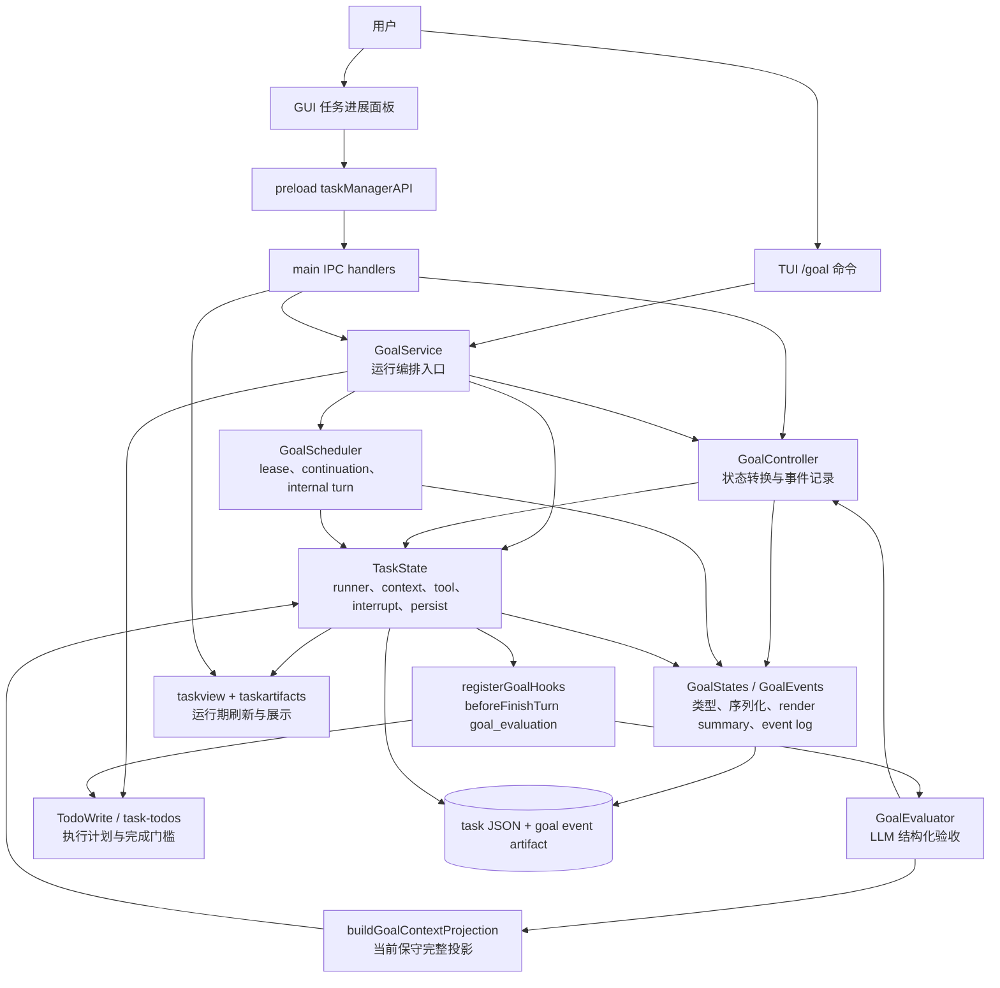
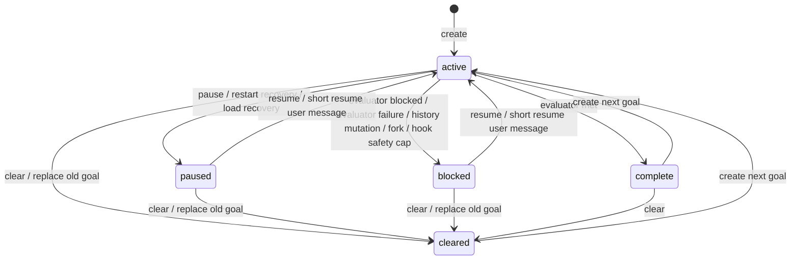
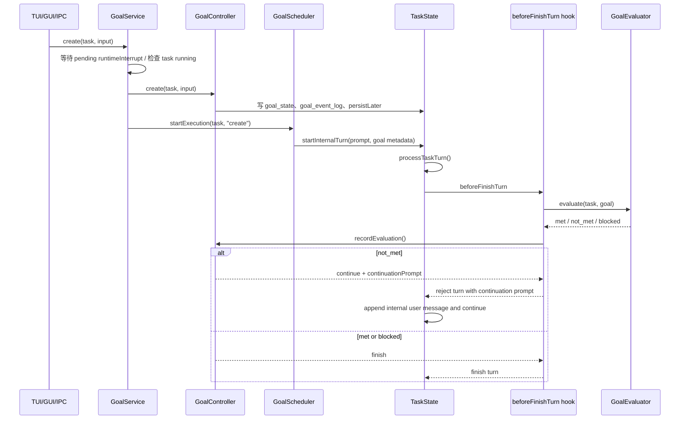
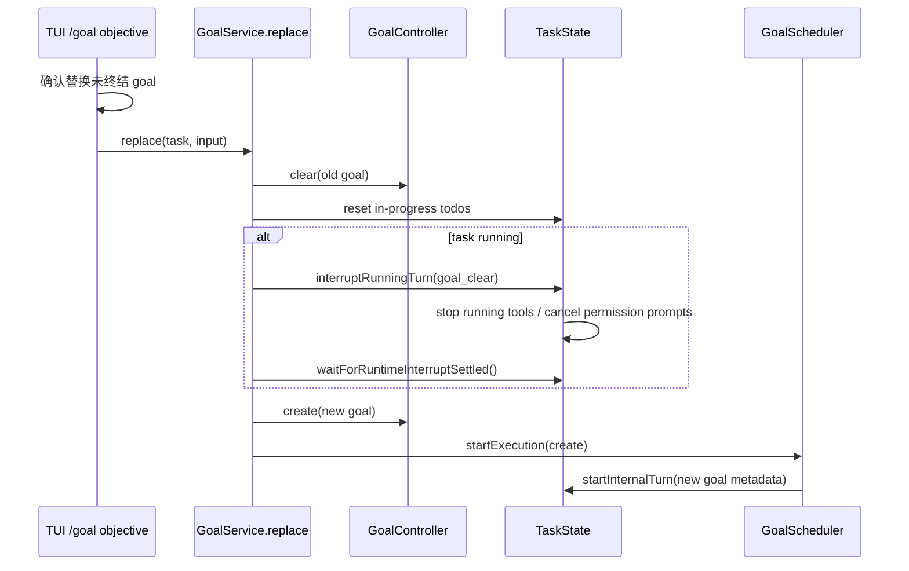

# Goal 架构与接口审查

> 审查范围：当前工作区中 Goal 机制相关实现，重点覆盖 `src/main/aikernel/goal/`、`TaskState` 集成点、TUI/GUI/IPC 入口、renderer 展示和测试看护边界。本文是面向实现维护者的架构说明，不替代 [README.md](./README.md) 中的用户行为规范。

## 1. 总体结论

Goal 是叠加在 `TaskState` 之上的控制面状态，用来表达“当前 task 要持续推进并最终验收的用户级目标”。它没有扩展 `task_status`，而是通过 `task.goal_state`、`task.goal_event_log` 和 `runtimeInterrupt` 与现有 runner 协作。

当前架构的核心设计是：

- 状态语义集中在 `GoalController` 和 `GoalStates`。
- 运行编排集中在 `GoalService` 和 `GoalScheduler`。
- 执行仍复用 `TaskState.processTaskTurn()`、工具系统、权限系统、上下文压缩和 finish hooks。
- TUI、GUI、IPC、renderer 不直接写 `task.goal_state`，只通过共享服务入口或 render summary 交互。
- evaluator 作为 `beforeFinishTurn` hook 运行，只在 TodoWrite 完成、goal active 且未被中断时判断目标是否完成。

这意味着 Goal 不是第二套 task runner，而是现有 task runner 上的一层控制器。这个选择降低了工具、权限、订阅、持久化和 compaction 的重复实现成本；代价是 `TaskState` 内部必须显式处理 goal metadata、runtime interrupt、stale revision tool guard 和 hook reject 循环。

## 2. 架构图

### 2.1 分层视图

### 2.2 Goal 状态机

当前 `GoalStatus` 只有 `active`、`paused`、`blocked`、`complete`、`cleared`。`complete` 和 `cleared` 是终结状态；`active`、`paused`、`blocked` 是未终结状态。早期设计中的预算受限状态已经从当前实现中移除，文档和调用方不应再假设存在 `budget_limited`。

### 2.3 创建与续跑时序

### 2.4 运行中替换时序

## 3. 模块职责

| 模块             | 文件                                                                                       | 职责                                                                                                          |
| ---------------- | ------------------------------------------------------------------------------------------ | ------------------------------------------------------------------------------------------------------------- |
| Goal 状态模型    | `src/main/aikernel/goal/state.ts`                                                          | 定义 Goal 类型、序列化/反序列化、event log、render summary、continuation 和 lease 判断。                      |
| Goal 状态控制    | `src/main/aikernel/goal/controller.ts`                                                     | 修改 `task.goal_state`，记录事件，处理 create/edit/pause/resume/clear/evaluation/load/fork/history mutation。 |
| Goal 服务编排    | `src/main/aikernel/goal/service.ts`                                                        | 对 UI/IPC 暴露共享语义，串联 controller、scheduler、Todo 清理和 runner interrupt。                            |
| Goal 调度器      | `src/main/aikernel/goal/scheduler.ts`                                                      | 防重入 lease、选择 continuation/start/resume prompt，启动 `TaskState.startInternalTurn()`。                   |
| Goal 评估器      | `src/main/aikernel/goal/evaluator.ts`                                                      | 读取 goal、Todo、文件变更、最近 transcript，调用 LLM 输出结构化验收结果。                                     |
| Goal finish hook | `src/main/aikernel/goal/hooks.ts`                                                          | 注册 `beforeFinishTurn` hook，决定是否执行 evaluator，以及把 `not_met` 转成 hook reject。                     |
| Goal 上下文投影  | `src/main/aikernel/goal/projection.ts`                                                     | 当前保守复制完整 `ChatContext`，为 evaluator 和 active context override 提供统一入口。                        |
| TaskState 集成   | `src/main/aikernel/states/tasks.ts`                                                        | 持久化 goal、启动内部 turn、处理中断、拦截 stale revision 工具、fork/history/load 集成。                      |
| TUI 命令         | `src/main/tui/commands/goal.ts`                                                            | `/goal` 参数解析、补全、创建/替换确认、pause/resume/clear。                                                   |
| TUI 面板         | `src/main/tui/components/goalpanel.ts`                                                     | 在 TUI 常驻展示 goal 状态、attempts、evaluation、token 和 elapsed time。                                      |
| GUI IPC          | `src/main/main.ts`                                                                         | `taskManager:*Goal` handler，桥接 renderer 与 `GoalService`。                                                 |
| Renderer API     | `src/renderer/preload.js`                                                                  | 向 renderer 暴露 `taskManagerAPI.get/create/edit/pause/resume/clearGoal`。                                    |
| GUI 展示         | `src/renderer/components/taskartifacts.ts`、`src/renderer/components/taskview.js`          | 任务进展 tab、Goal 创建/编辑/操作、timeline、运行期刷新和 active goal stop 转 pause。                         |
| 普通 stop 边界   | `src/main/tui/commands/stop.ts`、`src/main/main.ts`、`src/renderer/components/taskview.js` | active goal 下拒绝普通 stop，要求走 pause/clear 以保持状态一致。                                              |

## 4. 状态模型与事件接口

### 4.1 类型接口

| 接口                        | 功能                                            | 实现逻辑与边界                                                                                                                                                                                               |
| --------------------------- | ----------------------------------------------- | ------------------------------------------------------------------------------------------------------------------------------------------------------------------------------------------------------------ |
| `GoalStatus`                | Goal 生命周期状态枚举。                         | 只允许 `active`、`paused`、`blocked`、`complete`、`cleared`。`GoalStates.isTerminal()` 和 `isUnfinished()` 是所有入口判断终态/未终态的共享函数。                                                             |
| `GoalState`                 | 当前 task 的 authoritative goal 状态。          | 挂在 `TaskState.goal_state`。关键字段包括 `id`、`taskId`、`objective`、`revision`、`attempts`、`tokenUsageBaseline`、`lastEvaluation`、`pendingContinuation`、`editHistory`、`schedulerLease` 和各类时间戳。 |
| `GoalEvaluation`            | evaluator 的结构化输出。                        | status 只能是 `met`、`not_met`、`blocked`；`not_met` 可携带 `nextPrompt`；非 `not_met` 会删除 `nextPrompt`。                                                                                                 |
| `GoalContinuation`          | 需要下一轮继续推进时保存的 prompt。             | 由 `GoalStates.createContinuation()` 创建；scheduler 消费时写 `consumedAt` 和 `consumedByTurnGeneration`，并记录 `continuation_consumed` 事件。                                                              |
| `GoalSchedulerLease`        | scheduler 防重入租约。                          | 由 `GoalScheduler` 获取，TTL 30 秒；`GoalStates.isLeaseValid()` 只按 `expiresAt` 判断。turn 完成后如果 goal 仍 active，`TaskState` 清理 lease。                                                              |
| `GoalEvent`                 | 审计事件。                                      | 类型覆盖 created/edited/paused/resumed/evaluated/continuation/blocked/completed/forked/cleared；payload 可以保存内部细节，但 render summary 只暴露安全子集。                                                 |
| `GoalEventLogStorage`       | 事件日志存储模型。                              | inline 模式直接存 events；artifact 模式保留 tail 和 `artifactPath`。render summary 只使用 tail，不读取完整 artifact。                                                                                        |
| `CreateGoalInput`           | create/replace 的输入。                         | 当前入口只使用 `objective`、可选 `successCriteria` 和 `source`；GUI/TUI 当前通常不传 success criteria。                                                                                                      |
| `ResumeGoalOptions`         | resume 的输入。                                 | 支持 `source`、`promptOverride`、`note`。`note` 只会附加到 resume prompt，不改变 objective。                                                                                                                 |
| `GoalRenderSummary`         | renderer/export 安全读模型。                    | 包含状态、revision、objective、pending continuation、attempts、lastEvaluation 和 event summary；不暴露 raw evidence、artifact path、完整 payload。                                                           |
| `GoalStatusView`            | `getGoalStatus()` 返回模型。                    | 包含 `summary`、最近 evaluation status/time、attempts。GUI 运行期刷新依赖这个接口。                                                                                                                          |
| `GoalCommandResult`         | service/controller 命令返回模型。               | 统一表达 `ok`、`status`、`messageKey`、`messageArgs`、`startedScheduler`、`interruptedRunner`、`summary`、`errorCode`，方便 TUI/GUI 本地化错误展示。                                                         |
| `GoalEvaluationApplyResult` | `recordEvaluation()` 对 runner 的指令。         | `finish` 表示当前 turn 可以结束；`continue` 表示 hook 需要 reject 并追加 continuation prompt。                                                                                                               |
| `GoalMaybeResumeResult`     | 普通用户消息对 paused/blocked goal 的分类结果。 | 短恢复词会走 scheduler-only resume；blocked goal 的无关普通消息会被拒绝；paused goal 的无关普通消息按普通对话处理。                                                                                          |
| `TaskRuntimeInterrupt`      | runner 中断请求。                               | reason 包含 `goal_pause`、`goal_clear`、`user_stop`、`system_shutdown`、`failure_recovery`。Goal 相关中断会让 finish hook 跳过 evaluator。                                                                   |

### 4.2 `GoalStates`

| 接口                                       | 功能                              | 实现逻辑                                                                                                                                                                           |
| ------------------------------------------ | --------------------------------- | ---------------------------------------------------------------------------------------------------------------------------------------------------------------------------------- |
| `create(taskId, input)`                    | 构造新的 active goal。            | 生成 UUID，revision 从 1 开始，attempts 为 0，写 created/updated/started 时间；不负责写入 task 或事件。                                                                            |
| `deserialize(raw, taskId?)`                | 从 task JSON 恢复 goal。          | 规范化 status/source/evaluation/continuation/lease/editHistory；缺失 id 会生成新 UUID；无效 status 或 objective 会丢弃。                                                           |
| `serialize(state?)`                        | 序列化 goal。                     | JSON clone，避免外部持有可变引用。                                                                                                                                                 |
| `clone(state)`                             | 克隆 goal。                       | JSON clone，用于 fork。                                                                                                                                                            |
| `isTerminal(status?)`                      | 判断终态。                        | `complete` 和 `cleared` 为终态。                                                                                                                                                   |
| `isUnfinished(status?)`                    | 判断未终结状态。                  | `active`、`paused`、`blocked` 为未终结。                                                                                                                                           |
| `renderSummary(state, events?, options?)`  | 生成 renderer/export 安全摘要。   | 默认隐藏 cleared；可通过 `includeCleared` 展示。终态可通过 `terminalRetentionMs` 控制保留时间。events 会先按当前 goal id 过滤，只取最近 8 条 event summary 和 objective timeline。 |
| `statusView(state?, events?)`              | 生成 IPC status view。            | 基于 `renderSummary()`，额外附上 `lastEvaluationStatus`、`lastEvaluationAt` 和 attempts。                                                                                          |
| `createContinuation(goal, prompt, reason)` | 构造 pending continuation。       | 绑定当前 goal id/revision，记录 prompt、reason、createdAt。                                                                                                                        |
| `isLeaseValid(lease?, at?)`                | 判断 scheduler lease 是否仍有效。 | `expiresAt` 可解析且晚于当前时间即有效。                                                                                                                                           |

### 4.3 `GoalEvents`

| 接口                        | 功能                   | 实现逻辑                                                                                                                                        |
| --------------------------- | ---------------------- | ----------------------------------------------------------------------------------------------------------------------------------------------- |
| `deserializeEvents(raw)`    | 反序列化事件数组。     | 对缺失 id/timestamp/source 做兜底；payload 仅在对象时保留。                                                                                     |
| `deserialize(raw)`          | 反序列化事件存储。     | 兼容旧数组、inline storage、artifact storage 三种格式。                                                                                         |
| `serialize(storage?)`       | 序列化事件存储。       | JSON clone。                                                                                                                                    |
| `getTail(storage?)`         | 读取当前可用事件尾部。 | inline 返回 `events`，artifact 返回 `tail`，无 storage 返回空数组。                                                                             |
| `appendToTask(task, event)` | 向 task 追加事件。     | 200 条以内保持 inline；超过后写 `artifacts/<taskId>/goal/events.jsonl` 并在 task 中保存最近 200 条 tail。写 artifact 失败时退化为 inline tail。 |

### 4.4 事件辅助函数

| 接口                                            | 功能                 | 实现逻辑                                                                         |
| ----------------------------------------------- | -------------------- | -------------------------------------------------------------------------------- |
| `createGoalEvent(goal, type, source, payload?)` | 构造事件。           | 从 goal 取 `goalId`、`taskId`、revision，生成 id 和 timestamp。                  |
| `sanitizeErrorSummary(error)`                   | evaluator 失败摘要。 | 取 Error.message 或字符串化结果，压缩空白并截断到 500 字符，避免长错误污染状态。 |

## 5. 状态控制接口

### 5.1 token 计量

| 接口                       | 功能                                | 实现逻辑                                                                                                       |
| -------------------------- | ----------------------------------- | -------------------------------------------------------------------------------------------------------------- |
| `getTotalTokenUsage(task)` | 读取 task 级 assistant token 总量。 | 遍历 `task.chat_context.messages`，累计 assistant message 的 `usage.total_tokens`。                            |
| `getGoalTokenUsage(task)`  | 读取当前 goal 生命周期 token 增量。 | 用当前 task 总 token 减去 `goal.tokenUsageBaseline`；若 compaction 等导致累计回退，使用 `Math.max(0, delta)`。 |

`tokenUsageBaseline` 在 goal 创建和 fork 时写入，用来避免同一 task 内多个 goal 串行执行时互相污染展示用量。当前实现只用于展示和测试，不作为预算终止机制。

### 5.2 `GoalController`

| 接口                                              | 功能                                  | 实现逻辑                                                                                                                                                                                                    |
| ------------------------------------------------- | ------------------------------------- | ----------------------------------------------------------------------------------------------------------------------------------------------------------------------------------------------------------- |
| `getStatus(task)`                                 | 返回当前 goal status view。           | 直接委托 `GoalStates.statusView(task.goal_state, task.goal_event_log)`。                                                                                                                                    |
| `create(task, input)`                             | 创建 goal 的状态层入口。              | trim objective，拒绝空 objective 和未终结旧 goal；构造 `GoalState`，写 `tokenUsageBaseline`，必要时用 objective 派生 task name，记录 `created` 事件，调用 `persistLater()` 和 task list update。            |
| `editObjective(task, objective, source?)`         | 修改 objective。                      | 空 objective 失败；无 goal 失败；内容不变时幂等返回。变化时 revision +1，清空 last evaluation、pending continuation、scheduler lease，写 editHistory 和 `edited` 事件。                                     |
| `pause(task, source?, reason?)`                   | 暂停 goal 状态。                      | 无 goal 失败；complete 失败；其余状态置为 `paused`，写 pauseReason/pausedAt/updatedAt，清理 lease，记录 `paused` 事件。                                                                                     |
| `resumeStateOnly(task, options?)`                 | 只恢复状态，不启动 scheduler。        | 只允许 paused/blocked；置为 `active`，清空 pause/block reason，写 resumedAt/updatedAt，清理 lease，记录 `resumed` 事件。                                                                                    |
| `clear(task, source?)`                            | 清除 goal。                           | 无 goal 返回成功语义；有 goal 时置为 `cleared`，清空 pending continuation 和 lease，写 clearedAt/updatedAt，记录 `cleared` 事件。                                                                           |
| `recordEvaluation(task, evaluation)`              | 应用 evaluator 输出。                 | 先校验 goal id/revision/status，防止 stale evaluation。`met` -> complete 并重置完成态 turn counters；`blocked` -> blocked；`not_met` -> attempts +1，创建 pending continuation，返回 continue 指令给 hook。 |
| `recordEvaluatorFailure(task, staleGoal, error)`  | evaluator 异常兜底。                  | 校验仍是同一 active goal 后置为 blocked，blockedReason 为 `goal_evaluator_failed`，写一条 synthetic blocked evaluation 和事件。                                                                             |
| `maybeResumeGoalFromUserMessage(task, message)`   | 普通用户消息恢复分类。                | paused/blocked goal 收到短恢复词时返回 scheduler-only resume；blocked goal 收到其他消息时返回 reject；paused goal 收到其他消息返回 none。                                                                   |
| `blockForHistoryMutation(task, source?)`          | 历史变更后阻塞未终结 goal。           | undo/redo/rewind 等调用。未终结 goal 置 blocked，原因 `history_rewound_requires_goal_review`，清空 continuation/lease。                                                                                     |
| `blockActiveGoal(task, reason, source?)`          | 主动阻塞 active goal。                | 主要给 hook reject 安全上限使用；只处理 active goal。                                                                                                                                                       |
| `normalizeLoadedTask(task, wasRunningAtShutdown)` | 加载 task 后修复 goal/runner 不一致。 | 清理 lease。若上次 running 且 goal active，转 paused 并生成 crash recovery continuation；active goal 加载到 waiting task 时也转 paused；paused/blocked + waiting task 会把 task 置 stopped。                |
| `prepareForkedGoal(sourceTask, forkedTask)`       | fork task 时处理 goal。               | 克隆源 goal，换新 id/taskId，清理 lease，重设 token baseline；未终结 goal 转 blocked，原因 `forked_history_requires_goal_review`；复制最近 50 条 event tail 并追加 `forked` 事件。                          |

审查结论：`GoalController` 是“状态语义集中层”，但不是纯 reducer。它会直接写可变 `TaskState`、append event、`persistLater()` 和 publish task list update。短期这减少了调用方遗漏持久化的风险；长期若要事务化 replace 或 event replay，可以考虑拆成 reducer + task adapter。

## 6. 服务与调度接口

### 6.1 `GoalService`

| 接口                             | 功能                                        | 实现逻辑                                                                                                                                                                                                                       |
| -------------------------------- | ------------------------------------------- | ------------------------------------------------------------------------------------------------------------------------------------------------------------------------------------------------------------------------------ |
| `create(task, input)`            | UI/IPC 创建 goal 的共享入口。               | 等待 pending runtime interrupt 最多 2 秒并拒绝 running task；调用 `GoalController.create()`；成功后删除 task-local TodoWrite；调用 scheduler 启动 create turn。                                                                |
| `replace(task, input)`           | TUI 确认后替换未终结 goal。                 | 先校验新 objective，避免空输入清除旧 goal。随后 clear 旧 goal、reset in-progress todos；running task 会发 `goal_clear` interrupt、停止工具和取消权限弹窗，并等待 interrupt settle；再创建新 goal、清空 todos、启动 scheduler。 |
| `edit(task, objective, source?)` | GUI/API 编辑 objective。                    | 调 controller edit。active goal 正在 running 时注入 edit reminder，不停止已运行工具；active goal 不 running 时启动 scheduler 继续推进。                                                                                        |
| `pause(task, source?, reason?)`  | 暂停 goal 并中断 runner。                   | 调 controller pause。running task 会发 `goal_pause` interrupt，停止工具并取消权限弹窗。返回值标记 `interruptedRunner`。                                                                                                        |
| `resume(task, options?)`         | 恢复 paused/blocked goal 并启动 scheduler。 | 若 pending runtime interrupt 未 settle，最多等待 2 秒；task running 则拒绝。状态恢复成功后调用 scheduler，可带 promptOverride/note。                                                                                           |
| `clear(task, source?)`           | 清除 goal 并中断 runner。                   | 调 controller clear，reset in-progress todos；running task 发 `goal_clear` interrupt。                                                                                                                                         |

服务层是 TUI/GUI/IPC 应该调用的最高层接口。凡是需要联动 runner、Todo 或权限弹窗的操作，都不应直接调用 `GoalController`。

### 6.2 `GoalScheduler`

| 接口                                                       | 功能                                 | 实现逻辑                                                                                                                                                                                                                                                                                |
| ---------------------------------------------------------- | ------------------------------------ | --------------------------------------------------------------------------------------------------------------------------------------------------------------------------------------------------------------------------------------------------------------------------------------- |
| `startExecution(task, reason?, promptOverride?, options?)` | 启动 goal 控制的一轮 internal turn。 | 只允许 active goal；task running、pending runtime interrupt、有效 lease 都会拒绝。获取 30 秒 lease 后，优先消费 pending continuation；否则按 create/resume 构造默认 prompt。最后调用 `TaskState.startInternalTurn()`，写入 `scope: 'goal'`、controller id/revision 和 continuation id。 |

内部 prompt 由 scheduler 生成，形式是 `<system-reminder>`，要求 agent 根据当前 task 上下文推进 goal。`resume` 的 `note` 会追加为额外 system reminder，不改变 goal objective。

## 7. Evaluator、Hook 与 Projection

### 7.1 `GoalEvaluator`

| 接口                   | 功能                        | 实现逻辑                                                                                                                                                                                                                                         |
| ---------------------- | --------------------------- | ------------------------------------------------------------------------------------------------------------------------------------------------------------------------------------------------------------------------------------------------ |
| `evaluate(task, goal)` | 判断 active goal 是否完成。 | 收集 TodoWrite 展示数据、文件变更摘要、最近 transcript 摘要，拼成只读 evaluator prompt。调用 `LLM.askForObjectWithSchema()`，schema 约束输出为 `GoalEvaluation`。返回前强制校正 goal id/revision/evaluatedAt，并删除非 `not_met` 的 nextPrompt。 |

`recentTranscriptSummary()` 当前从 `buildGoalContextProjection(task)` 取最近 20 条消息。用户消息取纯文本前 1000 字；assistant 文本截断到 1000 字；工具调用最多取最近 5 个，每个结果截断到 500 字。

### 7.2 `registerGoalHooks()`

| 接口                  | 功能                               | 实现逻辑                                                                                                                                                                                                                 |
| --------------------- | ---------------------------------- | ------------------------------------------------------------------------------------------------------------------------------------------------------------------------------------------------------------------------ |
| `registerGoalHooks()` | 注册 goal evaluation finish hook。 | 幂等注册到 `HookRegistry.beforeFinishTurn()`，priority 为 300，phase 为 `goal_evaluation`。跳过子任务、internal task、goal pause/clear interrupt、无 goal、终态 goal、非 active goal，以及仍有未完成 TodoWrite 的 task。 |

hook 调用 evaluator 后，会再次检查当前 goal id/revision/status，防止运行期间被 edit/clear/replace。`met`、`blocked` 返回 finish；`not_met` 通过 `GoalController.recordEvaluation()` 创建 continuation，并返回 `{ operation: 'reject', message }`，让 `TaskState` 在同一个 turn 中追加内部 user message 后继续执行。

### 7.3 `buildGoalContextProjection()`

| 接口                               | 功能                                 | 实现逻辑                                                                                                                                            |
| ---------------------------------- | ------------------------------------ | --------------------------------------------------------------------------------------------------------------------------------------------------- |
| `buildGoalContextProjection(task)` | 为 goal 控制链路提供上下文投影入口。 | 当前是保守实现：复制完整 `ChatContext.system_prompt` 和完整 `messages` 数组。它没有真正过滤其他 goal 或普通插曲，只提供未来收敛投影策略的统一入口。 |

审查结论：projection 的实现与部分历史文档中“丢弃其他目标/插曲”的理想设计不同。当前事实是保留完整 transcript，再由 evaluator 摘要阶段截断。维护文档或新增测试时必须以这个实现为准。

## 8. TaskState 集成接口

### 8.1 新增字段与序列化

| 接口/字段                                 | 功能                              | 实现逻辑                                                                                                                                      |
| ----------------------------------------- | --------------------------------- | --------------------------------------------------------------------------------------------------------------------------------------------- |
| `goal_state?: GoalState`                  | 当前物化 goal 状态。              | `fromJSON()` 通过 `GoalStates.deserialize()` 恢复；`toJSON()` 通过 `GoalStates.serialize()` 保存；`toRenderJSON()` 输出 `GoalRenderSummary`。 |
| `goal_event_log?: GoalEventLogStorage`    | Goal 审计事件日志。               | `fromJSON()` 兼容旧字段 `goal_event_log_tail` / `goal_event_log_artifact`，最终统一为 `goal_event_log`。                                      |
| `runtimeInterrupt?: TaskRuntimeInterrupt` | 运行时中断请求。                  | Goal pause/clear 用它通知 runner 跳过 evaluator、停止工具并等待 settle。                                                                      |
| `toSimplifiedJSON().goal`                 | task list 摘要中的 goal。         | 使用不带 event log 的 summary。                                                                                                               |
| `toRenderJSON().goal`                     | renderer full task load 的 goal。 | `includeCleared: true`，确保刚 clear 的状态也能刷新到 GUI。                                                                                   |

### 8.2 internal turn 与 edit reminder

| 接口                                    | 功能                               | 实现逻辑                                                                                                                                                                                                |
| --------------------------------------- | ---------------------------------- | ------------------------------------------------------------------------------------------------------------------------------------------------------------------------------------------------------- |
| `StartInternalTurnOptions`              | scheduler 启动内部 turn 的输入。   | `source` 只能是 `goal_create`、`goal_resume`、`goal_continuation`、`goal_hook`，并必须携带 runtime metadata。                                                                                           |
| `startInternalTurn(options)`            | 用内部 user message 启动 runner。  | turn generation +1，设置 `_activeTurnMetadata`，task 置 running，清理旧 runtime interrupt，append internal user message 和 assistant placeholder，attach toolsets，调用 `processTaskTurn(generation)`。 |
| `GoalEditReminderInput`                 | 运行中 objective 编辑提醒。        | 包含 goal id/revision/objective 和 reason `goal_edit`。                                                                                                                                                 |
| `injectGoalEditReminder(input)`         | 队列化 edit reminder。             | 由 `GoalService.edit()` 在 active running goal 下调用。                                                                                                                                                 |
| `materializePendingGoalEditReminders()` | 将 edit reminder 写入 transcript。 | 在工具阶段前追加 internal user message，metadata 带新 revision，并创建新 assistant placeholder，确保后续回复按新 objective 推进。                                                                       |

### 8.3 runtime interrupt

| 接口                                              | 功能                                         | 实现逻辑                                                                                                                                                                                                   |
| ------------------------------------------------- | -------------------------------------------- | ---------------------------------------------------------------------------------------------------------------------------------------------------------------------------------------------------------- |
| `InterruptRunningTurnOptions`                     | 中断 runner 的输入。                         | 指定 reason，可要求停止运行中工具、取消权限弹窗。                                                                                                                                                          |
| `interruptRunningTurn(options)`                   | 请求中断当前 turn。                          | 写 `runtimeInterrupt`，取消权限弹窗，遍历运行中工具并调用 `tool.stop()`；task 置 stopped，标记 interrupted tool calls，唤醒 stop waiters。若 turn 已不在运行，立即标记 handled 并 resolve settle waiters。 |
| `waitForRuntimeInterruptSettled()`                | 等待 runner 消费 interrupt。                 | 若无 pending interrupt 立即 resolve；否则挂 resolver，直到 `finishRuntimeInterruptIfCurrentTurn()` 或 `clearRuntimeInterruptForNewTurn()` resolve。                                                        |
| `isGoalRuntimeInterrupted()`                      | 判断当前 turn 是否被 goal pause/clear 中断。 | hook 用它跳过 evaluator。                                                                                                                                                                                  |
| `finishRuntimeInterruptIfCurrentTurn(generation)` | turn 收尾消费 interrupt。                    | 匹配 generation 后写 handled，清空 runtimeInterrupt，resolve waiters；goal pause/clear 返回 true，指示跳过 finish hooks。                                                                                  |

### 8.4 runner 与工具保护

| 接口/逻辑                 | 功能                                                 | 实现逻辑                                                                                                                                                                                                                               |
| ------------------------- | ---------------------------------------------------- | -------------------------------------------------------------------------------------------------------------------------------------------------------------------------------------------------------------------------------------- |
| active context override   | 让 goal turn 进入模型前使用 projection。             | `processCompletion()` 中，如果 `_activeTurnMetadata.execution.controller === 'goal'` 且 goal active，则调用 `buildActiveContextView(buildGoalContextProjection(this))` 作为 `prepareContextForModel()` 的 override。                   |
| stale revision tool guard | 防止编辑 goal 后旧工具继续按旧 revision 产生副作用。 | `processToolCall()` 前调用 `markStaleGoalToolCallSkipped()`。如果 tool metadata 中 controller id 匹配但 revision 旧于当前 goal revision，则 tool call 直接标记 error，result 为 `stale_goal_revision` JSON，不进入权限检查或工具执行。 |
| hook reject safety cap    | 防止 evaluator 无限续跑。                            | turn loop 中 hook reject 连续达到 10 次后，调用 `GoalController.blockActiveGoal(this, 'hook_reject_safety_cap', 'system')`，然后结束 turn。                                                                                            |
| scheduler lease cleanup   | turn 结束后清理 lease。                              | 如果 goal 仍 active 且存在 schedulerLease，turn 收尾置 undefined 并持久化。                                                                                                                                                            |

### 8.5 用户消息、历史与 fork

| 接口/逻辑                                                       | 功能                                             | 实现逻辑                                                                                                                                 |
| --------------------------------------------------------------- | ------------------------------------------------ | ---------------------------------------------------------------------------------------------------------------------------------------- |
| `submitUserMessage()` 的 goal resume 分类                       | 普通消息进入 runner 前检查 paused/blocked goal。 | 调 `GoalController.maybeResumeGoalFromUserMessage()`；短恢复词走 `GoalService.resume()` 并返回 ok；blocked goal 无关消息返回本地化错误。 |
| `rewindMessages()` / `redoMessages()` / `rewindToUserMessage()` | 历史变更保护。                                   | 删除或重放 transcript 后调用 `GoalController.blockForHistoryMutation()`，让未终结 goal 进入 blocked，等待用户确认。                      |
| `forkTask()` 集成                                               | fork 后目标一致性保护。                          | 调 `GoalController.prepareForkedGoal()`，为 forked task 换新 goal id、重设 baseline，并把未终结 goal block。                             |

## 9. TUI 接口

### 9.1 `/goal` 命令

| 接口/函数                        | 功能                           | 实现逻辑                                                                                                               |
| -------------------------------- | ------------------------------ | ---------------------------------------------------------------------------------------------------------------------- |
| `registerGoalCommand(tui)`       | 注册 TUI `/goal` 命令。        | description、help、错误和确认文案都走 locale。支持 `help`、`pause`、`resume`、`clear` 子命令；其他文本视为 objective。 |
| `getArgumentCompletions()`       | 子命令补全。                   | 只在非空前缀时补全 `help/pause/resume/clear`；objective 文本不再补全参数。                                             |
| `createGoal()`                   | 无旧 goal 时创建。             | 调 `GoalService.create()`，成功且 scheduler started 时 `followRunningTask()`。                                         |
| `replaceGoalAfterConfirmation()` | 有未终结旧 goal 时确认替换。   | 弹 `ConfirmOverlay`；确认后调用 `GoalService.replace()`，清空当前 task 输入队列，并 follow running task。              |
| `clearInputQueueForTask()`       | 清理替换/clear 后的 TUI 队列。 | 清空 `task.message_queue`，并同步清空当前输入区 message queue。                                                        |
| `showResult()`                   | 展示命令失败。                 | `messageKey` 走 `t()` 本地化；`goal.help` 特判为帮助弹窗。                                                             |

### 9.2 `GoalPanel`

| 接口                     | 功能                  | 实现逻辑                                                                          |
| ------------------------ | --------------------- | --------------------------------------------------------------------------------- |
| `GoalPanelData`          | 面板输入模型。        | 包含 `goalState`、`totalTokens`、`elapsedMs`。                                    |
| `GoalPanel.update(data)` | 更新面板数据。        | 局部合并数据，更新可见性，标记缓存失效。                                          |
| `getGoalState()`         | 供外部读取当前 goal。 | 返回面板持有的 `GoalState \| null`。                                              |
| `isVisible()`            | 面板可见性。          | cleared 或 null 隐藏；complete 仍显示。                                           |
| `render(width)`          | 渲染 TUI 卡片。       | 使用 `Card` 组件渲染 objective、status、attempts、evaluation、token、elapsed 等。 |

## 10. GUI、IPC 与 renderer 接口

### 10.1 主进程 IPC

| IPC channel                 | 功能                     | 实现逻辑                                                                                                                                        |
| --------------------------- | ------------------------ | ----------------------------------------------------------------------------------------------------------------------------------------------- |
| `taskManager:getGoalStatus` | GUI 运行期刷新 goal。    | 查 task，不存在返回 error；存在则返回 `GoalController.getStatus(task)`。                                                                        |
| `taskManager:createGoal`    | GUI 创建 goal。          | GUI 不支持 replace：若当前 goal 未 complete/cleared，返回 `goal.create.requires_clear`。否则调用 `GoalService.create()`。成功后广播 Todo 清空。 |
| `taskManager:editGoal`      | GUI 编辑 objective。     | 调 `GoalService.edit(task, objective, 'gui')`。                                                                                                 |
| `taskManager:pauseGoal`     | GUI 暂停 goal。          | 调 `GoalService.pause(task, 'gui')`。                                                                                                           |
| `taskManager:resumeGoal`    | GUI 恢复 goal。          | 规范化 options 后调 `GoalService.resume(task, { source: 'gui', ...options })`。                                                                 |
| `taskManager:clearGoal`     | GUI 清除 goal。          | 调 `GoalService.clear(task, 'gui')`，再广播当前 Todo 展示数据。                                                                                 |
| `taskManager:stopTask`      | 普通 stop 的 goal 边界。 | active goal 下返回 `goal.stop.active_rejected`，避免绕过 pause/clear。                                                                          |

### 10.2 preload API

| API                                      | 功能                        | 实现逻辑                                                           |
| ---------------------------------------- | --------------------------- | ------------------------------------------------------------------ |
| `taskManagerAPI.getGoalStatus(taskId)`   | renderer 获取 status view。 | invoke `taskManager:getGoalStatus`，非 ok 抛 Error，ok 返回 data。 |
| `createGoal(taskId, objective, options)` | renderer 创建 goal。        | invoke `taskManager:createGoal`。                                  |
| `editGoal(taskId, objective, options)`   | renderer 编辑 goal。        | invoke `taskManager:editGoal`；当前 main handler 不使用 options。  |
| `pauseGoal(taskId)`                      | renderer 暂停 goal。        | invoke `taskManager:pauseGoal`。                                   |
| `resumeGoal(taskId, options)`            | renderer 恢复 goal。        | invoke `taskManager:resumeGoal`。                                  |
| `clearGoal(taskId)`                      | renderer 清除 goal。        | invoke `taskManager:clearGoal`。                                   |

### 10.3 `taskartifacts` Goal UI

| 接口/方法                   | 功能                                          | 实现逻辑                                                                                                                                                    |
| --------------------------- | --------------------------------------------- | ----------------------------------------------------------------------------------------------------------------------------------------------------------- |
| `GoalRenderSummaryLike`     | renderer 侧 goal 摘要类型。                   | 与 main 的 `GoalRenderSummary` 对齐，状态不包含已移除的预算状态。                                                                                           |
| `setGoalState(goal)`        | 接收 task full load 或 live refresh 的 goal。 | 更新 `_goalState`，新 goal 打开 timeline；非终态 goal 关闭创建模式；终态/无 goal 关闭编辑模式；必要时切到任务进展 tab。                                     |
| `showGoalCreation()`        | 打开创建表单。                                | 只有没有非终态 goal 时进入 `_goalCreating`。                                                                                                                |
| `_renderTaskPlanPanel()`    | 渲染任务进展 tab。                            | TodoWrite 在上；没有 goal 但有 todos 时展示轻提示；创建模式展示表单；否则展示 goal section。                                                                |
| `_renderGoalSuggestion()`   | Todo 下方轻提示。                             | 提供“设为目标”和“暂不需要”操作；dismiss 只影响当前组件状态。                                                                                                |
| `_renderGoalCreationForm()` | 创建 follow-up goal 表单。                    | 只输入 objective；提交时调用 `taskManagerAPI.createGoal()`。                                                                                                |
| `_renderGoalSection(goal)`  | Goal 展示与操作区。                           | 显示状态、revision、objective、attempts、evaluation、pending continuation 和 timeline。active 显示 pause；paused/blocked 显示 resume；总是显示 edit/clear。 |
| `_onGoalSectionClick()`     | 处理所有 Goal UI 操作。                       | 根据 `data-goal-action` 调 create/edit/pause/resume/clear API；成功后用 result.summary 更新本地状态，失败用本地化 alert。                                   |

### 10.4 `taskview` 运行期刷新与 stop 集成

| 接口/方法                                           | 功能                                        | 实现逻辑                                                                                                              |
| --------------------------------------------------- | ------------------------------------------- | --------------------------------------------------------------------------------------------------------------------- |
| `_hasActiveGoal()`                                  | 判断当前 renderer summary 是否 active。     | 用于 stop button 和队列立即发送逻辑。                                                                                 |
| `_scheduleGoalRefresh()` / `_syncGoalLiveRefresh()` | active goal 运行期定时刷新。                | active goal 时每秒触发一次节流刷新；组件隐藏或后台时跳过。                                                            |
| `_doGoalRefresh()`                                  | 拉取最新 status view。                      | 调 `taskManagerAPI.getGoalStatus()`，兼容 `{ data: { summary } }` 与直接 status view 两种返回形态，并同步 artifacts。 |
| `_pauseActiveGoal()`                                | GUI stop button 在 active goal 下转 pause。 | 调 `taskManagerAPI.pauseGoal()`，成功后更新 `_currentGoal`；失败用本地化 alert。                                      |

## 11. 关键运行链路审查

### 11.1 create

1. UI 调 `GoalService.create()`。
2. service 等待 pending interrupt settle，拒绝 running task。
3. controller 校验并创建 active goal，设置 token baseline，写事件并持久化。
4. service 删除当前 task 的 TodoWrite。
5. scheduler 获取 lease，构造 start prompt，启动 internal turn。
6. TaskState append internal user message 和 assistant placeholder，执行原有 runner。

关键边界：`GoalController.create()` 会拒绝未终结旧 goal；TUI replace 必须走 `GoalService.replace()`，GUI create 必须 clear-first。

### 11.2 edit

1. GUI/API 调 `GoalService.edit()`。
2. controller 递增 revision 并清空旧 evaluation/continuation/lease。
3. 如果 task 正在运行，service 注入 edit reminder，不直接停止工具。
4. 工具执行前的 stale revision guard 会阻止旧 revision 的 tool call 继续执行。

关键边界：已经启动的外部工具不会仅因 edit 被强制取消；这是当前实现的保守取舍。

### 11.3 pause/clear

1. service 先让 controller 修改 goal 状态。
2. running task 下发 runtime interrupt。
3. TaskState 停止工具、取消权限弹窗、标记 interrupted tool calls。
4. turn 收尾时 `finishRuntimeInterruptIfCurrentTurn()` 消费 interrupt，goal pause/clear 会跳过 evaluator。

关键边界：普通 `task.stop()` 不应替代 pause/clear，否则 goal 状态、工具停止和 hook 跳过语义会不一致。

### 11.4 resume

1. service 等待 pending runtime interrupt settle。
2. 拒绝仍在 running 的 task。
3. controller 把 paused/blocked goal 置 active。
4. scheduler 优先消费 pending continuation；没有则生成默认 resume prompt。

关键边界：blocked goal 收到无关普通消息不会作为补充信息自动注入；当前只支持短恢复词触发 resume。

### 11.5 evaluation

1. runner 到 finish hook。
2. hook 检查 task/goal/Todo 状态。
3. evaluator 读取 goal、Todo、changes、recent transcript，输出结构化 JSON。
4. controller 应用结果。
5. `not_met` 返回 hook reject，TaskState 追加 internal user message 继续同一个 turn；`met` 和 `blocked` 结束 turn。

关键边界：evaluator 的 evidence 只被记录为数量和 reason 摘要，代码没有制度化“最低证据阈值”。高风险场景仍需要后续产品策略。

## 12. 架构风险与维护建议

1. `GoalController` 含副作用。它集中状态语义是正确的，但当前还负责持久化和 task list update；如果未来要支持事务式 replace、event replay 或迁移工具，建议拆出无副作用 reducer。

2. Projection 仍是保守完整 transcript。当前实现优先不丢上下文，但没有 goal-only 隔离。任何文档、测试或功能都不应声称它已经过滤其他 goal。

3. Event artifact 只完成写入与 tail 展示。超过 200 条后完整 JSONL 会落盘，但 UI/export/status 只消费 tail，不做完整回读或修复。

4. Evaluator 完成阈值依赖模型。schema 能保证形状，不能保证 evidence 质量。若 Goal 进入更高风险工作流，应增加证据策略、用户确认或二次审核。

5. Replace 不是事务。`GoalService.replace()` 会先 clear 旧 goal，再等待旧 runner settle 并创建新 goal。若后续创建或调度失败，旧 goal 已清除；当前通过 objective 预校验和 TUI 确认降低风险。

6. Renderer 只持有 summary。renderer 不应尝试补全 raw event、artifact 或状态转换；任何新操作都应通过 IPC -> `GoalService`。

## 13. 本地化与协议边界

本次文档审查没有新增运行时用户可见文本。当前 Goal 机制中的用户可见文本边界如下：

- 需要本地化：TUI `/goal` 描述/帮助/错误/确认替换、GUI tab/按钮/表单/状态/错误、普通 stop 的 active goal 拒绝提示。
- 不需要本地化：`GoalStatus`、`GoalEvent.type`、IPC channel、metadata 字段、`stale_goal_revision`、artifact path、内部日志 code、测试 fixture。
- 动态文本边界：用户输入的 objective、模型返回的 evaluation reason/evidence、event payload 中的动态内容不应被 locale 转换，只需要在 UI 中 escape。

## 14. 测试看护

当前主要测试覆盖：

| 文件                                            | 覆盖重点                                                                                                                                                        |
| ----------------------------------------------- | --------------------------------------------------------------------------------------------------------------------------------------------------------------- |
| `src/tests/ut/aikernel/goal.test.ts`            | controller/scheduler/service、token baseline、event summary、artifact tail、projection、fork、history mutation、blocked/paused 用户消息分类、stale tool guard。 |
| `src/tests/ut/tui/commands/goal.test.ts`        | `/goal` help/create/replace/pause/resume/clear、补全、无 active task 创建、active goal stop 拦截。                                                              |
| `src/tests/ut/tui/components/goalpanel.test.ts` | TUI GoalPanel 可见性与完成态展示。                                                                                                                              |
| `src/tests/ut/renderer/slash-command.test.ts`   | GUI slash command 不暴露 `/goal`。                                                                                                                              |

建议新增或修改以下行为时同步补测试：

- `GoalService.replace()` 失败恢复策略。
- evaluator evidence 阈值或二次确认策略。
- projection 从完整 transcript 改为 goal-only 过滤。
- event artifact 完整回读和导出。
- renderer 新增任何绕过 `GoalService` 的操作入口。
